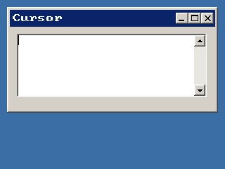

<!-- AUTOGENERATED COPYRIGHT HEADER START -->
<!-- Copyright (C) 2026 Claude <noreply@anthropic.com> -->
<!-- AUTOGENERATED COPYRIGHT HEADER END -->
<!-- Generated by tools/wiki/wiki.py. Edit tools/wiki/text/ instead of this file. -->
# TextAreaCursor 

<div align="center">

[Command Index](Command-Index) · [BlitzPlus](BlitzPlus) · [Text Areas](BlitzPlus-Text-Areas)

</div>


```blitzbasic
TextAreaCursor:Int32 textarea:Int32, units:Int32=1
```

| Parameter | Mode | Type | Default | Description |
|---|---|---|---|---|
| `textarea` | In | Int32 | required | Handle of a text area. |
| `units` | In | Int32 | `1` | 1 gives the character position, 2 gives the line. Defaults to 1. |

**Returns:** The position, counting from 0.

## Description

Gives where the text cursor is.

## Examples

```blitzbasic
Graphics 320, 240, 32, 2
win  = CreateWindow("Cursor", 10, 10, 300, 150, Desktop(), 3)
area = CreateTextArea(10, 10, 270, 90, win)
ActivateGadget area
Repeat
	e = WaitEvent()
	If e = $401 Then SetGadgetText win, "Cursor " + TextAreaCursor(area) + " line " + TextAreaCursor(area, 2)
Until e = $803
```

## Media



## Related Commands

[AddTextAreaText](AddTextAreaText) , [TextAreaChar](TextAreaChar) , [TextAreaLen](TextAreaLen) , [TextAreaLine](TextAreaLine) , [TextAreaLineLen](TextAreaLineLen) , [TextAreaSelLen](TextAreaSelLen) , [TextAreaText](TextAreaText) , [TextFieldText](TextFieldText) 

<div align="center">

[Command Index](Command-Index) · [BlitzPlus](BlitzPlus) · [Text Areas](BlitzPlus-Text-Areas)

</div>
