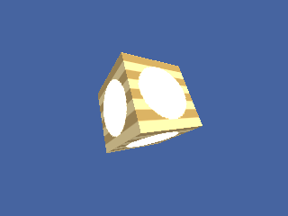

<!-- AUTOGENERATED COPYRIGHT HEADER START -->
<!-- Copyright (C) 2026 Claude <noreply@anthropic.com> -->
<!-- AUTOGENERATED COPYRIGHT HEADER END -->
<!-- Generated by tools/wiki/wiki.py. Edit tools/wiki/text/ instead of this file. -->


# TextureBlend

<div align="center">

[Command Index](Command-Index) · [Blitz3D](Blitz3D) · [Textures](Blitz3D-Textures)

</div>


```blitzbasic
TextureBlend:Void texture:Int32, blend:Int32
```

| Parameter | Mode | Type | Default | Description |
|---|---|---|---|---|
| `texture` | In | Int32 | required | The texture to change. |
| `blend` | In | Int32 | required | Blend mode from the table above. |

## Description

Chooses how this texture combines with what lies below it. A texture on layer 0 blends with the surface itself, a texture on layer 1 blends with layer 0, and so on up to layer 7. Layers are set with the index argument of [EntityTexture](EntityTexture) or [BrushTexture](BrushTexture).

| Blend | Result |
|---|---|
| 0 | No blending. |
| 1 | Alpha: uses the alpha of the texture. |
| 2 | Multiply, the default. |
| 3 | Add. |
| 4 | Dot3 bump mapping. |
| 5 | Multiply twice as bright (x2). |

## Differences

* Modes 1, 2, 3 and 5 are drawn on layers above the first. Mode 0 and mode 4 (Dot3) are drawn like mode 2, because there is no bump mapping. Layer 0 is blended by the entity or brush blend mode, not by TextureBlend.

## Examples

```blitzbasic
Graphics3D 320, 240, 0, 2
SetBuffer BackBuffer()
camera = CreateCamera()
CameraClsColor camera, 70, 100, 160
light = CreateLight()
RotateEntity light, 40, 30, 0

base = CreateTexture(64, 64, 1 + 4096)
SetBuffer TextureBuffer(base)
ClsColor 230, 200, 120
Cls
Color 160, 120, 40
For i = 0 To 63 Step 16
	Rect 0, i, 64, 8, 1
Next
over = CreateTexture(64, 64, 1 + 4096)
SetBuffer TextureBuffer(over)
ClsColor 60, 60, 60
Cls
Color 255, 255, 255
Oval 8, 8, 48, 48, 1
SetBuffer BackBuffer()
TextureBlend over, 3

cube = CreateCube() : PositionEntity cube, 0, 0, 4.4 : TurnEntity cube, 25, 35, 0
EntityTexture cube, base, 0, 0
EntityTexture cube, over, 0, 1
RenderWorld
Flip
WaitKey
```

## Media



## Related Commands

[TextureBuffer](TextureBuffer), [TextureCoords](TextureCoords), [TextureFilter](TextureFilter), [TextureFrameDelay](TextureFrameDelay), [TextureFrames](TextureFrames), [TextureHeight](TextureHeight), [TextureName](TextureName), [TextureReady](TextureReady) 〔BlitzLLVM〕

<div align="center">

[Command Index](Command-Index) · [Blitz3D](Blitz3D) · [Textures](Blitz3D-Textures)

</div>
