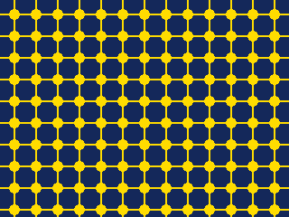

<!-- AUTOGENERATED COPYRIGHT HEADER START -->
<!-- Copyright (C) 2026 Claude <noreply@anthropic.com> -->
<!-- AUTOGENERATED COPYRIGHT HEADER END -->
<!-- Generated by tools/wiki/wiki.py. Edit tools/wiki/text/ instead of this file. -->
# TileImage 

<div align="center">

[Command Index](Command-Index) · [BlitzBasic](BlitzBasic) · [Images](BlitzBasic-Images)

</div>


```blitzbasic
TileImage:Void image:Int32, x:Int32=0, y:Int32=0, frame:Int32=0
```

| Parameter | Mode | Type | Default | Description |
|---|---|---|---|---|
| `image` | In | Int32 | required | The image to repeat. |
| `x` | In | Int32 | `0` | Horizontal offset of the pattern. Defaults to 0. |
| `y` | In | Int32 | `0` | Vertical offset of the pattern. Defaults to 0. |
| `frame` | In | Int32 | `0` | Which frame to use. Defaults to 0. |

## Description

Like [TileBlock](TileBlock), but the mask color is left out, so what is behind the tiles shows through.

## Examples

```blitzbasic
Graphics 320, 240, 0, 2
SetBuffer BackBuffer()
Local star = CreateImage(24, 24)
SetBuffer ImageBuffer(star)
Color 255, 220, 0
Oval 6, 6, 12, 12, 1
Rect 11, 0, 2, 24, 1
Rect 0, 11, 24, 2, 1
SetBuffer BackBuffer()
Cls
Color 20, 40, 90
Rect 0, 0, 320, 240, 1
TileImage star, 4, 4
Flip
WaitKey
```

## Media



## Related Commands

[CopyImage](CopyImage) , [CreateImage](CreateImage) , [DrawImage](DrawImage) , [FreeImage](FreeImage) , [GrabImage](GrabImage) , [HandleImage](HandleImage) , [LoadAnimImage](LoadAnimImage) , [LoadImage](LoadImage) 

<div align="center">

[Command Index](Command-Index) · [BlitzBasic](BlitzBasic) · [Images](BlitzBasic-Images)

</div>
