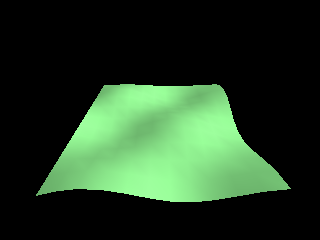

<!-- AUTOGENERATED COPYRIGHT HEADER START -->
<!-- Copyright (C) 2026 Claude <noreply@anthropic.com> -->
<!-- AUTOGENERATED COPYRIGHT HEADER END -->
<!-- Generated by tools/wiki/wiki.py. Edit tools/wiki/text/ instead of this file. -->


# UpdateNormals

<div align="center">

[Command Index](Command-Index) · [Blitz3D](Blitz3D) · [Surfaces](Blitz3D-Surfaces)

</div>


## Command Syntax

```blitzbasic
UpdateNormals mesh:Int32
```

## Parameters

| Parameter | Type | Default | Description |
|---|---|---|---|
| `mesh` | Int32 | required | Mesh handle. |

## Description

Works out the normals of every vertex of a mesh from its triangles. A normal tells lights which way a surface faces, so without it a mesh built from code is lit wrongly or not at all. Call it after adding vertices and triangles and again after you moved vertices. Shared vertices get the average of the triangles around them, which makes round shapes look smooth.

## Examples

```blitzbasic
Graphics3D 320, 240, 0, 2
SetBuffer BackBuffer()
camera = CreateCamera()
PositionEntity camera, 0, 7, -9
RotateEntity camera, 38, 0, 0
light = CreateLight()
RotateEntity light, 40, 60, 0
; A bumpy field, built from a grid of 12 by 12 vertices.
mesh = CreateMesh()
surf = CreateSurface(mesh)
For z = 0 To 11
	For x = 0 To 11
		AddVertex surf, x - 5.5, Sin(x * 40) * Cos(z * 40) * 0.6, z - 5.5
	Next
Next
For z = 0 To 10
	For x = 0 To 10
		i = z * 12 + x
		AddTriangle surf, i, i + 12, i + 1
		AddTriangle surf, i + 1, i + 12, i + 13
	Next
Next
UpdateNormals mesh
EntityColor mesh, 120, 200, 120
RenderWorld
Flip
WaitKey
```

## Media



## Related Commands

[PaintSurface](PaintSurface), [TriangleVertex](TriangleVertex), [VertexAlpha](VertexAlpha), [VertexBlue](VertexBlue)

<div align="center">

[Command Index](Command-Index) · [Blitz3D](Blitz3D) · [Surfaces](Blitz3D-Surfaces)

</div>
