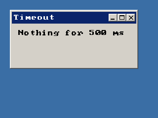

<!-- AUTOGENERATED COPYRIGHT HEADER START -->
<!-- Copyright (C) 2026 Claude <noreply@anthropic.com> -->
<!-- AUTOGENERATED COPYRIGHT HEADER END -->
<!-- Generated by tools/wiki/wiki.py. Edit tools/wiki/text/ instead of this file. -->
# WaitEvent 

<div align="center">

[Command Index](Command-Index) · [BlitzPlus](BlitzPlus) · [Events](BlitzPlus-Events)

</div>


```blitzbasic
WaitEvent:Int32 timeout:Int32=-1
```

| Parameter | Mode | Type | Default | Description |
|---|---|---|---|---|
| `timeout` | In | Int32 | `-1` | Longest time to wait in milliseconds. -1 waits forever, 0 does not wait. Defaults to -1. |

**Returns:** The kind of the event, or 0 if the time ran out.

## Description

Waits until something happens and gives the kind of event. Use [EventData](EventData), [EventSource](EventSource), [EventX](EventX) and the others to learn more about it. While it waits the windows keep working and are redrawn.

A program with windows is built around a loop with `WaitEvent`. Take every event from one call: calling it again before you read the values throws the earlier event away.

## Examples

```blitzbasic
Graphics 320, 240, 32, 2
win  = CreateWindow("Timeout", 20, 20, 260, 120, Desktop(), 3)
info = CreateLabel("Waiting", 10, 10, 230, 40, win)
Repeat
	e = WaitEvent(500)
	If e = 0 Then SetGadgetText info, "Nothing for 500 ms"
Until e = $803
```

## Media



## Related Commands

[EventData](EventData) , [EventID](EventID) , [EventSource](EventSource) , [EventX](EventX) , [EventY](EventY) , [EventZ](EventZ) , [PeekEvent](PeekEvent) 

<div align="center">

[Command Index](Command-Index) · [BlitzPlus](BlitzPlus) · [Events](BlitzPlus-Events)

</div>
