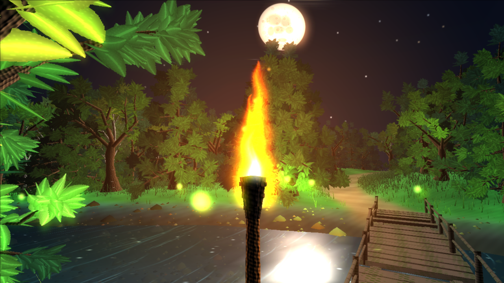
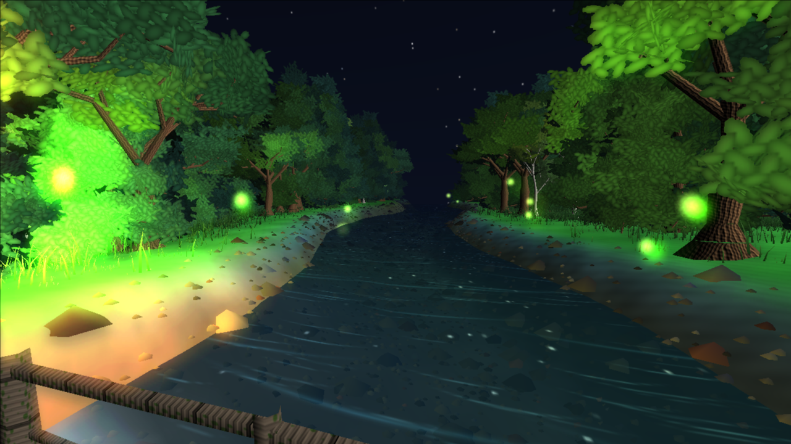

= Benchmarks

Benchmarks are Blitz programs with a small Python runner each. They are heavy, so they are not part of the test suite or of
the CI: you run them by hand, when you want to know what a change did to the speed.

The older benchmarks are in `tools/` (`benchmark_draws`, `benchmark_collisions`, `benchmark_overlap`, `benchmark_stranded2`) and
are used the same way.

The programs in `original/` run in the original BlitzBasic / Blitz3D as well and give the baseline for the performance history, see
`original/README.adoc`.

== Ending a benchmark

The runners start compilers and benchmark programs through `tools/procutil.py` (`procutil.run` and `procutil.Popen` replace
`subprocess.run` and `subprocess.Popen`). Whenever a script ends, no matter how (it finishes, raises, times out, gets Ctrl-C, SIGTERM or
a closed console window, or is killed hard), everything it started is terminated with it, grandchildren included, and the script never
asks first. A benchmark process that outlives its script would distort every later measurement.

On Windows the children live in a Job Object that is killed with the script; elsewhere each child gets its own process group, killed by
the script and by a small watcher process if the script dies without cleaning up. `tests/cli/procutil.py` (the `procutil` test) proves
this for exit, exception, kill, interrupt and timeout. New scripts that start programs must use `procutil`, not `subprocess` directly.

== Program names

The runners build every benchmark program under a random file name (`benchutil.program_path`), never as `dungeon.exe` and the like.
Windows (Auto HDR, the game detection of Game Bar) and graphics drivers (application profiles) choose settings by the name of the
executable, and a known name can get a frame rate cap or another present path that has nothing to do with the program: Windows turned
Auto HDR on for `dungeon.exe` on a 180 Hz HDR display, and `dungeon.exe` and `bigmesh.exe` were then held to the refresh rate with
BlitzLLVM and with the original Blitz3D. New runners must use `benchutil.program_path` too.

== How a benchmark is built

Every benchmark has the same frame: the parts that all benchmarks share are in a few files, and the benchmark itself is only its setup
and what it does every frame.

* `benchutil.py` is the shared part of the runners. `benchutil.Runner` has the options every benchmark has (`--blitzcc`, `--frames`,
  `--warmup`, `--seed`, `--size`, `--depth`, `--gpu`, `--quick`, `--debug`, `--profile`, `--label`, `--shot`, `--no-save`, `--json`), tells
  BlitzLLVM from the original Blitz3D by `blitzcc -v` (and then leaves out `-O3` and `--profile`, sets `BLITZPATH`, checks the window
  size), builds the program under a random name, runs it (under `xvfb-run` without a display), reads its RESULT line and prints and
  saves it. A runner adds its own options and lines.
* `bench_llvm.bi` and `bench_original.bi` are what differs between the compilers: the timer (`Microseconds`, or `MilliSecs` in the
  original), the draw counters of `Stats3D` (0 in the original) and `BenchFlip`, which is `Flip 0` in both, so that no frame waits for
  the display. The runner copies the one of the compiler next to the program as `bench_compiler.bi`.
* `bench_begin.bi` reads the settings (`BENCH_FRAMES`, `BENCH_WARMUP`, `BENCH_SEED`, `BENCH_W`, `BENCH_H`, `BENCH_DEPTH`, `BENCH_GPU`),
  has the random number generator that gives the same numbers in both compilers (`BenchRnd`), and opens the window (always windowed;
  `SetGfxDriver` when `BENCH_GPU` is given).
* `bench_profile_on.bi` and `bench_profile_off.bi`: with `--profile` (BlitzLLVM only) the program reads the GPU time of the passes,
  the CPU time of `RenderWorld` and the wait for the GPU with `ProfileValue` after every timed frame, which is not tied to the
  once-a-second report of `BLITZLLVM_PROFILE_FPS`, so a short run has numbers too. The runner copies one of them as `bench_profile.bi`.
  The GPU times come back some frames late (the faster the program runs, the more frames), one frame's per `Flip` once they do, so
  the n-th GPU time that comes back is counted as the one of frame n: only those of the timed frames are added up, and after the timed
  frames the last picture is drawn again (untimed, at most 10 seconds) until all of them are back. `gpu_frames` says how many came
  back and `gpu_lag` at the `Flip` of which frame the first one did.
* `bench_end.bi` draws the frames and times them, and writes the RESULT line: frames, window, `create_ms`, `update_ms`, `ms_avg`,
  `ms_min`, `ms_median`, `ms_p95`, `ms_max`, `fps`, and per frame the triangles and the draw counters, followed by the values of the
  benchmark. It calls the functions of the benchmark: `BenchUpdate` (not timed), `BenchTimedUpdate` (timed, also on its own as
  `update_ms`), `BenchRender`, `BenchAfterFrame` (not timed), `BenchFinish` and `BenchResult$`.
* `<name>_llvm.bi` and `<name>_original.bi`, when a benchmark has them, are what differs between the compilers for that benchmark
  only (the culling setting of bigmesh, the sampler of the forest, the sprite limit of the dungeon, the physics of the space battle). The runner copies the right one
  as `<name>_compiler.bi`.

A new benchmark is a `.bb` file that includes `bench_compiler.bi`, its own `<name>_compiler.bi` if it has one, and `bench_begin.bi`,
makes its scene, includes `bench_end.bi` and defines the six functions; and a runner that makes a `benchutil.Runner`. A benchmark
that does not time frames (`loading.bb`) leaves out `bench_end.bi` and writes its RESULT line with `BenchWriteResult`. Variables of the
setup that the functions use must be `Global`, as in every Blitz program.

== ab: is build B faster than build A, or is it noise?

`ab.py` compares two builds of BlitzLLVM on one benchmark and says whether the difference is real. A single run of each build cannot
tell a change of 1% from the spread between runs; `ab.py` runs both builds many times and tests the difference.

----
python3 benchmarks/ab.py --a base/code_compiler/blitzcc --b change/code_compiler/blitzcc --rounds 10 flythrough --quick
python3 benchmarks/ab.py --values-a 33.47,33.52,33.25,33.42 --values-b 34.22,34.33,33.80,34.08 --higher-is-better
----

The first form runs the runner (here `flythrough`, followed by its own options) with each compiler in rounds of A B B A, so that a
machine that slowly warms up or cools down hits both builds alike. Each build first runs once untimed, because the first start of a
program pays for the shader and pipeline caches of the driver, and keeps one program path (`BENCH_PROGRAM`) for all its runs, so that
those caches stay warm. Each run gives one value, the `--metric` of its RESULT line (`ms_avg` by default; a metric that starts with
`fps` counts higher as better). The runner writes it with `--json`. The second form only does the statistics, for values measured
some other way, such as a game that shows its own frame rate.

It prints the mean, standard deviation and median of each build, the difference B - A with a 95% bootstrap interval, the p value of a
permutation test (no assumption about the distribution) and of the Mann-Whitney U test (ranks, so one odd run weighs little), and a
verdict: B is faster or slower only when the permutation p is below `--alpha` (0.05) and the interval does not contain 0. Ten rounds
(twenty runs of each build) find differences of about a third of the spread between runs; smaller ones need more rounds, or a
benchmark that times only the part that changed.

=== Under load: memload

`--load "ARGS"` keeps `memload` (`memload.c`, built by `ab.py` with `$CC`, `clang` or `cc`) running through all runs of both builds,
so that a cost of the caches or the memory that a fast machine hides shows as it would on one with less cache or slower memory.
`--mode chase` (the default) walks a random cycle through a buffer of `--kb` kilobytes per thread, one cache line per step;
`--mode stream` reads and writes it from start to end, for the bandwidth of the memory. `--cpus 2,4,6` pins one thread to each
listed logical processor.

* L3: a buffer a few times the size of L3 on other cores, such as `--load "--kb 24576 --cpus 4,6,8,10"`.
* L1 and L2: a buffer about the size of L2 on the SMT sibling of the processor that the program runs on, such as
  `--load "--kb 1024 --cpus 1"` with the program on processor 0 (on Windows logical processors 0 and 1 are usually the two of core 0;
  on Linux see `lscpu -e`). Pin the program yourself, for example by running `ab.py` itself under `start /affinity 1` or `taskset -c 0`.

* Everything at once: `--mode stress` is the load of the `--stress` option of the benchmark of
  https://github.com/Xaymar/datapath[datapath]. Every round of a thread is a burst of work in registers, one pass that reads and
  writes one word of each cache line of its buffer (`--kb`, 8192 by default), and one read at a place that the burst picked. By
  default it runs one unpinned thread on every logical processor, so that the program shares the cores, the caches and the memory
  with it. `ab.py --stress N` is short for `--load "--mode stress --threads N"`, with 0 for every logical processor, and
  `--stress-nice M` runs it at nice M (below normal priority for 1 to 9 and idle for 10 and more on Windows), which keeps the load on
  the caches and the memory but leaves the program most of its processor time. Without it, the program also has to win processor
  time from the load, which is a different test.

`memload` prints the rate of each thread at the end, and how many cores its threads kept busy on average, which says whether both
builds had the same load; under half of its threads, it warns that the run was not under the full load. Numbers from runs under
load only compare with each other.

== history: the numbers of the Performance History wiki page

`history.py` runs the common benchmarks with one compiler, 3 times each, and saves the runs with their mean and standard deviation in a JSON file. The
results and the page are not in `root`: they are on the empty branch `performance-history` (check it out next to the repository, or set
`PERF_HISTORY`), one folder per machine (`areldir/`). The programs are always the ones of the latest `root`, built with the compiler of the commit in
question, so every compiler runs the same program (a compiler that can not build the BlitzLLVM include of a benchmark uses the original's, which counts
in milliseconds). The page lists the original Blitz3D as the baseline and one row per version tag (`X.Y.Z`), each linking to its release notes, with the
change against the baseline.

[source,sh]
----
# on the machine (PERF_HISTORY=<checkout of performance-history>/areldir, PERF_MACHINE=<machine.json> for a machine that is not the Linux container)
python3 benchmarks/history.py --blitzcc /path/to/original/bin/blitzcc.exe --label r00-original      # the baseline, the original Blitz3D 1.118
python3 benchmarks/history_commits.py --repo <clone> --since 0a33d2cc --tags \
    --build-script benchmarks/build_windows.ps1 --build-dir <kept build folder>                       # builds and runs the commit of every version tag
python3 benchmarks/history_page.py                                                                    # writes Performance-History.md there
----

`history_commits.py` without `--tags` does every distinct code state of `root`, `--max-minutes` stops it after a time so that it can run in chunks, and
`--download OWNER/REPO` takes the Windows CI binaries instead of building (CI only keeps them for about a day). `build_windows.ps1` builds a commit like
the Windows CI did at it: with `tools/build.cmake` (llvm-mingw) where the commit has it, before that with Visual Studio, and writes which clang that
blitzcc links programs with, which `history_commits.py` puts first on `PATH`.

The page of a physical machine uses the game benchmarks, `--set real`: `forest.bb` (software vertex animation, huge triangle counts) and
`spacebattle.bb` (AI, collisions, picking; once without physics, which every version and the original run, and once with physics, which only the
versions with the physics commands run), at 640x360 and 3000 frames. `--head` adds the root that is not released yet as the last row. On a laptop
the GPU is given explicitly (`--gpu`, the index of `SetGfxDriver`), and the original Blitz3D can only use the GPU that drives the display, so the
root runs a second time on that GPU (`--head-tag root-igpu`), the row next to the baseline. `BENCH_PROGRAM` builds every program to one path, for
which Windows can be told the GPU (`HKCU\Software\Microsoft\DirectX\UserGpuPreferences`).

[source,bat]
----
rem Shibela: RX 6600M (1) for BlitzLLVM, the integrated GPU (2) for the row next to the original
set PERF_HISTORY=<checkout of performance-history>\shibela
set PERF_MACHINE=%PERF_HISTORY%\machine.json
set BENCH_PROGRAM=C:\...\run\bhist.exe
python benchmarks\history.py --blitzcc <original>\bin\blitzcc.exe --label r00-original --set real --gpu 0
python benchmarks\history_commits.py --repo <clone> --since 2026.10.26.9019^ --until <root> --tags --head --set real --gpu 1 ^
    --build-script benchmarks\build_windows.ps1 --build-dir <kept build folder>
python benchmarks\history_commits.py --repo <clone> --since 2026.10.26.9019^ --until <root> --head-tag root-igpu --set real --gpu 2 ^
    --build-script benchmarks\build_windows.ps1 --build-dir <kept build folder>
python benchmarks\history_page.py --results %PERF_HISTORY% --out %PERF_HISTORY%\Performance-History.md
----

The old versions of the compiler (the first few tags) have no runtime, so they have no numbers and are not listed. The compile time is not part of the page: the original does no optimization at all.

== flythrough: a camera through a field of many entities

`flythrough.bb` makes a field of entities (a million with `--objects 1000000`) and flies a camera through it on a loop that is
the same on every run. The positions come from a fixed seed, and the camera moves one step per frame, not per second, so two runs
see exactly the same frames and their numbers can be compared. Entity `i` is one of 16 kinds, so every kind has the same share:

[cols="1,3"]
|===
| Kinds | What

| 0, 1 | cube, lit with one color / textured
| 2, 3 | sphere, smooth lit / flat shaded (`EntityFX 4`)
| 4, 5 | cone, textured / cylinder, lit
| 6 | octahedron with vertex colors (`EntityFX 2`)
| 7 | sphere, full-bright and textured (`EntityFX 1`)
| 8, 9 | cube with alpha 0.5 / sphere with additive blending (`EntityBlend 3`)
| 10 | cube drawn on both sides (`EntityFX 16`)
| 11 | a loaded model (`tests/suite/models/textured.3ds`, a cube if it is missing)
| 12-15 | sprites: textured, alpha, additive, and a flat color with a fixed rotation
|===

All of them are made with `CopyEntity` of one hidden template per kind, with a random position, rotation and size.
The field keeps the same density for any count (about 3 units per entity), so the camera sees about the same share of it.

=== Running it

[source,sh]
----
python3 benchmarks/flythrough.py --quick                       # 2000 objects, 30 frames: does it work?
python3 benchmarks/flythrough.py                               # 20000 objects, 300 frames
python3 benchmarks/flythrough.py --objects 1000000 --frames 600 # the full run
----

The runner builds the program with `build/code_compiler/blitzcc` (or `--blitzcc PATH`), runs it and prints one table. Options:
`--objects`, `--frames`, `--seed`, `--size WxH`, `--shot FILE` (saves the last frame), `--label NAME` (such as the GPU, it
is stored with the result), `--debug` (`-d`, no optimization), `--profile` (builds with `--profile` and reads the GPU time of the passes, the CPU time of `RenderWorld` and the wait for the GPU
with `ProfileValue` after every frame, see <<How a benchmark is built>>), and `--no-save`. The defaults can be set with `BENCH_OBJECTS`, `BENCH_FRAMES`, `BENCH_SEED` and `BENCH_SIZE`.
The program itself reads `BENCH_OBJECTS`, `BENCH_FRAMES`, `BENCH_WARMUP`, `BENCH_SEED`, `BENCH_W`, `BENCH_H`, `BENCH_RANGE`, `BENCH_MOVING` (how many objects are moved every frame, to see what the spatial grid costs when things move), `BENCH_MODEL`,
`BENCH_SHOT` and `BENCH_FRAMETIMES`, see the top of `flythrough.bb`. `BENCH_FOG=0|1|2` turns on `CameraFogMode` (2 is BlitzLLVM only), `BENCH_DITHER=2` sets the Dither level and `BENCH_GPU=2` the graphics driver (also for the waterfall).

It reports the time to make the entities, the milliseconds per frame (average, minimum, median, 95th percentile, maximum; a frame is
`RenderWorld` and `Flip`), the frames per second, and per frame the triangles (`TrisRendered`) and the draw calls, pipeline, texture
and buffer binds (`Stats3D(1000..1003)`). BlitzLLVM counts the triangles it draws: a sprite drawn as an octagon (see Sprite shapes in the
GPU optimizations wiki page) is 6 triangles where the original counts 2, so sprite benchmarks report more triangles than the original. The first `BENCH_WARMUP` frames (default 5) are not counted, they build the GPU buffers.

Every run is saved in `benchmarks/results/` (ignored by git): a JSON file with the build configuration, the compiler version, the
platform and the time of every frame, and a line in `flythrough.csv`. Compare runs only when the build configuration (`-O3` or `-d`, `--profile`),
the size, the seed, the count and the machine are the same.

NOTE: Without a display the runner uses `xvfb-run`, which with Mesa is llvmpipe, a software rasterizer: the milliseconds are then
mostly the CPU drawing pixels, which makes that only a smoke test. The counts are exact everywhere. Use a real GPU for timings. A million
entities need several GB of memory and a long time to create on a slow computer.

=== With the original Blitz3D

`flythrough.bb` uses only commands that the original Blitz3D has as well, so that the speed of BlitzLLVM can be compared with it.
The two things the original does not have, the microsecond timer and the draw counters of `Stats3D`, are in `bench_llvm.bi` and
`bench_original.bi` (`MilliSecs`, and draw counters of 0), see <<How a benchmark is built>>. The runner looks at `blitzcc -v`, builds
with the right one, leaves out `-O3` and `--profile` for the original, sets `BLITZPATH` to the folder with `bin` in it, and reads the
result from a file because the original has no output to a console:

[source,bat]
----
python benchmarks\flythrough.py --blitzcc C:\Blitz3D-V1.118\bin\blitzcc.exe --objects 20000
python benchmarks\flythrough.py --blitzcc C:\BlitzLLVM\bin\blitzcc.exe --objects 20000
----

The original times have a resolution of one millisecond, so use enough frames and look at the average. The original `SaveBuffer`
writes a BMP whatever the file is called, so a `--shot` made with it needs converting to compare it. Run benchmarks windowed only
(they are), the original changes the screen settings in fullscreen.

NOTE: The original Blitz3D can draw at most 16128 sprites. All sprites share one vertex buffer of 4 vertices each, `Sprite::allocIndex` grows it
256 sprites at a time with `createMesh( mesh_size*4,mesh_size*2,0 )` (`blitz3d/sprite.cpp`), so after 16128 sprites (64512 vertices) the next step
needs 65536 vertices. `gxGraphics::createMesh` returns 0 when Direct3D 7 cannot make a vertex buffer that big (65535 vertices at most), and the next
`mesh->lock` is a null access: the program dies with an access violation (exit code 3221225477). Hidden template sprites count too.
A quarter of the flythrough objects (kinds 12 to 15) are sprites and 4 more are the templates, so the original manages at most 64508 objects, which is why it
crashed at 100000 and passed at 50000. `flythrough.py` stops with a message above that with the original, and `--objects 60000` is the
highest round number to compare the two. A mesh surface has the same limit: its triangles are `unsigned short` vertex indices (`Surface::Triangle`), so it holds at most 65535 vertices.

NOTE: The original Blitz3D cannot open a window above 2048 in either direction (Direct3D 7 caps the backbuffer at its 2048 maximum
texture size). Above that its runtime stops with the message "Unable to create 3D Scene" (the string is in its `runtime.dll`). Measured on
Areldir (2560x1440 desktop): 2047x2047, 2048x2048, 2048x1080, 1080x2048, 1000x1440 and 1440x1440 work; 2049x1080, 2300x1300, 2400x1080,
2560x720, 2560x1440, 3000x500 and 500x3000 fail. It is neither the area nor the desktop size, each side has its own limit of 2048. That is
why the original could not start at 2560x1440. The runners stop with a clear message above 2048 in either direction with the original;
BlitzLLVM has no such limit. wined3d under Wine has no such limit either, so it does not show there.

== waterfall: a river over a cliff, made of see-through sprites

`waterfall.bb` is the opposite of the flythrough: little geometry, a lot of blending. A river meanders over a plateau and falls
30 units off a cliff into a pool. The ground is one mesh of about 43000 triangles. Everything that looks like water is a sprite
with the same soft, round, see-through texture:

[cols="1,1,3"]
|===
| Share | What | How it moves

| 35% | river | drifts along the river on the plateau to the lip, 600 frames from start to lip
| 40% | waterfall | leaves the lip, speeds up and drops in 80 frames, gets bigger and thinner on the way down
| 25% | mist | the cloud at the foot: rises, spreads and fades, 140 frames from birth to gone
|===

The sprites overlap a lot, and the fall and the mist are in front of each other, so the GPU blends many layers for most pixels
and the sprites have to be drawn from the back to the front. That is what it measures: sorting and drawing thousands of
blended sprites, and what culling them (sprites outside the view or hidden by the cliff) saves. The more sprites, the thinner each
one is (above 5000), so that the picture stays a waterfall and not a white wall. Where every sprite is depends only on the frame
number, and the camera swings 45 degrees to both sides in front of the fall (1200 frames are one lap), so every run, and every
machine, draws the same frames.

[source,sh]
----
python3 benchmarks/waterfall.py --quick                   # 500 sprites, 30 frames: does it work?
python3 benchmarks/waterfall.py                           # 5000 sprites, 300 frames
python3 benchmarks/waterfall.py --sprites 50000           # a heavy fall
python3 benchmarks/waterfall.py --sprites 50000 --static  # the water stays still, only the camera moves
----

It takes the same options as the flythrough (`--frames`, `--seed`, `--size`, `--shot`, `--label`, `--debug`, `--profile`,
`--no-save`, and `BENCH_SPRITES`, `BENCH_FRAMES`, `BENCH_SEED`, `BENCH_SIZE` for the defaults) and prints the same table. Because
the sprites move every frame, it also prints `update`, the time the program spends moving them (it is part of `ms/frame`, which
is the update, `RenderWorld` and `Flip`). `--static` places the sprites once, and then `ms/frame` is only rendering. Results are saved
as `benchmarks/results/waterfall-*.json` and `waterfall.csv`.

=== With the original Blitz3D

To compare the speed of BlitzLLVM with the original, `waterfall.bb` uses only commands that the original Blitz3D has as well. The
timer and the draw counters are in `bench_llvm.bi` and `bench_original.bi`, as for every benchmark; `waterfall_llvm.bi` only has the
saving of the raw picture (`BENCH_RAW`), which `waterfall_original.bi` leaves out. The runner looks at `blitzcc -v`, builds with the
right ones, leaves out `-O3` and `--profile` for the original, sets `BLITZPATH` to the folder with `bin` in it, and reads the result
from a file because the original has no output to a console:

[source,bat]
----
python benchmarks\waterfall.py --blitzcc C:\Blitz3D-V1.118\bin\blitzcc.exe --sprites 5000
python benchmarks\waterfall.py --blitzcc C:\BlitzLLVM\bin\blitzcc.exe --sprites 5000
----

The original times have a resolution of one millisecond, so use enough frames (`--frames 1500`) and look at the average.

NOTE: The original `SaveBuffer` writes a BMP whatever the file is called, so a `--shot` made with the original needs converting to compare it.

NOTE: The original Blitz3D can have at most 16128 sprites. All sprites share one vertex buffer of 4 vertices each, `Sprite::allocIndex` grows
it 256 sprites at a time with `createMesh( mesh_size*4,mesh_size*2,0 )` (`blitz3d/sprite.cpp`), so it holds 16128 sprites (64512 vertices)
and the next step would be 16384 sprites (65536 vertices). `gxGraphics::createMesh` returns 0 when Direct3D 7 cannot make a vertex
buffer that big (65535 vertices at most), and the next `mesh->lock` is a null access: the program dies with an access violation (exit code
3221225477, no runtime error message). `waterfall.bb` makes 3 hidden template sprites that count too, so 16125 water sprites is the most
the original runs (measured with 1.118), and `waterfall.py` stops with a message above that with the original. 15000 is the highest round
number to compare the two (`--sprites 15000`). A mesh surface has a similar limit: its triangles are `unsigned short` vertex indices (`Surface::Triangle`), so at most 65535 vertices.

== dungeon: a walk through torch-lit rooms

`dungeon.bb` is the benchmark for hiding things, in particular for early-Z with see-through sprites. A dungeon of rooms (16 by default)
lies in a snake of rows, and room `i` is joined to room `i + 1` by a corridor. A room has a floor, a ceiling, four walls with doorways,
four pillars, and in each corner a torch. Every room is one mesh (a few thousand triangles), plus loose props (barrels, crates and
balls, `--props` of them) that are entities of their own.

The camera walks through every room by a wide path: in by one door, out to the side of the room (4.5 units, to the left in one room and
to the right in the next) and out by the other door, so the doors are never straight ahead. It looks ahead on the path and sways 40
degrees to both sides, so the walls beside the doors are often in the view, and behind them are the torches of the next room, and their
flames and smoke. Those sprites are in the view of the camera and pass any culling of the view, but the walls hide them: that is what
early-Z can save, and what the numbers of `--coverage` show.

Every torch is a point light and has `--particles` sprites (12 by default): half of them flame (small, orange, added to the picture,
rising and shrinking in 20 frames) and half smoke (grey, see-through, rising, growing and thinning out in 90 frames). Some rooms
(`--campfires`, a chance of 25 percent for every room, and at least one) have a campfire as well, on the floor: three times as many sprites,
twice as big, and a brighter light. When the camera comes near one, it turns to the fire. A graphics card has 8 lights, so the 8 sources of
light nearest to the camera are on (they flicker) and the others are hidden. All sprites are updated in every frame, also those in rooms
that nobody sees, as a game would not bother to hide them.

[source,sh]
----
python3 benchmarks/dungeon.py --quick                                    # 4 rooms, 30 frames: does it work?
python3 benchmarks/dungeon.py                                            # 16 rooms, 4 torches each, 600 frames
python3 benchmarks/dungeon.py --rooms 100 --torches 6 --particles 20    # a big dungeon with lots of fire
python3 benchmarks/dungeon.py --static                                   # the fire stays still, only the camera moves
python3 benchmarks/dungeon.py --coverage                                 # also count the sprites in the view (not timed)
----

It takes the same options as the others (`--frames`, `--seed`, `--size`, `--shot`, `--label`, `--debug`, `--profile`, `--no-save`, and
`BENCH_ROOMS`, `BENCH_TORCHES`, `BENCH_PARTICLES`, `BENCH_PROPS`, `BENCH_CAMPFIRES`, `BENCH_FRAMES`, `BENCH_SEED`, `BENCH_SIZE` for the defaults) and
prints the same table, with `update` (lights and particles, part of `ms/frame`) and the number of sprites. With `--coverage` the program asks
for every sprite whether it is in the view (`EntityInView`), after the frame is timed, and prints the average per frame: the sprites that are
in the view but not on the screen are the ones that culling of the view can't skip and early-Z has to. The rooms, torches and particles scale separately:
more rooms make more that can be hidden, more particles make more blending. Random numbers come from a small generator in the program
and not from `Rnd`, so BlitzLLVM and the original Blitz3D draw the same frames.

=== GPU time

`ms/frame` is the time of the program, and `Flip` does not wait for the GPU, so it can miss what the GPU saves (for instance with early-Z).
With `--profile` the runner builds with `--profile` and the program reads the GPU time of the passes with `ProfileValue` after every
timed frame (the frames whose GPU times are not back yet are left out); the runner prints them per frame (`scene`, `2d`, `copy`,
`present`, `frame`).
Use a size that is limited by the GPU (`--size 1920x1080`) and compare the `scene` time.

The dungeon costs the GPU very little (the sprites are small), so the speed is limited by the CPU. `--sprite-scale 6` draws every flame and
smoke sprite 6 times as big (36 times the pixels) with the same number of sprites, so that the overdraw is most of what the GPU does and
the time that early-Z saves can show in `ms/frame` as well. The original Blitz3D can do it as well, as the number of sprites stays the same.

`--depth-fade 1.5` gives the flames and smoke `SpriteDepthFade` with that distance (BlitzLLVM only, the original ignores it), to measure what the soft edges cost: run it with and without, and compare the `scene` time with `--profile`.

=== With the original Blitz3D

As with the other benchmarks, `dungeon.bb` uses only commands that the original Blitz3D has too. The timer and the draw counters are
in `bench_llvm.bi` and `bench_original.bi`; `dungeon_llvm.bi` and `dungeon_original.bi` only have `SpriteDepthFade` (BlitzLLVM) and the
most sprites the original can draw. The runner picks the right ones by `blitzcc -v` and leaves out `-O3` and `--profile` for the original:

[source,bat]
----
python benchmarks\dungeon.py --blitzcc C:\Blitz3D-V1.118\bin\blitzcc.exe
python benchmarks\dungeon.py --blitzcc C:\BlitzLLVM\bin\blitzcc.exe
----

The original crashes with more than 16128 sprites in total (they share one vertex buffer, 4 vertices each, see the waterfall section), and 2 of
them are the flame and smoke templates, so the program stops with a message when the sprites of the torches and the campfires are more than 16126. Every room is one surface of a few thousand vertices, far below the 65535
that the original allows. The original times have a resolution of one millisecond, so use enough frames. The original `SaveBuffer` writes a BMP whatever the file is
called. Run benchmarks windowed only (they are), the original changes the screen settings in fullscreen.

NOTE: The original Blitz3D cannot open a window above 2048 in either direction (see the flythrough section for the measurements). The
runner stops with a clear message above that with the original; BlitzLLVM has no such limit.

== forest: a night forest with a river, bump maps and bloom

`forest.bb` is the benchmark for a whole game-like scene. A dense forest of 1800 trees (spruces, broadleaf trees and birches with branches, twigs and
individual leaves growing out of the twigs, 18 on a twig, of four shapes, only on the thin branches) stands around a winding river. A dirt path leads to an old bridge, lit by a standing torch with an animated flame and embers. Pebbles
lie along the banks (dark, concentrated at the water's edge), 600000 small opaque blades of grass grow in clumps (thinner towards the river, only the tip of
a blade moves in the wind, in the areas near the camera, and so do the leaves and the thin branches, while the trunk and thick branches stay solid) and 40 glowing insects fly around, six of them with a light. The night sky has a moon and stars.
Everything is made in code, there are no files.

What it measures, besides plain triangle and draw call throughput (about 7.5 million triangles and 1200 draw calls per frame):

* bump mapping the way the original Blitz3D does it (Direct3D 7 Dot3, `TextureBlend 4`, with the light direction in the vertex colors) on the ground, the
  bark and the bridge;
* a mesh that changes every frame (the river surface, `VertexCoords` and `UpdateNormals`), and the grass tips changed by `VertexCoords`;
* render targets: the picture of the river is drawn on the GPU every frame by a second camera and copied into a texture (`CopyRect` to `TextureBuffer`),
  and a fullscreen bloom is made the same way (the frame is copied, multiplied with itself to keep the bright parts, shrunk, blurred with shifted, added
  copies of itself and added back on top; `--no-bloom` leaves it out);
* many lights (moon, torch and insects, the original uses the first 8 in creation order, BlitzLLVM the 8 nearest) and fog.

[source,sh]
----
python3 benchmarks/forest.py --quick            # a small scene, 30 frames: does it work?
python3 benchmarks/forest.py                    # the full scene, 600 frames
python3 benchmarks/forest.py --no-bloom         # without the fullscreen bloom
python3 benchmarks/forest.py --grass 1200000    # twice the grass
----

The camera walks along the path to the bridge and back (1200 frames are a round trip), so a run of fewer frames only sees the first part of the walk. Where
everything is depends only on the seed and the frame number. It takes the same options as the other benchmarks (`--frames`, `--seed`, `--size`, `--shot`,
`--label`, `--debug`, `--profile`, `--no-save`) and `--trees`, `--grass`, `--pebbles` and `--insects` (also `BENCH_TREES`, `BENCH_GRASS`, `BENCH_PEBBLES`,
`BENCH_INSECTS`), and prints the same table. Results are saved as `benchmarks/results/forest-*.json` and `forest.csv`. `BENCH_VIEWRIVER=1` or `2`
puts the camera on the bridge or at the torch, for screenshots.

=== With the original Blitz3D

`forest.bb` uses only commands that the original Blitz3D has as well. The timer and the draw counters are in `bench_llvm.bi` and `bench_original.bi`, as for
every benchmark, and `forest_llvm.bi` has the anisotropic filtering with a sampler for every texture, which `forest_original.bi` leaves out. The runner picks
the right ones, as for the other benchmarks:

[source,bat]
----
python benchmarks\forest.py --blitzcc C:\Blitz3D-V1.118\bin\blitzcc.exe
python benchmarks\forest.py --blitzcc C:\BlitzLLVM\bin\blitzcc.exe
----

The scene stays within the original's limits: a surface never holds more than 65535 vertices (the grass is split into one mesh per area, and more
surfaces when an area is bigger), there are a few hundred sprites, and the window can be at most 2048 in each direction. The original needs arrays to be
declared in the main program and every texture to be a power of two, which the scene does as well. Under Wine (llvmpipe) the original draws the same scene,
which was used to check that it compiles and renders correctly; its timing there means nothing.

== bigmesh: a camera over one terrain of over a million triangles

`bigmesh.bb` builds one mesh of 6 by 6 surfaces (each 128 by 128 squares, 16641 vertices, 32768 triangles) with hills and vertex colors made
from formulas, and moves the camera in a small circle over its middle, so that it sees a small part of the mesh. Culling whole meshes can
not leave out any of it; it is what `CameraCulling` flag 2 (culling of faces on the GPU) is for.

[source,sh]
----
python3 benchmarks/bigmesh.py --cull 1      # frustum culling of meshes only, the default of cameras
python3 benchmarks/bigmesh.py --cull 3      # and the GPU culls the faces that are out of view (the default of this benchmark)
python3 benchmarks/bigmesh.py --surfaces 4 --grid 255 --frames 120
----

`Flip` does not wait for the GPU or the screen here (`Flip 0`), so use `--profile` (as for the other benchmarks) for the GPU time of a frame, and `--camera above` for the worst case, where the whole mesh is in view. It prints the time of a frame, the triangles that were given to the GPU (all of them in both cases, the GPU decides later) and the
clusters of faces that the GPU decided about. Without a display it runs under llvmpipe, where the CPU rasterizes and the numbers say
little about a real GPU; run it on one and alternate the settings a few times.

The original Blitz3D works too (`--blitzcc`), without the setting, as every surface has at most 65535 vertices (`--grid 255` is the most). The
same rules as for the other benchmarks apply: windowed, at most 2048 in each direction.

== frontbuffer: drawing to FrontBuffer() or BackBuffer()

`frontbuffer.bb` clears the buffer, draws a fixed set of rectangles, lines, ovals and text (`--draws`, 2000 by default) and calls
`Flip 0` (`BenchFlip`), every frame. `python3 benchmarks/frontbuffer.py` builds it, runs it drawing to `BackBuffer()` and to `FrontBuffer()` in turns
(`--rounds` times) and prints the median microseconds per frame of each. In BlitzLLVM `FrontBuffer()` is the back buffer, so both
should be the same; in the original Blitz3D the front buffer is the picture on the screen. It works with both compilers
(`--blitzcc`), and runs windowed only.

NOTE: The original Blitz3D cannot open a window above 2047x2047 (not 2048: Direct3D 7 and DirectDraw have an off-by-one in the largest
surface). Above that it stops with "Unable to create 3D Scene"; that is why it could not start at 2560x1440 on the 4080 SUPER machine.
The runner stops with a clear message above 2047 in either direction with the original; BlitzLLVM has no such limit.

== spacebattle: two fleets, stations, asteroids and traders

`spacebattle.bb` is the benchmark for what a game does besides drawing: the code of its actors, picking, collisions, physics and entities
that come and go. Two fleets (`--ships`, 2000 by default, every tenth a trader) fight between their stations (4 each, turning, one mesh of
about 800 triangles), with two belts of asteroids (`--asteroids`, 1500) in the middle, five planets and a sun around them. Every frame:

[cols="1,3"]
|===
| Part | What it does

| `ai` | Puts every ship into a grid of cells (Blitz arrays), lets every fighter look for the nearest enemy in the cells around it every 4th frame
(the ships in turns), steers every ship (`AlignToVector`, `MoveEntity`). A fighter that comes within 25 units of its target or chases it
out of the battle breaks off for a while, and fighters differ a little in speed, so that they do not end up inside each other. Fighters fly from the front to an enemy station and home again
when they have no target, traders fly between the stations of their team and the planets.
| `picks` | A line of sight check (`EntityVisible`) for every fighter with a target every 8th frame (a few hundred per frame, asteroids,
stations and ships are in the way), a `LinePick` for every shot (a ship whose target is in front of it and in range, then a pause of
about 20 frames), and a `CameraPick` at the middle of the screen. A shot that hits an enemy takes one of its hit points (1 for a fighter,
3 for a trader).
| `effects` | Laser bolts (sprites, a `Type` list) fly and go, ships without hit points die, break into 4 pieces of debris (another list, at
most `--debris` at once, the oldest go first) and come back at their home station 180 frames later: the entity is freed and copied again.
The stations and asteroids turn.
| `collisions` | `UpdateWorld`: ships slide along asteroids (sphere to sphere) and along the stations (sphere to polygon); then every ship
reads its place and `CountCollisions`.
| `physics` | BlitzLLVM only: the debris are dynamic Jolt bodies without gravity that bump into each other, into static bodies of the
asteroids and into the hubs of the stations, `PhysicsUpdate 1.0 / 60` each frame. In the original, the debris fly in straight lines.
| `render` | `RenderWorld` and `Flip 0`.
|===

The camera rides behind a trader for the first 1000 frames (on its way past the battle to a planet), behind a fighter in the fight for the
next 1000, and circles a station for the last 1000; when the ship it rides behind dies, it takes the next one of the same kind.

[source,sh]
----
python3 benchmarks/spacebattle.py --quick                         # 200 ships, 150 asteroids, 60 frames: does it work?
python3 benchmarks/spacebattle.py                                 # 2000 ships, 1500 asteroids, 3000 frames
python3 benchmarks/spacebattle.py --ships 6000 --asteroids 4000   # a bigger battle
python3 benchmarks/spacebattle.py --no-physics                    # BlitzLLVM without physics, as the original (for 1.0)
----

It takes the options of every benchmark (see <<How a benchmark is built>>; `--warmup` is 30 here) and `BENCH_SHIPS`, `BENCH_ASTEROIDS`,
`BENCH_DEBRIS` for the defaults of its own, and prints the frame times, the time of each part per frame (`ai`, `picks`, `effects`,
`collisions`, `physics` together are `update_ms`; `render` is `RenderWorld` and the `Flip` after it) and what happened in the game:
kills, shots and hits, line of sight checks and how many were blocked, ship collisions, camera picks that hit.

Every step is one frame, not a time, and the random numbers come from `BenchRnd`, so two runs with the same compiler give the same
frames and the same counts. Between compilers the rounding of floats differs a little, and a fight grows from such differences over
thousands of frames: compare the counts to see how far two runs went apart before comparing their times.

The original Blitz3D builds the same program (`bench_original.bi`: milliseconds, no draw counters; `spacebattle_original.bi`: no physics). Its collisions test
every ship against every asteroid, so it is slow at the full size; its times have a resolution of one millisecond, which makes the times of
the parts rough.

== collision_oracle: a fixed course for the collision code

`collision_oracle.bb` pushes seven movers (spheres and one ellipsoid) along fixed paths into spheres, polygon meshes (cube,
cone, ramp) and a box, with response 1, 2 and 3, and writes the position and every `Collision*` value of every mover for every
frame to a text file (`ORACLE_OUT`, `ORACLE_FRAMES`). It is not a speed test: it is what two compilers, or two collision
backends, are compared with line by line. Values are written in units of 0.0001 so that float formatting cannot differ. Run it
with the original through `tools/original_blitz3d.sh run` and with `blitzcc`, then `diff` the files. `CollisionEntity` is written
as the creation number of the entity, and `CollisionSurface` as the index of the surface on that entity, because the original
returns pointers for both.

== pick_oracle: a fixed list of picks for the pick code

`pick_oracle.bb` makes a fixed scene of pickable spheres (pick mode 1), polygon meshes (2, they block sight) and boxes (3), and
does a fixed list of `LinePick` (with and without a radius), `EntityPick`, `EntityVisible` and `CameraPick` calls. Every result and
every `Picked*` value goes to a text file (`PICK_OUT`, `PICK_ENTITIES`, `PICK_COUNT`), so two compilers, or two pick backends, can
be compared line by line; the scene as it was built is written too, so a difference in it can not be taken for a difference of the
picks. The time of all the picks is written to `PICK_OUT` with `.time` added, so with many entities and picks it is a benchmark as
well (on a real machine, with both compilers). For timing set `PICK_BENCH=1`, which writes no results, so that the time is only that of the picks. Entities and surfaces are written as numbers (creation number, surface index)
because the original returns pointers. Note that the original writes its files with CRLF line ends.

== physics_queries: rays, shape casts and overlaps against physics bodies

`physics_queries.bb` makes a floor and `BENCH_BODIES` physics bodies (default 1000; half static, half dynamic, boxes and spheres, each
with a mesh) in a 40 x 40 area, calls `PhysicsUpdate 1.0 / 60` every frame and does `BENCH_QUERIES` queries per frame (default 1000) of
the kind `BENCH_QUERY` names: 1 `PhysicsRayCast`, 2 `PhysicsSphereCast`, 3 `PhysicsBoxCast` (turned by yaw), 4 `PhysicsCapsuleCast`,
5 `PhysicsOverlapSphere`, 6 `PhysicsOverlapBox`, 7 `PhysicsPointInside`, 0 none. Rays and casts are 10 units long, from random points in
random directions; the points come from `BENCH_SEED` and are made before the timing. It writes one line to `BENCH_RESULT` with the time
of the whole frame (`ms_avg`, `frame_min_ms`, `frame_max_ms`), of `PhysicsUpdate` (`update_ms`) and of the queries alone (`query_ms`),
all per frame, and how many queries found something (`hits_per_frame`), which has to be the same for two builds that are compared.
`BENCH_GPU`, `BENCH_DEPTH`, `BENCH_W`, `BENCH_H`, `BENCH_FRAMES` and `BENCH_WARMUP` are as in the other benchmarks. It is BlitzLLVM only.

[source,sh]
----
blitzcc -o physics_queries benchmarks/physics_queries.bb
BENCH_GPU=1 BENCH_QUERY=2 BENCH_RESULT=sphere.txt ./physics_queries
----

It was made for #600 and #615: before #615 every query compared the pose of every body with its entity first, about 74 µs per query
with 1000 bodies, and a query now costs what the search in the physics library costs (0.8 µs for a ray, 1.3 µs for a sphere cast, 1.9 µs
for a sphere overlap with 1000 bodies on the machine of #615). With `BENCH_BODIES` 100, 1000 and 4000 it shows how the queries grow with
the number of bodies.
