<!-- AUTOGENERATED COPYRIGHT HEADER START -->
<!-- Copyright (C) 2026 Narta Xaymar Dirks <info@xaymar.com> -->
<!-- AUTOGENERATED COPYRIGHT HEADER END -->
# The HTML help

Status: design for 3.0, implemented by the same pull request. The text of the wiki does not change.

The help is the folder `help/` of every package (`<prefix>/share/doc/blitzllvm/help` in the Flatpak). `python3
tools/wiki/wiki.py help --out DIR` writes it from the same text as the wiki (`tools/wiki/text`, `tools/wiki/pages`,
`tests/suite/functions.txt`), so it is built while packaging and never committed.

## Why

Until 3.0 the help copied the help of Blitz3D 1.118: framesets, a menu that reloads a whole page per click, tables
for layout, Verdana at 8 to 10 points, yellow links on blue (commands) and on teal (language), no search, no dark
mode, and nothing that works on a small screen. The originals had to run in Internet Explorer 5; we do not.

| Before                                                    | After                                                  |
|-----------------------------------------------------------|--------------------------------------------------------|
| 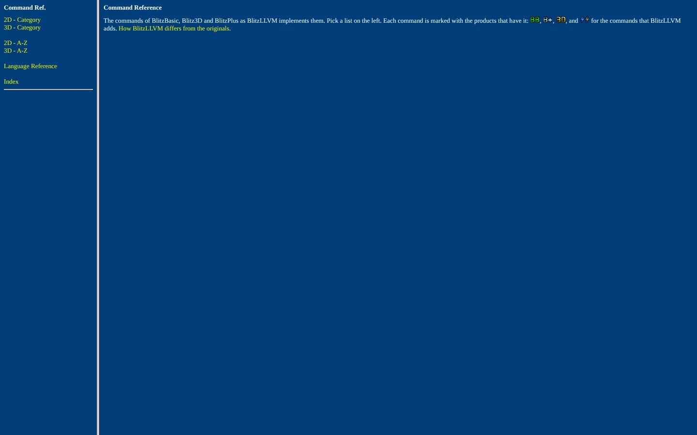                   | 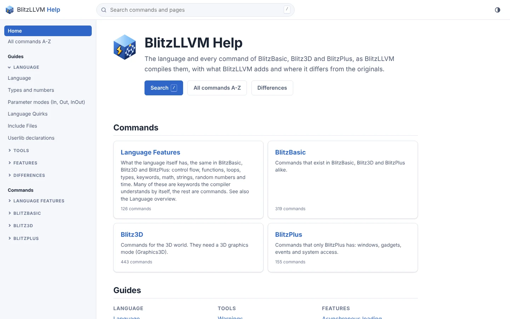                     |
| 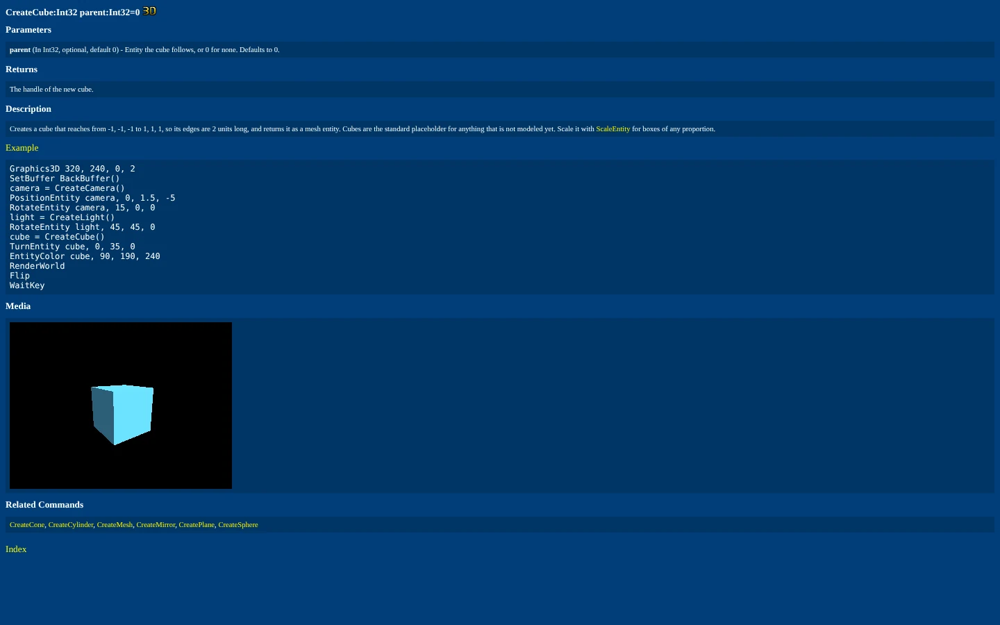                    | 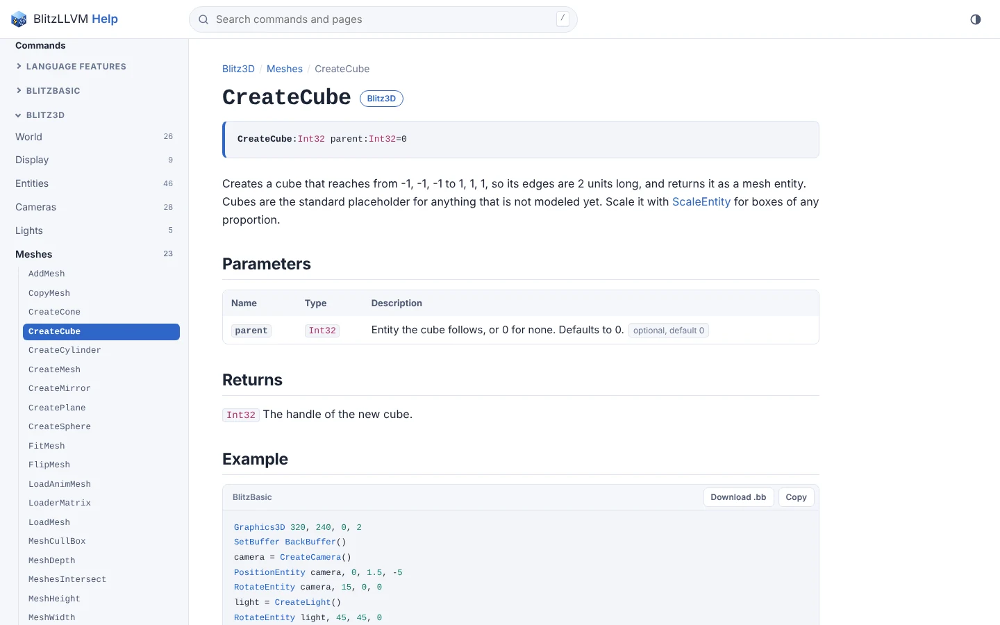                  |
| 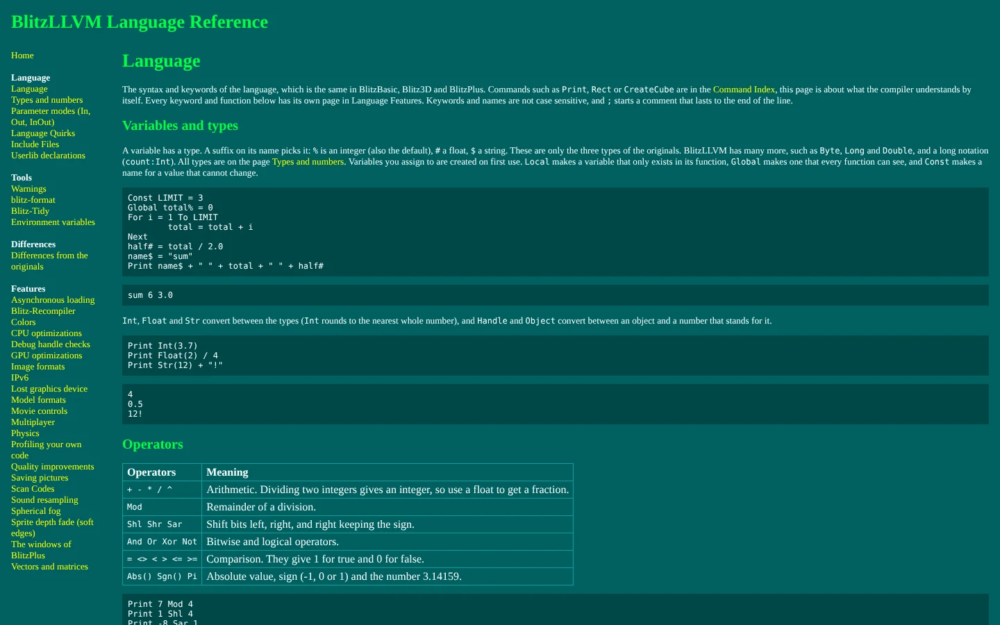                   | 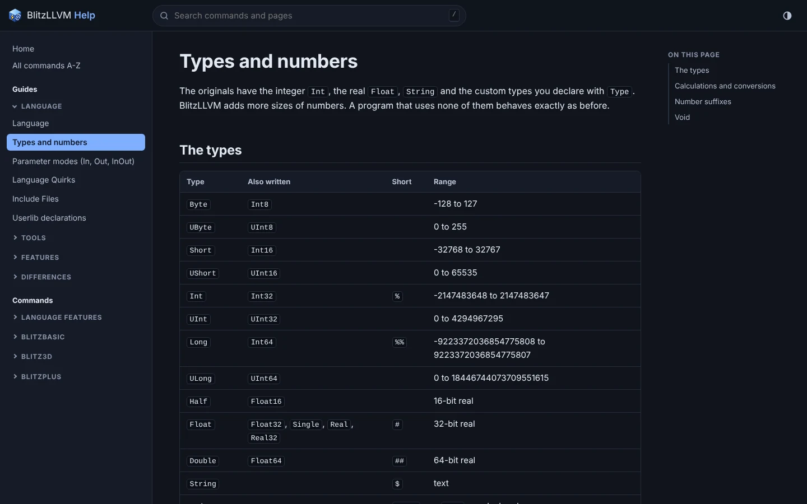               |

## Goals

* **Works from the disk.** The help is opened as `file://.../help/index.html`, with no server and often no internet.
  So: no CDN, no web fonts, no `fetch()`, no modules, no service worker. Everything is in the folder.
* **Readable without JavaScript.** Every page is complete HTML. The script only adds the search, the theme switch,
  the copy buttons, the play buttons of sounds and the menu on small screens.
* **Modern HTML5 and CSS.** Semantic elements (`header`, `nav`, `main`, `article`, `section`, `figure`), one style
  sheet with custom properties, system fonts, grid and flex layout.
* **Light and dark.** Follows the system (`prefers-color-scheme`) until the reader picks one with the button in the
  top bar; the choice is kept in `localStorage` (when the browser allows it for `file://`).
* **Phones and tablets.** Below 900 pixels the sidebar becomes a drawer behind a menu button. Nothing scrolls sideways
  except wide code and tables, which scroll inside their own box.
* **Accessible.** Skip link, visible focus, `aria-current` in the sidebar, the search is a combobox with a listbox,
  contrast checked in both themes, `prefers-reduced-motion` honoured. Printing hides the chrome.
* **Old paths keep working.** Editors and habits open `help/commands/2d_commands/Print.htm` and friends; those paths
  are tiny pages that forward to the new ones.

Not goals: a client side app, a build step with Node, or copying anything from the look of the originals.

## Layout

```text
help/
  index.html                       Home: search, the four dialects, the guides, the credits
  commands/index.html              Every category of every dialect, as cards
  commands/a-z.html                Every command, A to Z, with a letter bar
  commands/Blitz3D-Meshes.html     A category: its introduction and its commands with a one line summary
  commands/CreateCube.html         A command
  pages/Types.html                 A guide (everything in tools/wiki/pages, plus Differences)
  examples/CreateCube.bb           The first example of a command, to download
  assets/help.css                  The only style sheet
  assets/help.js                   The only script (about 10 KB)
  assets/search.js                 The search index, made by the generator
  assets/logo.svg                  media/icon-small.svg
  media/                           The images, animations and sounds the pages use
  commands/index.htm               \
  commands/2d_commands/*.htm        |  Forwarders: meta refresh plus a link, for the paths of the
  commands/3d_commands/*.htm        |  Blitz3D help that earlier BlitzLLVM packages also used
  language/index.html, *.html       |
  credits.html                     /
```

Command and category pages share one folder, which cannot clash: category pages are named `Dialect-Category` and
command names never have a dash.

## Every page

* **Top bar** (sticky): logo and name (home), the search field, the theme button. On small screens also the menu
  button.
* **Sidebar**: Home, All commands A-Z, then **Guides** (the groups of the wiki sidebar: Language, Tools, Features,
  Differences) and **Commands** (Language Features, BlitzBasic, Blitz3D, BlitzPlus, each a collapsible list of its
  categories with a count). The category of the page is open and lists its commands; the current page is highlighted
  and scrolled into view. Built with `details`/`summary`, so it folds without the script.
* **Footer**: where the text comes from, and credit to Blitz Research.

## Command page

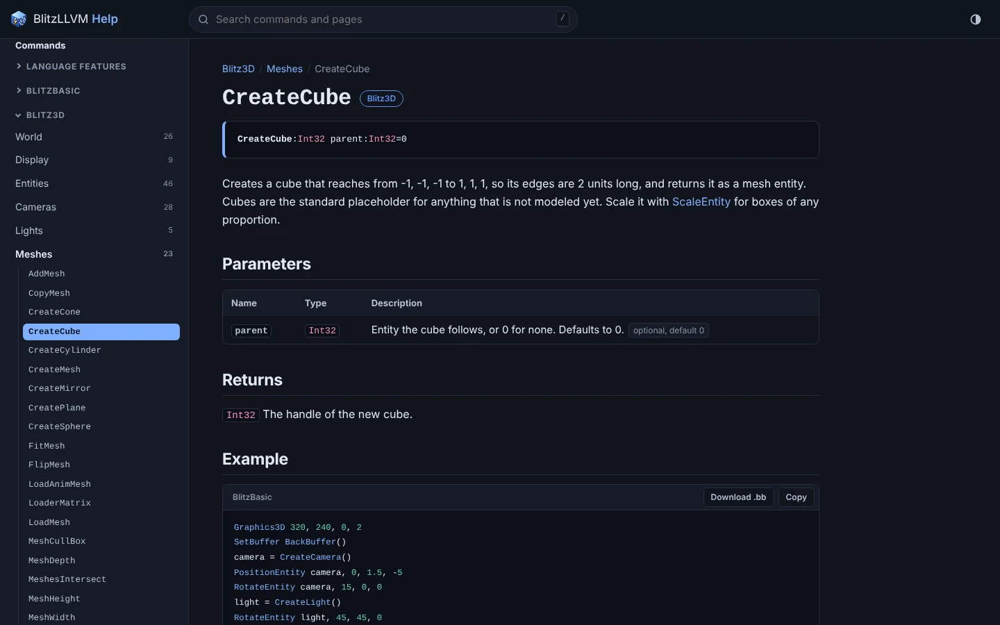

From top to bottom:

1. Breadcrumb: dialect / category / command.
2. The name, and a pill per product that has the command: BlitzBasic, Blitz3D, BlitzPlus, or BlitzLLVM for what we
   add. The pills replace the 20x14 pixel icons, which were made to imitate the originals.
3. The signature in the notation of the wiki (`CreateCube:Int32 parent:Int32=0`), types colored. Keywords show their
   syntax forms, highlighted like code.
4. "New in BlitzLLVM" note for commands the originals do not have.
5. Description.
6. Parameters as a table: name, type, description, with tags for `Out`/`InOut` and "optional, default X".
7. Returns, with the type.
8. Differences, in a yellow note box, so they are easy to find.
9. Examples: each code block has a bar with its language, **Copy**, and for the first example **Download .bb**.
   BlitzBasic is highlighted at build time (comments, strings, numbers, keywords, operators, types) and every command
   name in an example links to its page. A ` ```text ` block after an example is shown as its **Output**.
10. Media (pictures and animations), lazy loaded.
11. Related commands as chips.
12. Previous / next command of the category.

Section ids are `description`, `parameters`, `returns`, `differences`, `examples`, `media` and `related`, so the
links of the wiki such as `Graphics#color-depth` and `X#differences` land in the right place. Headings in guides get
the ids GitHub gives them, for the same reason, and a `#` link that appears on hover.

Sounds (`[name.ogg](media/...)`) are links with a play triangle. With the script a click plays the sound in place and
a second click stops it; without it the browser opens the file.

## Search

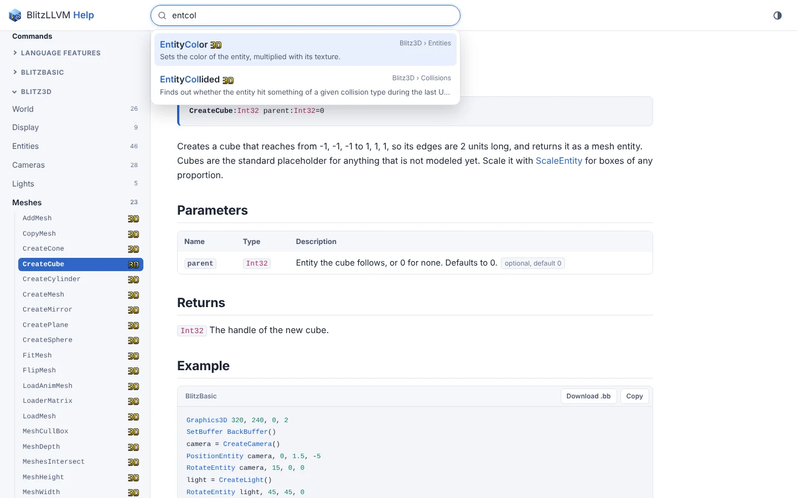

`/` or `Ctrl+K` focuses the search field on every page. The index is `assets/search.js`, a script that sets
`window.HELP_INDEX` (a page opened from the disk cannot `fetch()` a JSON file in most browsers). It is loaded the
first time the field gets focus, so pages that are only read never pay for it. About 1,100 entries, 160 KB.

Each entry is `[name, path, kind, where, summary]`, kind 0 command, 1 category, 2 guide; the summary is the first
sentence of the description. Ranking, best first: exact name, name prefix, prefix of a word of the name (`color`
finds `EntityColor`), anywhere in the name, the letters in order (`entcol` finds `EntityColor`), then the summary
and the category. Several words must all match. Arrow keys move, Enter opens, Escape closes. `?q=text` in the
address opens a page with that search already typed, so an editor can open the help on a word it does not know.

## Category, index and home pages

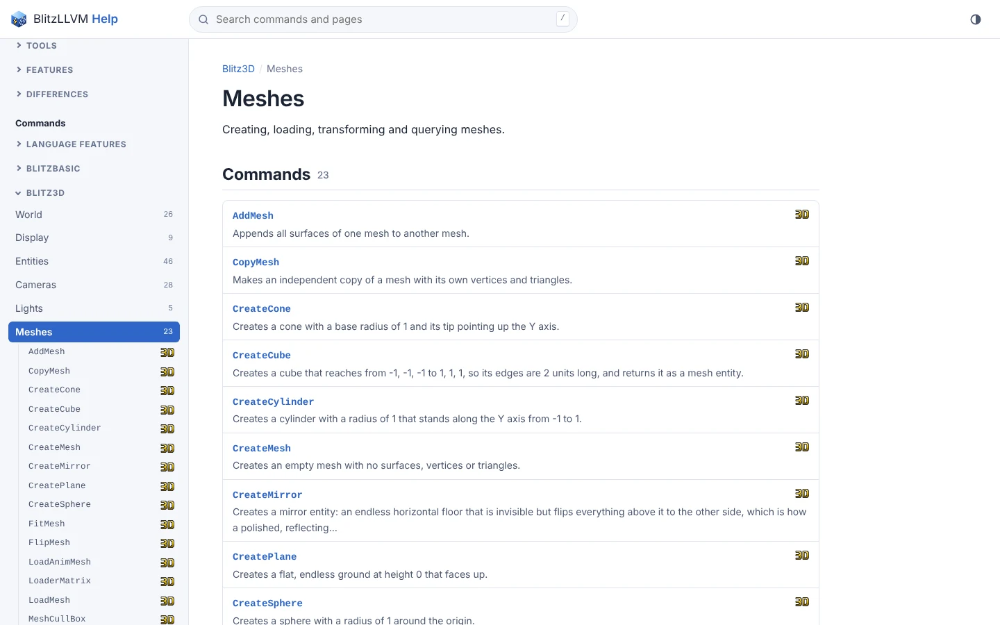

* Category: the `_intro.md` of the category (or its line from `categories.py`), then its commands as a list with
  the summary and the pills of each.
* `commands/index.html`: per dialect its description and a card per category with its line and count.
* `commands/a-z.html`: a sticky letter bar, then the same list as a category page for each letter.
* Home: the logo, a short description, Search / All commands / Differences buttons, a card per dialect, the guides in
  columns, and the credits (the former `credits.html`).

## Phones

| Page                                     | Menu open                                     |
|------------------------------------------|-----------------------------------------------|
| 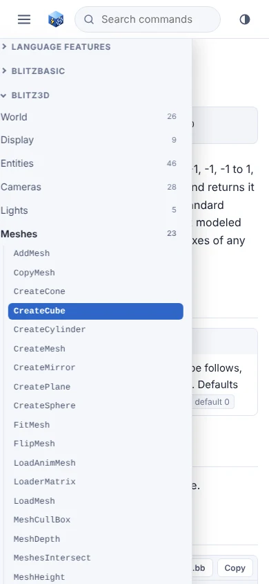      | 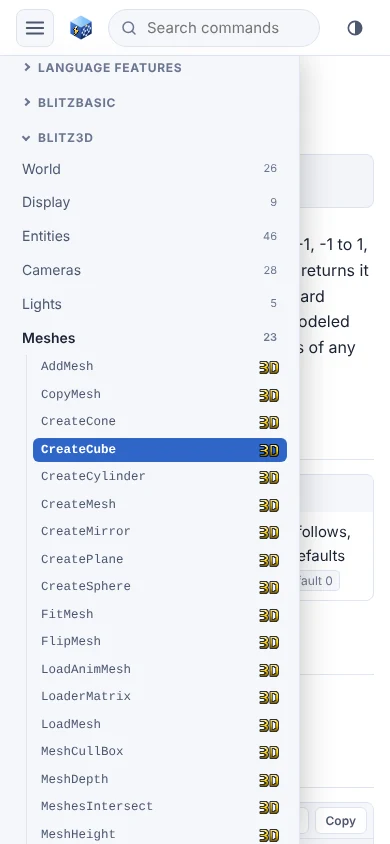      |

## Size

The sidebar is repeated in every page so that pages work without the script. That makes the help about 20 MB on disk
(4.6 MB before) and 6.7 MB as a zip (2.9 MB before); in the installer, which compresses all files together, the
repeated sidebar costs almost nothing. Links inside the sidebar are relative to the folder of the page to keep it
short.

## Code

* `tools/wiki/helpgen.py`: the generator. The Markdown subset is the one it had before, plus heading ids,
  quotes (`> `) as note boxes, the play links, and the syntax highlighter (keyword lists from
  `tools/generate_vscode_grammar.py`, so the help and the editor agree).
* `tools/wiki/help/help.css` and `help.js`: copied as they are into `assets/`.
* `.github/workflows/wiki.yml` builds the help on every pull request, as before.
