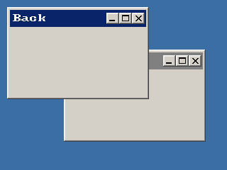

<!-- AUTOGENERATED COPYRIGHT HEADER START -->
<!-- Copyright (C) 2026 Claude <noreply@anthropic.com> -->
<!-- AUTOGENERATED COPYRIGHT HEADER END -->
<!-- Generated by tools/wiki/wiki.py. Edit tools/wiki/text/ instead of this file. -->


# ActivateWindow

<div align="center">

[Command Index](Command-Index) · [BlitzPlus](BlitzPlus) · [Windows](BlitzPlus-Windows)

</div>


## Command Syntax

```blitzbasic
ActivateWindow window:Int32
```

## Parameters

| Parameter | Type | Default | Description |
|---|---|---|---|
| `window` | Int32 | required | Handle of a window made with [CreateWindow](CreateWindow). |

## Description

Brings a window of your program to the front and makes it the active one, as if the user had clicked on its title. The window gets a [WindowActivate](EventID) event ($804). It only works for your own windows, never for other programs.

## Differences

* All windows are drawn inside the one window of your program, so activating one moves it in front of the others there instead of in front of other applications.

## Examples

```blitzbasic
Graphics 320, 240, 32, 2
back  = CreateWindow("Back", 10, 10, 200, 130, Desktop(), 3)
front = CreateWindow("Front", 90, 70, 200, 130, Desktop(), 3)
ActivateWindow back
Repeat
Until WaitEvent() = $803
```

## Media



## Related Commands

* [ActiveWindow](ActiveWindow)
* [CreateWindow](CreateWindow)
* [MaximizeWindow](MaximizeWindow)
* [MinimizeWindow](MinimizeWindow)
* [RestoreWindow](RestoreWindow)
* [SetMinWindowSize](SetMinWindowSize)
* [UpdateWindowMenu](UpdateWindowMenu)
* [WindowMaximized](WindowMaximized)

<div align="center">

[Command Index](Command-Index) · [BlitzPlus](BlitzPlus) · [Windows](BlitzPlus-Windows)

</div>
