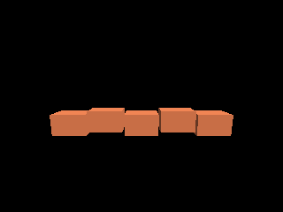

<!-- AUTOGENERATED COPYRIGHT HEADER START -->
<!-- Copyright (C) 2026 Claude <noreply@anthropic.com> -->
<!-- AUTOGENERATED COPYRIGHT HEADER END -->
<!-- Generated by tools/wiki/wiki.py. Edit tools/wiki/text/ instead of this file. -->
# AddMesh

[Command Index](Command-Index) · [Blitz3D](Blitz3D) · [Meshes](Blitz3D-Meshes)

```blitzbasic
AddMesh source_mesh:Int32, dest_mesh:Int32
```

**Works in:** Blitz3D

Appends all surfaces of one mesh to another mesh. This is the way to merge many small models into one, which draws much faster than many entities. The source mesh stays as it is and can be freed afterwards.

Position, rotate and scale the source with the mesh commands, [PositionMesh](PositionMesh), [RotateMesh](RotateMesh) and [ScaleMesh](ScaleMesh), before adding it. The entity commands move the entity, not its vertices, so `AddMesh` would ignore them. The mesh commands all work around the origin, so scale and rotate before you move.

```blitzbasic
Graphics3D 320, 240, 0, 2
SetBuffer BackBuffer()
camera = CreateCamera()
PositionEntity camera, 0, 1.2, -4
RotateEntity camera, 10, 0, 0
light = CreateLight()
RotateEntity light, 45, 45, 0
; Build one wall out of 5 boxes.
wall = CreateMesh()
For i = 0 To 4
	brick = CreateCube()
	ScaleMesh brick, 0.47, 0.3, 0.3
	PositionMesh brick, i - 2, (i Mod 2) * 0.1, 0
	AddMesh brick, wall
	FreeEntity brick
Next
EntityColor wall, 200, 110, 70
RenderWorld
Flip
WaitKey
```



| Parameter | Type | Default | Description |
|---|---|---|---|
| `source_mesh` | Int32 | required | Mesh that is copied into the other. |
| `dest_mesh` | Int32 | required | Mesh that receives the surfaces. |

## Related commands

* [CopyMesh](CopyMesh)
* [CreateMesh](CreateMesh)
* [FitMesh](FitMesh)
* [FlipMesh](FlipMesh)
* [LoadAnimMesh](LoadAnimMesh)
* [LoadMesh](LoadMesh)
* [PaintMesh](PaintMesh)
* [PositionMesh](PositionMesh)

[Command Index](Command-Index) · [Blitz3D](Blitz3D) · [Meshes](Blitz3D-Meshes)
