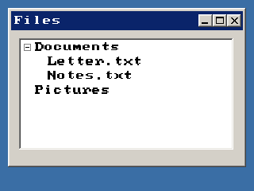

<!-- AUTOGENERATED COPYRIGHT HEADER START -->
<!-- Copyright (C) 2026 Claude <noreply@anthropic.com> -->
<!-- AUTOGENERATED COPYRIGHT HEADER END -->
<!-- Generated by tools/wiki/wiki.py. Edit tools/wiki/text/ instead of this file. -->


# AddTreeViewNode

[Command Index](Command-Index) · [BlitzPlus](BlitzPlus) · [Tree Views](BlitzPlus-Tree-Views)

## Command Syntax

```blitzbasic
AddTreeViewNode:Int32 text:String, parent_node:Int32, icon:Int32=-1
```

## Description

Adds a node at the end of the children of another node. To add one at the top level, give [TreeViewRoot](TreeViewRoot) as the parent.

## Parameters

| Parameter | Type | Default | Description |
|---|---|---|---|
| `text` | String | required | Text of the node. |
| `parent_node` | Int32 | required |  |
| `icon` | Int32 | `-1` | Number of an icon of the tree. Defaults to -1, which means none. |

**Returns:** A handle for the new node.

## Examples

```blitzbasic
Graphics 320, 240, 32, 2
win  = CreateWindow("Files", 10, 10, 300, 200, Desktop(), 3)
tree = CreateTreeView(10, 10, 270, 140, win)
root = TreeViewRoot(tree)
docs = AddTreeViewNode("Documents", root)
AddTreeViewNode "Letter.txt", docs
AddTreeViewNode "Notes.txt", docs
AddTreeViewNode "Pictures", root
ExpandTreeViewNode docs
Repeat
Until WaitEvent() = $803
```

## Media



## Related Commands

* [CollapseTreeViewNode](CollapseTreeViewNode)
* [ExpandTreeViewNode](ExpandTreeViewNode)
* [FreeTreeViewNode](FreeTreeViewNode)
* [InsertTreeViewNode](InsertTreeViewNode)
* [ModifyTreeViewNode](ModifyTreeViewNode)
* [SelectedTreeViewNode](SelectedTreeViewNode)
* [SelectTreeViewNode](SelectTreeViewNode)
* [TreeViewNodeText](TreeViewNodeText)

[Command Index](Command-Index) · [BlitzPlus](BlitzPlus) · [Tree Views](BlitzPlus-Tree-Views)
