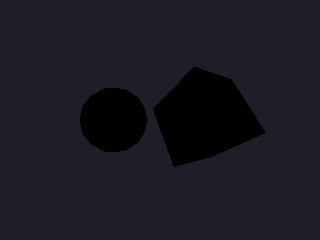

<!-- AUTOGENERATED COPYRIGHT HEADER START -->
<!-- Copyright (C) 2026 Claude <noreply@anthropic.com> -->
<!-- AUTOGENERATED COPYRIGHT HEADER END -->
<!-- Generated by tools/wiki/wiki.py. Edit tools/wiki/text/ instead of this file. -->
# AmbientLight

[Command Index](Command-Index) · [Blitz3D](Blitz3D) · [World](Blitz3D-World)

```blitzbasic
AmbientLight red:Float32, green:Float32, blue:Float32
```

**Works in:** Blitz3D

Sets the color of the light that reaches every surface equally, from every direction. With only ambient light, objects look flat because nothing is brighter on one side than another. Lights from [CreateLight](CreateLight) add shading on top of it. The default is 127, 127, 127, a medium gray; 0, 0, 0 leaves unlit parts black.

The example removes the lights from a scene and steps the ambient light from black to white.

```blitzbasic
Graphics3D 320, 240, 0, 2
SetBuffer BackBuffer()
camera = CreateCamera()
CameraClsColor camera, 30, 30, 40

ball = CreateSphere()
EntityColor ball, 230, 120, 60
PositionEntity ball, -1.4, 0, 5
box = CreateCube()
EntityColor box, 90, 170, 230
PositionEntity box, 1.4, 0, 5
TurnEntity box, 30, 40, 0

For i = 0 To 19
	level = i * 255 / 19
	AmbientLight level, level, level
	RenderWorld
	Flip
Next
```



| Parameter | Type | Default | Description |
|---|---|---|---|
| `red` | Float32 | required | Red part, 0 to 255. |
| `green` | Float32 | required | Green part, 0 to 255. |
| `blue` | Float32 | required | Blue part, 0 to 255. |

## Related commands

* [ActiveTextures](ActiveTextures)
* [AntiAlias](AntiAlias)
* [CaptureWorld](CaptureWorld)

[Command Index](Command-Index) · [Blitz3D](Blitz3D) · [World](Blitz3D-World)
