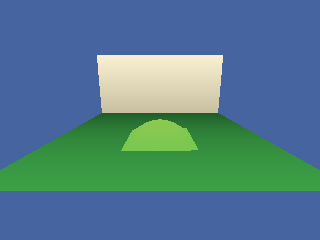

<!-- AUTOGENERATED COPYRIGHT HEADER START -->
<!-- Copyright (C) 2026 Claude <noreply@anthropic.com> -->
<!-- AUTOGENERATED COPYRIGHT HEADER END -->
<!-- Generated by tools/wiki/wiki.py. Edit tools/wiki/text/ instead of this file. -->
# Blitz3D: BSP

Quake 3 BSP levels.


Back to [[Blitz3D]] or the [[Command-Index]].

| Command | Returns | Summary |
|---|---|---|
| [BSPAmbientLight](Blitz3D-BSP#bspambientlight) | None | Sets a color that a level is brightened with. |
| [BSPLighting](Blitz3D-BSP#bsplighting) | None | Chooses between lightmaps and vertex lighting for a level. |
| [LoadBSP](Blitz3D-BSP#loadbsp) | Int | Loads a Quake 3 level (`.bsp`, version 46) as one entity. |

### BSPAmbientLight

```blitzbasic
BSPAmbientLight bsp%, red#, green#, blue#
```

**Works in:** Blitz3D

Sets a color that a level is brightened with. Levels ignore the normal [AmbientLight](Blitz3D-World#ambientlight). It can make a dark level easier to see, although using the gamma value of LoadBSP looks nicer in the original.

| Parameter | Type | Default | Description |
|---|---|---|---|
| `bsp` | Int | required | The level. |
| `red` | Float | required | Red part, 0 to 255. |
| `green` | Float | required | Green part, 0 to 255. |
| `blue` | Float | required | Blue part, 0 to 255. |

**Differences and known gaps:**

* Here the color multiplies the vertex colors: a new level starts at 255, 255, 255 and smaller values tint and darken it, down to black for 0, 0, 0. The original adds the color to the lightmap light and starts at 0, 0, 0.

### BSPLighting

```blitzbasic
BSPLighting bsp%, use_lightmaps%
```

**Works in:** Blitz3D

Chooses between lightmaps and vertex lighting for a level. Vertex lighting is faster on some graphics cards but looks worse.

| Parameter | Type | Default | Description |
|---|---|---|---|
| `bsp` | Int | required | The level. |
| `use_lightmaps` | Int | required | True for lightmaps, False for vertex lighting. Defaults to True. |

**Differences and known gaps:**

* There are no lightmaps. The call is accepted and the level always uses its vertex colors.

### LoadBSP

```blitzbasic
LoadBSP file$, gamma_adj#=0, parent%=0  ; returns Int
```

**Works in:** Blitz3D

Loads a Quake 3 level (`.bsp`, version 46) as one entity. The level is an ordinary entity, so [PositionEntity](Blitz3D-Entities#positionentity), [ScaleEntity](Blitz3D-Entities#scaleentity) and the collision commands work on it; use [EntityType](Blitz3D-Collisions#entitytype) and a `Collisions` rule with method 2 to walk through it. Its surfaces are shared by the triangles that use the same texture. Quake's axes are turned into Blitz3D's: Quake's forward axis is Z here, its left axis is -X, and its up axis is Y.

The textures of the level are found by the names inside the file, with `.tga`, `.jpg`, `.png` or `.dds` added, next to the level and in the folders above it. Faces that the level marks as sky, hidden or not solid are not drawn, and a level cannot be painted, textured, colored or faded like other entities.

The example below builds a minimal level file itself, so it runs without any level from a game: a floor, a wall and a curved hill. The faces have no textures, which leaves the colors of the vertices.

```blitzbasic
Graphics3D 320, 240, 0, 2
SetBuffer BackBuffer()
camera = CreateCamera()
CameraClsColor camera, 70, 100, 160
PositionEntity camera, 0, 70, -90
RotateEntity camera, 14, 0, 0

; A vertex of a level: position, texture and lightmap coordinates, normal and color.
Function WriteVertex(file, x#, y#, z#, r, g, b)
	WriteFloat file, x : WriteFloat file, y : WriteFloat file, z
	WriteFloat file, 0 : WriteFloat file, 0 : WriteFloat file, 0 : WriteFloat file, 0
	WriteFloat file, 0 : WriteFloat file, 0 : WriteFloat file, 1
	WriteByte file, r : WriteByte file, g : WriteByte file, b : WriteByte file, 255
End Function
; A face: 3 is a flat piece made of triangles, 2 is a curved patch of control points.
Function WriteFace(file, kind, vertex, vertices, meshvert, meshverts, size_x, size_y)
	WriteInt file, 0 : WriteInt file, -1 : WriteInt file, kind : WriteInt file, vertex : WriteInt file, vertices
	WriteInt file, meshvert : WriteInt file, meshverts : WriteInt file, -1
	For i = 1 To 4
		WriteInt file, 0
	Next
	For i = 1 To 12
		WriteFloat file, 0
	Next
	WriteInt file, size_x : WriteInt file, size_y
End Function

file = WriteFile("wiki_level.bsp")
WriteInt file, $50534249
WriteInt file, 46
; Header: 17 lumps of offset and length. Only textures, vertices, mesh vertices and faces are used.
For lump = 0 To 16
	If lump = 1 Then WriteInt file, 144 : WriteInt file, 72
	If lump = 10 Then WriteInt file, 216 : WriteInt file, 748
	If lump = 11 Then WriteInt file, 964 : WriteInt file, 48
	If lump = 13 Then WriteInt file, 1012 : WriteInt file, 312
	If lump <> 1 And lump <> 10 And lump <> 11 And lump <> 13 Then WriteInt file, 1324 : WriteInt file, 0
Next
; One texture entry: an empty name, no flags, and "solid" contents.
For i = 1 To 64
	WriteByte file, 0
Next
WriteInt file, 0 : WriteInt file, 1
; Floor, wall and the 3 by 3 control points of a hill.
WriteVertex file, 0, -128, 0, 60, 160, 70
WriteVertex file, 256, -128, 0, 30, 90, 40
WriteVertex file, 256, 128, 0, 30, 90, 40
WriteVertex file, 0, 128, 0, 60, 160, 70
WriteVertex file, 256, -128, 0, 200, 190, 160
WriteVertex file, 256, 128, 0, 200, 190, 160
WriteVertex file, 256, 128, 120, 250, 240, 210
WriteVertex file, 256, -128, 120, 250, 240, 210
For y = 0 To 2
	For x = 0 To 2
		h = 0
		If x = 1 And y = 1 Then h = 90
		WriteVertex file, 60 + x * 40, -40 + y * 40, h, 120 + h, 200, 80
	Next
Next
; Two ways to cut a square into triangles, one for each facing.
WriteInt file, 0 : WriteInt file, 1 : WriteInt file, 2
WriteInt file, 0 : WriteInt file, 2 : WriteInt file, 3
WriteInt file, 0 : WriteInt file, 2 : WriteInt file, 1
WriteInt file, 0 : WriteInt file, 3 : WriteInt file, 2
WriteFace file, 3, 0, 4, 6, 6, 0, 0
WriteFace file, 3, 4, 4, 0, 6, 0, 0
WriteFace file, 2, 8, 9, 0, 0, 3, 3
CloseFile file

level = LoadBSP("wiki_level.bsp")
RenderWorld
Flip
WaitKey
```



| Parameter | Type | Default | Description |
|---|---|---|---|
| `file` | String | required | The `.bsp` file. |
| `gamma_adj` | Float | `0` |  |
| `parent` | Int | `0` | Optional parent entity. The level is still created at 0, 0, 0. |

**Returns:** An entity handle, or 0 if the file is not a Quake 3 level.

**Differences and known gaps:**

* Lightmaps and visibility data are not used. The level is lit by the colors that its vertices carry and all of it is always drawn, so the gamma_adjust argument has no effect.
* The original lights a BSP with point and spot lights but not with ambient or directional ones. Here no light affects it; it is drawn as its vertex colors say, scaled by BSPAmbientLight.
* Curved patches are cut into a fixed number of triangles, and billboard faces are skipped.
