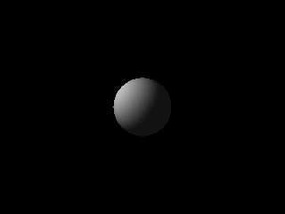
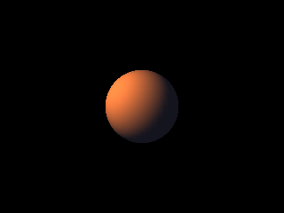

<!-- AUTOGENERATED COPYRIGHT HEADER START -->
<!-- Copyright (C) 2026 Claude <noreply@anthropic.com> -->
<!-- AUTOGENERATED COPYRIGHT HEADER END -->
<!-- Generated by tools/wiki/wiki.py. Edit tools/wiki/text/ instead of this file. -->
# Blitz3D: Lights

Light types, color, range and cone angles.


Back to [[Blitz3D]] or the [[Command-Index]].

| Command | Returns | Summary |
|---|---|---|
| [CreateLight](Blitz3D-Lights#createlight) | Int | Creates a light and returns its handle. |
| [LightColor](Blitz3D-Lights#lightcolor) | None | Sets the color of the light. |
| [LightConeAngles](Blitz3D-Lights#lightconeangles) | None | Sets the inner and outer angle of a spot light in degrees. |
| [LightMesh](Blitz3D-Lights#lightmesh) | None | Lights a mesh without any light in the world, by adding color to its vertices once. |
| [LightRange](Blitz3D-Lights#lightrange) | None | Sets how far a point or spot light reaches. |

### CreateLight

```blitzbasic
CreateLight type%=1, parent%=0  ; returns Int
```

**Works in:** Blitz3D

Creates a light and returns its handle. Without a light everything in the world is lit only by [AmbientLight](Blitz3D-World#ambientlight), which looks flat. A light is an entity: position and rotation work like on any other entity.

* **1, directional** (the default) is like the sun. Only its rotation matters, it shines along its own forward direction (+Z) and has no position or range.
* **2, point** is like a light bulb. It shines in all directions from its position and fades out until its range.
* **3, spot** is meant to be a cone of light. See the gap below.

A new light is white, sits at the origin and has a range of 1000. Any other value for `type` creates a directional light. Only the 8 lights that come first in the world affect a frame, so plan with 8 at most.

```blitzbasic
Graphics3D 320, 240, 0, 2
SetBuffer BackBuffer()
camera = CreateCamera()
PositionEntity camera, 0, 0, -5
AmbientLight 20, 20, 20
; A point light to the left of the ball.
light = CreateLight(2)
PositionEntity light, -3, 2, -2
LightRange light, 12
ball = CreateSphere(24)
EntityColor ball, 230, 230, 230
RenderWorld
Flip
WaitKey
```



| Parameter | Type | Default | Description |
|---|---|---|---|
| `type` | Int | `1` | 1 for a directional light, 2 for a point light, 3 for a spot light. Defaults to 1. |
| `parent` | Int | `0` | Entity the light follows, or 0 for none. Defaults to 0. |

**Returns:** The handle of the new light.

**Differences and known gaps:**

* Spot lights (3) are drawn like point lights, see [LightConeAngles](Blitz3D-Lights#lightconeangles).

### LightColor

```blitzbasic
LightColor light%, red#, green#, blue#
```

**Works in:** Blitz3D

Sets the color of the light. 255, 255, 255 is full white light, 0, 0, 0 adds nothing. The original accepts values from -255 to 255 where negative values darken what the light touches, which lets you fake shadows.

| Parameter | Type | Default | Description |
|---|---|---|---|
| `light` | Int | required | Light handle. |
| `red` | Float | required | Red part of the light. |
| `green` | Float | required | Green part of the light. |
| `blue` | Float | required | Blue part of the light. |

**Differences and known gaps:**

* Each part is clamped to 0 through 255 here, so negative lights do not darken anything yet.

### LightConeAngles

```blitzbasic
LightConeAngles light%, inner_angle#, outer_angle#
```

**Works in:** Blitz3D

Sets the inner and outer angle of a spot light in degrees. Inside the inner angle the light is at full strength and it fades out up to the outer angle. The defaults are 0 and 90.

| Parameter | Type | Default | Description |
|---|---|---|---|
| `light` | Int | required | Light handle. |
| `inner_angle` | Float | required | Angle of the fully lit center of the cone. |
| `outer_angle` | Float | required | Angle where the light has faded out. |

**Differences and known gaps:**

* The angles are stored, but spot lights are drawn as point lights that shine in all directions, ignoring the cone.

### LightMesh

```blitzbasic
LightMesh mesh%, red#, green#, blue#, range#=0, x#=0, y#=0, z#=0
```

**Works in:** Blitz3D

Lights a mesh without any light in the world, by adding color to its vertices once. It is a fast way to bake the look of a light into static geometry, or to fake lights beyond the limit of 8. The mesh must have vertex colors switched on with `EntityFX mesh, 2` or the change stays invisible. New meshes have white vertices, so the added light has nothing to brighten until you darken them with [VertexColor](Blitz3D-Surfaces#vertexcolor).

With a `range` of 0 the color is added to every vertex alike. Otherwise only vertices that face the position get light, and the more directly they face it and the closer they are, the more they get. `range` scales the strength, so doubling it doubles the light.

The color is added to what the vertices already have and is kept: calling the command again brightens the mesh further, and it is not undone by anything but painting the vertices again.

```blitzbasic
Graphics3D 320, 240, 0, 2
SetBuffer BackBuffer()
camera = CreateCamera()
PositionEntity camera, 0, 0, -4
ball = CreateSphere(24)
; Start from dark vertices, use them without any light in the world.
surf = GetSurface(ball, 1)
For v = 0 To CountVertices(surf) - 1
	VertexColor surf, v, 20, 20, 30
Next
EntityFX ball, 1 + 2
LightMesh ball, 255, 120, 40, 4, -3, 2, -3
RenderWorld
Flip
WaitKey
```



| Parameter | Type | Default | Description |
|---|---|---|---|
| `mesh` | Int | required | Mesh handle. |
| `red` | Float | required | Red part of the light, 0 to 255. |
| `green` | Float | required | Green part of the light, 0 to 255. |
| `blue` | Float | required | Blue part of the light, 0 to 255. |
| `range` | Float | `0` | Strength of the light, 0 for the same amount on every vertex. Defaults to 0. |
| `x` | Float | `0` | X position of the light in the mesh's own space. Defaults to 0. |
| `y` | Float | `0` | Y position of the light in the mesh's own space. Defaults to 0. |
| `z` | Float | `0` | Z position of the light in the mesh's own space. Defaults to 0. |

### LightRange

```blitzbasic
LightRange light%, range#
```

**Works in:** Blitz3D

Sets how far a point or spot light reaches. The light is full strength next to the light and fades steadily to nothing at the range, so everything beyond it stays dark. The original calls the value approximate, so try a few values until the scene looks right. The default is 1000. Directional lights ignore it.

```blitzbasic
Graphics3D 320, 240, 0, 2
SetBuffer BackBuffer()
camera = CreateCamera()
PositionEntity camera, 0, 0, -12
AmbientLight 10, 10, 10
; A row of balls that starts at a point light with a short range.
light = CreateLight(2)
PositionEntity light, -5.5, 1.5, -2
LightRange light, 8
For i = 0 To 6
	ball = CreateSphere(16)
	PositionEntity ball, i * 1.7 - 5, 0, 0
Next
RenderWorld
Flip
WaitKey
```


| Parameter | Type | Default | Description |
|---|---|---|---|
| `light` | Int | required | Light handle. |
| `range` | Float | required | How far the light reaches. |
