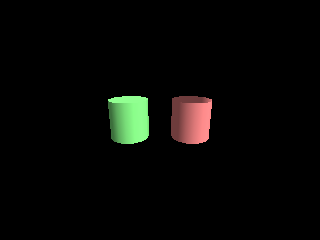
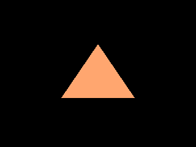
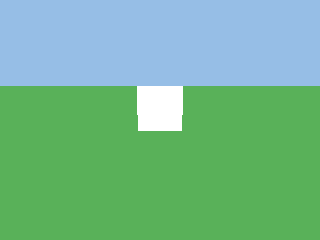

<!-- AUTOGENERATED COPYRIGHT HEADER START -->
<!-- Copyright (C) 2026 Claude <noreply@anthropic.com> -->
<!-- AUTOGENERATED COPYRIGHT HEADER END -->
<!-- Generated by tools/wiki/wiki.py. Edit tools/wiki/text/ instead of this file. -->
# Blitz3D: Meshes

Creating, loading, transforming and querying meshes.


Back to [[Blitz3D]] or the [[Command-Index]].

| Command | Returns | Summary |
|---|---|---|
| [AddMesh](Blitz3D-Meshes#addmesh) | None | Appends all surfaces of one mesh to another mesh. |
| [CopyMesh](Blitz3D-Meshes#copymesh) | Int | Makes an independent copy of a mesh with its own vertices and triangles. |
| [CreateCone](Blitz3D-Meshes#createcone) | Int | Creates a cone with a base radius of 1 and its tip pointing up the Y axis. |
| [CreateCube](Blitz3D-Meshes#createcube) | Int | Creates a cube that reaches from -1, -1, -1 to 1, 1, 1, so its edges are 2 units long, and returns it as a mesh entity. |
| [CreateCylinder](Blitz3D-Meshes#createcylinder) | Int | Creates a cylinder with a radius of 1 that stands along the Y axis from -1 to 1. |
| [CreateMesh](Blitz3D-Meshes#createmesh) | Int | Creates an empty mesh with no surfaces, vertices or triangles. |
| [CreateMirror](Blitz3D-Meshes#createmirror) | Int | Creates a mirror entity: an endless horizontal floor that is invisible but flips everything above it to the other side, which is how a polished, reflecting floor was drawn in the original. |
| [CreatePlane](Blitz3D-Meshes#createplane) | Int | Creates a flat, endless ground at height 0 that faces up. |
| [CreateSphere](Blitz3D-Meshes#createsphere) | Int | Creates a sphere with a radius of 1 around the origin. |
| [FitMesh](Blitz3D-Meshes#fitmesh) | None | Scales and moves a mesh so that it exactly fills a box. |
| [FlipMesh](Blitz3D-Meshes#flipmesh) | None | Turns every triangle of a mesh around so that it faces the other way. |
| [LoadAnimMesh](Blitz3D-Meshes#loadanimmesh) | Int | Loads a model together with its parts and animation. |
| [LoaderMatrix](Blitz3D-Meshes#loadermatrix) | None | Sets a 3x3 matrix that is applied to every model loaded from files with a certain extension, to correct a file format whose axes differ from Blitz3D. |
| [LoadMesh](Blitz3D-Meshes#loadmesh) | Int | Loads a model from a file as one mesh entity. |
| [MeshCullBox](Blitz3D-Meshes#meshcullbox) | None | Sets the box that decides whether a mesh is in view. |
| [MeshDepth](Blitz3D-Meshes#meshdepth) | Float | Reads the size of the mesh along Z, taken from the vertices. |
| [MeshesIntersect](Blitz3D-Meshes#meshesintersect) | Int | Tests if the triangles of two meshes touch at their current positions. |
| [MeshHeight](Blitz3D-Meshes#meshheight) | Float | Reads the size of the mesh along Y, taken from the vertices. |
| [MeshWidth](Blitz3D-Meshes#meshwidth) | Float | Reads the size of the mesh along X, taken from the vertices. |
| [PaintMesh](Blitz3D-Meshes#paintmesh) | None | Applies a brush to every surface of a mesh: color, texture, alpha, shininess, blend mode and effects in one go. |
| [PositionMesh](Blitz3D-Meshes#positionmesh) | None | Moves every vertex of a mesh by an offset, permanently. |
| [RotateMesh](Blitz3D-Meshes#rotatemesh) | None | Turns every vertex of a mesh around the origin, permanently. |
| [ScaleMesh](Blitz3D-Meshes#scalemesh) | None | Multiplies the coordinates of every vertex by a factor per axis, permanently, around the origin. |

### AddMesh

```blitzbasic
AddMesh source_mesh%, dest_mesh%
```

**Works in:** Blitz3D

Appends all surfaces of one mesh to another mesh. This is the way to merge many small models into one, which draws much faster than many entities. The source mesh stays as it is and can be freed afterwards.

Position, rotate and scale the source with the mesh commands, [PositionMesh](Blitz3D-Meshes#positionmesh), [RotateMesh](Blitz3D-Meshes#rotatemesh) and [ScaleMesh](Blitz3D-Meshes#scalemesh), before adding it. The entity commands move the entity, not its vertices, so `AddMesh` would ignore them. The mesh commands all work around the origin, so scale and rotate before you move.

```blitzbasic
Graphics3D 320, 240, 0, 2
SetBuffer BackBuffer()
camera = CreateCamera()
PositionEntity camera, 0, 1.2, -4
RotateEntity camera, 10, 0, 0
light = CreateLight()
RotateEntity light, 45, 45, 0
; Build one wall out of 5 boxes.
wall = CreateMesh()
For i = 0 To 4
	brick = CreateCube()
	ScaleMesh brick, 0.47, 0.3, 0.3
	PositionMesh brick, i - 2, (i Mod 2) * 0.1, 0
	AddMesh brick, wall
	FreeEntity brick
Next
EntityColor wall, 200, 110, 70
RenderWorld
Flip
WaitKey
```


| Parameter | Type | Default | Description |
|---|---|---|---|
| `source_mesh` | Int | required | Mesh that is copied into the other. |
| `dest_mesh` | Int | required | Mesh that receives the surfaces. |

### CopyMesh

```blitzbasic
CopyMesh mesh%, parent%=0  ; returns Int
```

**Works in:** Blitz3D

Makes an independent copy of a mesh with its own vertices and triangles. This differs from [CopyEntity](Blitz3D-Entities#copyentity), whose copies share the mesh: after a `CopyMesh` you can reshape, paint or flip the copy without touching the original. The copy is made at the origin even if the source was moved.

| Parameter | Type | Default | Description |
|---|---|---|---|
| `mesh` | Int | required | Mesh handle to copy. |
| `parent` | Int | `0` | Entity the copy follows, or 0 for none. Defaults to 0. |

**Returns:** The handle of the copy.

### CreateCone

```blitzbasic
CreateCone segments%=8, solid%=1, parent%=0  ; returns Int
```

**Works in:** Blitz3D

Creates a cone with a base radius of 1 and its tip pointing up the Y axis. With `solid` set to 0 the base is left open. 4 segments make a pyramid and 16 looks smooth. Valid values are 3 to 100.

```blitzbasic
Graphics3D 320, 240, 0, 2
SetBuffer BackBuffer()
camera = CreateCamera()
PositionEntity camera, 0, 2.5, -8
RotateEntity camera, 18, 0, 0
light = CreateLight()
RotateEntity light, 45, 45, 0
pyramid = CreateCone(4)
PositionEntity pyramid, -2.4, 0, 0
EntityColor pyramid, 240, 200, 80
smooth = CreateCone(24)
EntityColor smooth, 120, 200, 240
round = CreateCone(8)
PositionEntity round, 2.4, 0, 0
EntityColor round, 240, 120, 160
RenderWorld
Flip
WaitKey
```


| Parameter | Type | Default | Description |
|---|---|---|---|
| `segments` | Int | `8` | Detail of the cone, 3 to 100. Defaults to 8. |
| `solid` | Int | `1` | 1 for a cone with a base, 0 for an open one. Defaults to 1. |
| `parent` | Int | `0` | Entity the cone follows, or 0 for none. Defaults to 0. |

**Returns:** The handle of the new cone.

**Differences and known gaps:**

* The base is drawn as a fan around a center point, so a closed cone has `2 * segments` triangles and an open one `segments`. The original uses `segments + (segments - 2)` for a closed one, for example 14 instead of 16 at 8 segments.

### CreateCube

```blitzbasic
CreateCube parent%=0  ; returns Int
```

**Works in:** Blitz3D

Creates a cube that reaches from -1, -1, -1 to 1, 1, 1, so its edges are 2 units long, and returns it as a mesh entity. Cubes are the standard placeholder for anything that is not modeled yet. Scale it with [ScaleEntity](Blitz3D-Entities#scaleentity) for boxes of any proportion.

```blitzbasic
Graphics3D 320, 240, 0, 2
SetBuffer BackBuffer()
camera = CreateCamera()
PositionEntity camera, 0, 1.5, -5
RotateEntity camera, 15, 0, 0
light = CreateLight()
RotateEntity light, 45, 45, 0
cube = CreateCube()
TurnEntity cube, 0, 35, 0
EntityColor cube, 90, 190, 240
RenderWorld
Flip
WaitKey
```


| Parameter | Type | Default | Description |
|---|---|---|---|
| `parent` | Int | `0` | Entity the cube follows, or 0 for none. Defaults to 0. |

**Returns:** The handle of the new cube.

### CreateCylinder

```blitzbasic
CreateCylinder segments%=8, solid%=1, parent%=0  ; returns Int
```

**Works in:** Blitz3D

Creates a cylinder with a radius of 1 that stands along the Y axis from -1 to 1. With `solid` set to 0 the top and bottom are left open and you get a tube. 3 segments make a prism, 8 is about the smallest that still reads as round and 16 looks smooth. Valid values are 3 to 100.

```blitzbasic
Graphics3D 320, 240, 0, 2
SetBuffer BackBuffer()
camera = CreateCamera()
PositionEntity camera, 0, 2.5, -8
RotateEntity camera, 18, 0, 0
light = CreateLight()
RotateEntity light, 45, 45, 0
closed = CreateCylinder(16)
PositionEntity closed, -1.6, 0, 0
EntityColor closed, 120, 220, 120
tube = CreateCylinder(16, 0)
PositionEntity tube, 1.6, 0, 0
EntityColor tube, 220, 120, 120
EntityFX tube, 16
RenderWorld
Flip
WaitKey
```



| Parameter | Type | Default | Description |
|---|---|---|---|
| `segments` | Int | `8` | Detail of the cylinder, 3 to 100. Defaults to 8. |
| `solid` | Int | `1` | 1 for a cylinder with ends, 0 for a tube. Defaults to 1. |
| `parent` | Int | `0` | Entity the cylinder follows, or 0 for none. Defaults to 0. |

**Returns:** The handle of the new cylinder.

**Differences and known gaps:**

* The closed ends are drawn as fans around a center point, so a closed cylinder has `4 * segments` triangles and a tube `2 * segments`. The original uses `(segments + (segments - 2)) * 2` for a closed one, for example 28 instead of 32 at 8 segments.

### CreateMesh

```blitzbasic
CreateMesh parent%=0  ; returns Int
```

**Works in:** Blitz3D

Creates an empty mesh with no surfaces, vertices or triangles. Fill it with [CreateSurface](Blitz3D-Surfaces#createsurface), [AddVertex](Blitz3D-Surfaces#addvertex) and [AddTriangle](Blitz3D-Surfaces#addtriangle) to build your own geometry, or with [AddMesh](Blitz3D-Meshes#addmesh) to put other meshes together.

```blitzbasic
Graphics3D 320, 240, 0, 2
SetBuffer BackBuffer()
camera = CreateCamera()
PositionEntity camera, 0, 0, -4
light = CreateLight()
RotateEntity light, 20, 20, 0
mesh = CreateMesh()
surf = CreateSurface(mesh)
a = AddVertex(surf, -1.5, -1, 0)
b = AddVertex(surf, 0, 1.2, 0)
c = AddVertex(surf, 1.5, -1, 0)
AddTriangle surf, a, b, c
UpdateNormals mesh
EntityColor mesh, 240, 120, 80
EntityFX mesh, 16
RenderWorld
Flip
WaitKey
```



| Parameter | Type | Default | Description |
|---|---|---|---|
| `parent` | Int | `0` | Entity the mesh follows, or 0 for none. Defaults to 0. |

**Returns:** The handle of the new mesh.

### CreateMirror

```blitzbasic
CreateMirror parent%=0  ; returns Int
```

**Works in:** Blitz3D

Creates a mirror entity: an endless horizontal floor that is invisible but flips everything above it to the other side, which is how a polished, reflecting floor was drawn in the original. Position it with [PositionEntity](Blitz3D-Entities#positionentity) to set its height.

| Parameter | Type | Default | Description |
|---|---|---|---|
| `parent` | Int | `0` | Entity the mirror follows, or 0 for none. Defaults to 0. |

**Returns:** The handle of the mirror.

**Differences and known gaps:**

* A mirror is only an entity: nothing is reflected. [EntityClass](Blitz3D-Entities#entityclass) still reports `Mirror`, so programs run unchanged, but the floor looks empty.

### CreatePlane

```blitzbasic
CreatePlane segments%=1, parent%=0  ; returns Int
```

**Works in:** Blitz3D

Creates a flat, endless ground at height 0 that faces up. It is handy for outdoor scenes where the player should never see an edge. The plane is one-sided, so it is not seen from below. More `segments` split it into smaller squares, which gives lights and fog more vertices to work with and hides problems some graphics cards have with big flat triangles.

```blitzbasic
Graphics3D 320, 240, 0, 2
SetBuffer BackBuffer()
camera = CreateCamera()
PositionEntity camera, 0, 2, -6
RotateEntity camera, 12, 0, 0
CameraClsColor camera, 150, 190, 230
light = CreateLight()
RotateEntity light, 50, 30, 0
ground = CreatePlane()
EntityColor ground, 70, 140, 70
box = CreateCube()
PositionEntity box, 0, 1, 2
RenderWorld
Flip
WaitKey
```



| Parameter | Type | Default | Description |
|---|---|---|---|
| `segments` | Int | `1` | How many pieces the plane is divided into per side, 1 to 16. Defaults to 1. |
| `parent` | Int | `0` | Entity the plane follows, or 0 for none. Defaults to 0. |

**Returns:** The handle of the new plane.

**Differences and known gaps:**

* The plane is one very large square, 20000 units wide, and `segments` is ignored. It looks endless unless you travel far from the origin.

### CreateSphere

```blitzbasic
CreateSphere segments%=8, parent%=0  ; returns Int
```

**Works in:** Blitz3D

Creates a sphere with a radius of 1 around the origin. `segments` sets how round it looks. A sphere has `2 * segments * (segments - 1) * 2` triangles, so 8 gives 224 and 16 gives 960: use the smallest number that still looks smooth at the distance the sphere is seen from. Valid values are 2 to 100.

```blitzbasic
Graphics3D 320, 240, 0, 2
SetBuffer BackBuffer()
camera = CreateCamera()
PositionEntity camera, 0, 0, -9
light = CreateLight()
RotateEntity light, 45, 45, 0
For i = 0 To 2
	ball = CreateSphere(4 + i * 6)
	PositionEntity ball, i * 2.8 - 2.8, 0, 0
	EntityColor ball, 255, 190, 60
Next
RenderWorld
Flip
WaitKey
```


| Parameter | Type | Default | Description |
|---|---|---|---|
| `segments` | Int | `8` | Detail of the sphere, 2 to 100. Defaults to 8. |
| `parent` | Int | `0` | Entity the sphere follows, or 0 for none. Defaults to 0. |

**Returns:** The handle of the new sphere.

### FitMesh

```blitzbasic
FitMesh mesh%, x#, y#, z#, width#, height#, depth#, uniform%=0
```

**Works in:** Blitz3D

Scales and moves a mesh so that it exactly fills a box. `x`, `y` and `z` are the corner of the box with the smallest coordinates and `width`, `height` and `depth` are its size. With `uniform` set to 1 the proportions of the mesh are kept and it is fitted inside the box. Never pass 0 as a size: that squashes the mesh flat and its shape is lost. Use a small value like 0.001 for a flat mesh.

| Parameter | Type | Default | Description |
|---|---|---|---|
| `mesh` | Int | required | Mesh handle. |
| `x` | Float | required | X of the box corner. |
| `y` | Float | required | Y of the box corner. |
| `z` | Float | required | Z of the box corner. |
| `width` | Float | required | Size of the box along X. |
| `height` | Float | required | Size of the box along Y. |
| `depth` | Float | required | Size of the box along Z. |
| `uniform` | Int | `0` | 1 to scale by the same factor on all axes, 0 to stretch to the box. Defaults to 0. |

### FlipMesh

```blitzbasic
FlipMesh mesh%
```

**Works in:** Blitz3D

Turns every triangle of a mesh around so that it faces the other way. Triangles are only drawn from the side they face, so a sphere made as a sky has to be flipped to be seen from inside. Flipping also turns the lighting normals around. If you need a mesh visible from both sides, copy it with [CopyMesh](Blitz3D-Meshes#copymesh), flip the copy and merge both with [AddMesh](Blitz3D-Meshes#addmesh), or just draw both sides with the 16 flag of [EntityFX](Blitz3D-Entities#entityfx), which is cheaper.

```blitzbasic
Graphics3D 320, 240, 0, 2
SetBuffer BackBuffer()
camera = CreateCamera()
light = CreateLight()
sky = CreateSphere(16)
ScaleEntity sky, 50, 50, 50
FlipMesh sky
EntityFX sky, 1
EntityColor sky, 90, 150, 230
; The camera is inside the sphere and can only see it because it was flipped.
box = CreateCube()
PositionEntity box, 0, 0, 5
RenderWorld
Flip
WaitKey
```


| Parameter | Type | Default | Description |
|---|---|---|---|
| `mesh` | Int | required | Mesh handle. |

### LoadAnimMesh

```blitzbasic
LoadAnimMesh file$, parent%=0  ; returns Int
```

**Works in:** Blitz3D

Loads a model together with its parts and animation. The result is a pivot at the top of a hierarchy of entities, one per object in the file, so you can find a single part with [FindChild](Blitz3D-Entities#findchild) and play the animation with `Animate`. Unlike [LoadMesh](Blitz3D-Meshes#loadmesh) the parts stay separate entities, which costs more to draw but lets them move.

| Parameter | Type | Default | Description |
|---|---|---|---|
| `file` | String | required | Path of the model file. |
| `parent` | Int | `0` | Entity the model follows, or 0 for none. Defaults to 0. |

**Returns:** The handle of the top entity, or 0 if the file could not be loaded.

**Differences and known gaps:**

* Only `.b3d` files can be loaded, see [LoadMesh](Blitz3D-Meshes#loadmesh).

### LoaderMatrix

```blitzbasic
LoaderMatrix file_ext$, xx#, xy#, xz#, yx#, yy#, yz#, zx#, zy#, zz#
```

**Works in:** Blitz3D

Sets a 3x3 matrix that is applied to every model loaded from files with a certain extension, to correct a file format whose axes differ from Blitz3D. By default `.x` files are used as they are and `.3ds` files get Y and Z swapped. Only the file type matters, not the case.

| Parameter | Type | Default | Description |
|---|---|---|---|
| `file_ext` | String | required | File extension the matrix is for, for example `x` or `3ds`. |
| `xx` | Float | required | Matrix value, row 1, column 1. |
| `xy` | Float | required | Matrix value, row 1, column 2. |
| `xz` | Float | required | Matrix value, row 1, column 3. |
| `yx` | Float | required | Matrix value, row 2, column 1. |
| `yy` | Float | required | Matrix value, row 2, column 2. |
| `yz` | Float | required | Matrix value, row 2, column 3. |
| `zx` | Float | required | Matrix value, row 3, column 1. |
| `zy` | Float | required | Matrix value, row 3, column 2. |
| `zz` | Float | required | Matrix value, row 3, column 3. |

**Differences and known gaps:**

* The matrix is remembered but never used. Since only `.b3d` files can be loaded, and those are not changed by it in the original either, there is no visible effect yet.

### LoadMesh

```blitzbasic
LoadMesh file$, parent%=0  ; returns Int
```

**Works in:** Blitz3D

Loads a model from a file as one mesh entity. Any hierarchy and animation in the file is thrown away and the whole model is merged into a single mesh, which is what you want for scenery and props. The original reads `.b3d`, `.x` and `.3ds`. The mesh is made at the origin even with a `parent`. If the file cannot be found the result is 0, so check it.

Use [LoadAnimMesh](Blitz3D-Meshes#loadanimmesh) when the model has bones or parts that need to move on their own.

| Parameter | Type | Default | Description |
|---|---|---|---|
| `file` | String | required | Path of the model file. |
| `parent` | Int | `0` | Entity the mesh follows, or 0 for none. Defaults to 0. |

**Returns:** The handle of the mesh, or 0 if the file could not be loaded.

**Differences and known gaps:**

* Only `.b3d` files can be loaded. `.x` and `.3ds` files are not read, so the result is 0.

### MeshCullBox

```blitzbasic
MeshCullBox mesh%, x#, y#, z#, width#, height#, depth#
```

**Works in:** Blitz3D

Sets the box that decides whether a mesh is in view. By default the box is taken from the mesh vertices when it is made; for a model that animates it may be too small and the mesh disappears at the edge of the screen although parts of it are still visible. Make the box big enough for every pose. The box is given in the space of the mesh: `x`, `y` and `z` is the corner with the smallest coordinates.

| Parameter | Type | Default | Description |
|---|---|---|---|
| `mesh` | Int | required | Mesh handle. |
| `x` | Float | required | X of the box corner. |
| `y` | Float | required | Y of the box corner. |
| `z` | Float | required | Z of the box corner. |
| `width` | Float | required | Size of the box along X. |
| `height` | Float | required | Size of the box along Y. |
| `depth` | Float | required | Size of the box along Z. |

**Differences and known gaps:**

* The box only affects [EntityInView](Blitz3D-Entities#entityinview). The renderer does not cull meshes against the camera, so the box has no influence on what is drawn.

### MeshDepth

```blitzbasic
MeshDepth mesh%  ; returns Float
```

**Works in:** Blitz3D

Reads the size of the mesh along Z, taken from the vertices. Entity scale does not count, but mesh commands do.

| Parameter | Type | Default | Description |
|---|---|---|---|
| `mesh` | Int | required | Mesh handle. |

**Returns:** The depth of the mesh.

### MeshesIntersect

```blitzbasic
MeshesIntersect mesh_a%, mesh_b%  ; returns Int
```

**Works in:** Blitz3D

Tests if the triangles of two meshes touch at their current positions. It takes the entity position, rotation and scale into account. It is exact, but slow compared with the collision commands, so call it only when a cheaper check such as a distance already said the meshes are close.

| Parameter | Type | Default | Description |
|---|---|---|---|
| `mesh_a` | Int | required | First mesh handle. |
| `mesh_b` | Int | required | Second mesh handle. |

**Returns:** 1 if the meshes intersect, otherwise 0.

### MeshHeight

```blitzbasic
MeshHeight mesh%  ; returns Float
```

**Works in:** Blitz3D

Reads the size of the mesh along Y, taken from the vertices. Entity scale does not count, but mesh commands do.

| Parameter | Type | Default | Description |
|---|---|---|---|
| `mesh` | Int | required | Mesh handle. |

**Returns:** The height of the mesh.

### MeshWidth

```blitzbasic
MeshWidth mesh%  ; returns Float
```

**Works in:** Blitz3D

Reads the size of the mesh along X, taken from the vertices. Entity scale does not count, but mesh commands such as [ScaleMesh](Blitz3D-Meshes#scalemesh) do. A cube is 2 wide, so `MeshWidth(CreateCube())` is 2.

| Parameter | Type | Default | Description |
|---|---|---|---|
| `mesh` | Int | required | Mesh handle. |

**Returns:** The width of the mesh.

### PaintMesh

```blitzbasic
PaintMesh mesh%, brush%
```

**Works in:** Blitz3D

Applies a brush to every surface of a mesh: color, texture, alpha, shininess, blend mode and effects in one go. Surfaces that were painted before are overwritten. Make one brush and paint many meshes with it rather than setting each property separately.

| Parameter | Type | Default | Description |
|---|---|---|---|
| `mesh` | Int | required | Mesh handle. |
| `brush` | Int | required | Brush handle. |

### PositionMesh

```blitzbasic
PositionMesh mesh%, x#, y#, z#
```

**Works in:** Blitz3D

Moves every vertex of a mesh by an offset, permanently. Unlike [PositionEntity](Blitz3D-Entities#positionentity) it changes the mesh itself: all copies made with [CopyEntity](Blitz3D-Entities#copyentity) move with it, and the origin of the mesh is no longer its center. Use it to move the pivot point of a model before parenting it.

| Parameter | Type | Default | Description |
|---|---|---|---|
| `mesh` | Int | required | Mesh handle. |
| `x` | Float | required | Offset along X. |
| `y` | Float | required | Offset along Y. |
| `z` | Float | required | Offset along Z. |

### RotateMesh

```blitzbasic
RotateMesh mesh%, pitch#, yaw#, roll#
```

**Works in:** Blitz3D

Turns every vertex of a mesh around the origin, permanently. The angles are in degrees. It is how you stand a model upright or tilt a part before merging it with [AddMesh](Blitz3D-Meshes#addmesh).

| Parameter | Type | Default | Description |
|---|---|---|---|
| `mesh` | Int | required | Mesh handle. |
| `pitch` | Float | required | Rotation around X in degrees. |
| `yaw` | Float | required | Rotation around Y in degrees. |
| `roll` | Float | required | Rotation around Z in degrees. |

### ScaleMesh

```blitzbasic
ScaleMesh mesh%, x_scale#, y_scale#, z_scale#
```

**Works in:** Blitz3D

Multiplies the coordinates of every vertex by a factor per axis, permanently, around the origin. Unlike [ScaleEntity](Blitz3D-Entities#scaleentity) it changes the mesh itself, so its size from [MeshWidth](Blitz3D-Meshes#meshwidth) and friends changes too. A negative factor mirrors the mesh, which also turns its triangles inside out, so follow it with [FlipMesh](Blitz3D-Meshes#flipmesh).

| Parameter | Type | Default | Description |
|---|---|---|---|
| `mesh` | Int | required | Mesh handle. |
| `x_scale` | Float | required | Factor along X. |
| `y_scale` | Float | required | Factor along Y. |
| `z_scale` | Float | required | Factor along Z. |
