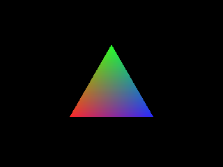

<!-- AUTOGENERATED COPYRIGHT HEADER START -->
<!-- Copyright (C) 2026 Claude <noreply@anthropic.com> -->
<!-- AUTOGENERATED COPYRIGHT HEADER END -->
<!-- Generated by tools/wiki/wiki.py. Edit tools/wiki/text/ instead of this file. -->
# Blitz3D: Surfaces

Vertices, triangles and surfaces of a mesh.


Back to [[Blitz3D]] or the [[Command-Index]].

| Command | Returns | Summary |
|---|---|---|
| [AddTriangle](Blitz3D-Surfaces#addtriangle) | Int | Joins three vertices of a surface into a triangle and returns the index of the triangle, which counts from 0. |
| [AddVertex](Blitz3D-Surfaces#addvertex) | Int | Adds a point to a surface and returns its index, which counts from 0 and is what [AddTriangle](Blitz3D-Surfaces#addtriangle) wants. |
| [ClearSurface](Blitz3D-Surfaces#clearsurface) | None | Removes the vertices, the triangles or both from a surface. |
| [CountSurfaces](Blitz3D-Surfaces#countsurfaces) | Int |  |
| [CountTriangles](Blitz3D-Surfaces#counttriangles) | Int |  |
| [CountVertices](Blitz3D-Surfaces#countvertices) | Int | Reports how many vertices a surface has. |
| [CreateSurface](Blitz3D-Surfaces#createsurface) | Int | Adds an empty surface to a mesh and returns its handle. |
| [FindSurface](Blitz3D-Surfaces#findsurface) | Int | Looks for the surface of a mesh that was painted with the given brush. |
| [GetSurface](Blitz3D-Surfaces#getsurface) | Int | Gets the handle of one surface of a mesh, which you need for every surface command. |
| [PaintSurface](Blitz3D-Surfaces#paintsurface) | None | Applies a brush to one surface: its color, texture, alpha, shininess, blend mode and effects. |
| [TriangleVertex](Blitz3D-Surfaces#trianglevertex) | Int | Tells which vertex is at a corner of a triangle, which is how you walk over the triangles of a mesh. |
| [UpdateNormals](Blitz3D-Surfaces#updatenormals) | None | Works out the normals of every vertex of a mesh from its triangles. |
| [VertexAlpha](Blitz3D-Surfaces#vertexalpha) | Float |  |
| [VertexBlue](Blitz3D-Surfaces#vertexblue) | Float |  |
| [VertexColor](Blitz3D-Surfaces#vertexcolor) | None | Sets the color of a vertex and its alpha. |
| [VertexCoords](Blitz3D-Surfaces#vertexcoords) | None | Moves an existing vertex to a new position in the space of the mesh. |
| [VertexGreen](Blitz3D-Surfaces#vertexgreen) | Float |  |
| [VertexNormal](Blitz3D-Surfaces#vertexnormal) | None | Sets the normal of a vertex: the direction it faces, which decides how light hits it. |
| [VertexNX](Blitz3D-Surfaces#vertexnx) | Float |  |
| [VertexNY](Blitz3D-Surfaces#vertexny) | Float |  |
| [VertexNZ](Blitz3D-Surfaces#vertexnz) | Float |  |
| [VertexRed](Blitz3D-Surfaces#vertexred) | Float |  |
| [VertexTexCoords](Blitz3D-Surfaces#vertextexcoords) | None | Sets which point of the texture a vertex shows. |
| [VertexU](Blitz3D-Surfaces#vertexu) | Float |  |
| [VertexV](Blitz3D-Surfaces#vertexv) | Float |  |
| [VertexW](Blitz3D-Surfaces#vertexw) | Float |  |
| [VertexX](Blitz3D-Surfaces#vertexx) | Float |  |
| [VertexY](Blitz3D-Surfaces#vertexy) | Float |  |
| [VertexZ](Blitz3D-Surfaces#vertexz) | Float |  |

### AddTriangle

```blitzbasic
AddTriangle surface%, v0%, v1%, v2%  ; returns Int
```

**Works in:** Blitz3D

Joins three vertices of a surface into a triangle and returns the index of the triangle, which counts from 0. A triangle is only drawn when seen from the side where its corners go clockwise, which is why the order matters: if your triangle does not show, swap two of its vertices, or draw both sides with the 16 flag of [EntityFX](Blitz3D-Entities#entityfx). The runtime stops with an error for a vertex index that does not exist.

```blitzbasic
Graphics3D 320, 240, 0, 2
SetBuffer BackBuffer()
camera = CreateCamera()
PositionEntity camera, 0, 0, -5
mesh = CreateMesh()
surf = CreateSurface(mesh)
a = AddVertex(surf, -2, -1, 0)
b = AddVertex(surf, -1, 1, 0)
c = AddVertex(surf, 0, -1, 0)
d = AddVertex(surf, 0.5, -1, 0)
e = AddVertex(surf, 1.5, 1, 0)
f = AddVertex(surf, 2.5, -1, 0)
; The left triangle goes clockwise as seen from the camera and is drawn.
AddTriangle surf, a, b, c
; The right one goes the other way around and is not.
AddTriangle surf, d, f, e
EntityFX mesh, 1
EntityColor mesh, 250, 200, 60
RenderWorld
Flip
WaitKey
```


| Parameter | Type | Default | Description |
|---|---|---|---|
| `surface` | Int | required | Surface handle. |
| `v0` | Int | required | Index of the first corner. |
| `v1` | Int | required | Index of the second corner. |
| `v2` | Int | required | Index of the third corner. |

**Returns:** The index of the new triangle, starting at 0.

### AddVertex

```blitzbasic
AddVertex surface%, x#, y#, z#, u#=0, v#=0, w#=1  ; returns Int
```

**Works in:** Blitz3D

Adds a point to a surface and returns its index, which counts from 0 and is what [AddTriangle](Blitz3D-Surfaces#addtriangle) wants. `x`, `y` and `z` are its position in the space of the mesh. `u` and `v` say which point of a texture lands on the vertex: 0, 0 is the top left of the texture and 1, 1 the bottom right, and values past 1 repeat the texture. The vertex starts with a white color and no normal, so call [UpdateNormals](Blitz3D-Surfaces#updatenormals) once the triangles exist, or lights will not shade the mesh.
Triangles that meet at a corner can share one vertex, which saves memory, but they then also share its normal, so edges look smooth. Add a vertex for each triangle to get a hard edge, like the corner of a cube.

| Parameter | Type | Default | Description |
|---|---|---|---|
| `surface` | Int | required | Surface handle. |
| `x` | Float | required | X position of the vertex. |
| `y` | Float | required | Y position of the vertex. |
| `z` | Float | required | Z position of the vertex. |
| `u` | Float | `0` | Horizontal texture coordinate. Defaults to 0. |
| `v` | Float | `0` | Vertical texture coordinate. Defaults to 0. |
| `w` | Float | `1` | Third texture coordinate, unused. Defaults to 1. |

**Returns:** The index of the new vertex, starting at 0.

**Differences and known gaps:**

* `w` is ignored.

### ClearSurface

```blitzbasic
ClearSurface surface%, clear_vertices%=1, clear_triangles%=1
```

**Works in:** Blitz3D

Removes the vertices, the triangles or both from a surface. The surface itself stays, ready to receive new geometry. Together with [AddVertex](Blitz3D-Surfaces#addvertex) this is the way to rebuild a mesh every frame or to switch to a different level of detail. If you remove only the vertices, remove the triangles as well, since they point at the vertices.

```blitzbasic
mesh = CreateMesh()
surf = CreateSurface(mesh)
a = AddVertex(surf, 0, 0, 0)
b = AddVertex(surf, 0, 1, 0)
c = AddVertex(surf, 1, 0, 0)
AddTriangle surf, a, b, c
Print CountVertices(surf) + " vertices, " + CountTriangles(surf) + " triangles"
ClearSurface surf
Print CountVertices(surf) + " vertices, " + CountTriangles(surf) + " triangles"
```

| Parameter | Type | Default | Description |
|---|---|---|---|
| `surface` | Int | required | Surface handle. |
| `clear_vertices` | Int | `1` | 1 to remove the vertices. Defaults to 1. |
| `clear_triangles` | Int | `1` | 1 to remove the triangles. Defaults to 1. |

### CountSurfaces

```blitzbasic
CountSurfaces mesh%  ; returns Int
```

**Works in:** Blitz3D

_Not documented yet._

| Parameter | Type | Default | Description |
|---|---|---|---|
| `mesh` | Int | required | Mesh handle. |

**Returns:** The number of surfaces in the mesh.

### CountTriangles

```blitzbasic
CountTriangles surface%  ; returns Int
```

**Works in:** Blitz3D

_Not documented yet._

| Parameter | Type | Default | Description |
|---|---|---|---|
| `surface` | Int | required | Surface handle. |

**Returns:** The number of triangles of the surface.

### CountVertices

```blitzbasic
CountVertices surface%  ; returns Int
```

**Works in:** Blitz3D

Reports how many vertices a surface has. Vertex indexes run from 0 to one less than this number, so it is the upper bound of a loop over all vertices.

| Parameter | Type | Default | Description |
|---|---|---|---|
| `surface` | Int | required | Surface handle. |

**Returns:** The number of vertices of the surface.

### CreateSurface

```blitzbasic
CreateSurface mesh%, brush%=0  ; returns Int
```

**Works in:** Blitz3D

Adds an empty surface to a mesh and returns its handle. A mesh is a list of surfaces, and every surface is one batch of triangles that shares a material: color, texture and so on. Use one surface per material and put all triangles with that material into it, since each surface costs a draw call. Fill the surface with [AddVertex](Blitz3D-Surfaces#addvertex) and [AddTriangle](Blitz3D-Surfaces#addtriangle).
A `brush` paints the surface right away, see [PaintSurface](Blitz3D-Surfaces#paintsurface).

```blitzbasic
Graphics3D 320, 240, 0, 2
SetBuffer BackBuffer()
camera = CreateCamera()
PositionEntity camera, 0, 0, -5
light = CreateLight()
RotateEntity light, 20, 20, 0
mesh = CreateMesh()
; Two surfaces in one mesh, each painted with its own brush.
red = CreateBrush(255, 80, 80)
blue = CreateBrush(80, 120, 255)
left = CreateSurface(mesh, red)
right = CreateSurface(mesh, blue)
For i = 0 To 1
	If i = 0 Then s = left Else s = right
	x = i * 2.2 - 2.0
	a = AddVertex(s, x, -1, 0)
	b = AddVertex(s, x, 1, 0)
	c = AddVertex(s, x + 1.8, 1, 0)
	d = AddVertex(s, x + 1.8, -1, 0)
	AddTriangle s, a, b, c
	AddTriangle s, a, c, d
Next
UpdateNormals mesh
RenderWorld
Flip
WaitKey
```


| Parameter | Type | Default | Description |
|---|---|---|---|
| `mesh` | Int | required | Mesh handle. |
| `brush` | Int | `0` | Brush that paints the new surface, or 0 for none. Defaults to 0. |

**Returns:** The handle of the new surface.

### FindSurface

```blitzbasic
FindSurface mesh%, brush%  ; returns Int
```

**Works in:** Blitz3D

Looks for the surface of a mesh that was painted with the given brush. Returns its handle, or 0 if no surface of the mesh has that brush. Use it to add geometry to an existing surface instead of creating a new one every time.

| Parameter | Type | Default | Description |
|---|---|---|---|
| `mesh` | Int | required | Mesh handle. |
| `brush` | Int | required | Brush handle to look for. |

**Returns:** The handle of the surface, or 0 if there is none.

### GetSurface

```blitzbasic
GetSurface mesh%, surface_index%  ; returns Int
```

**Works in:** Blitz3D

Gets the handle of one surface of a mesh, which you need for every surface command. The index starts at 1, so visit all surfaces with a loop from 1 to [CountSurfaces](Blitz3D-Surfaces#countsurfaces). This is also how you reach the surfaces of a mesh you loaded or of a primitive such as a cube.

```blitzbasic
mesh = CreateCube()
For i = 1 To CountSurfaces(mesh)
	surf = GetSurface(mesh, i)
	Print "surface " + i + ": " + CountVertices(surf) + " vertices, " + CountTriangles(surf) + " triangles"
Next
```

| Parameter | Type | Default | Description |
|---|---|---|---|
| `mesh` | Int | required | Mesh handle. |
| `surface_index` | Int | required | Number of the surface, 1 up to the number of surfaces. |

**Returns:** The handle of the surface.

### PaintSurface

```blitzbasic
PaintSurface surface%, brush%
```

**Works in:** Blitz3D

Applies a brush to one surface: its color, texture, alpha, shininess, blend mode and effects. Unlike [PaintMesh](Blitz3D-Meshes#paintmesh) the other surfaces of the mesh stay as they are, so you can give each part of a model a different look.

| Parameter | Type | Default | Description |
|---|---|---|---|
| `surface` | Int | required | Surface handle. |
| `brush` | Int | required | Brush handle. |

### TriangleVertex

```blitzbasic
TriangleVertex surface%, index%, vertex%  ; returns Int
```

**Works in:** Blitz3D

Tells which vertex is at a corner of a triangle, which is how you walk over the triangles of a mesh. Corners are 0, 1 and 2, in the order the triangle was added with.

| Parameter | Type | Default | Description |
|---|---|---|---|
| `surface` | Int | required | Surface handle. |
| `index` | Int | required |  |
| `vertex` | Int | required |  |

**Returns:** The index of the vertex.

### UpdateNormals

```blitzbasic
UpdateNormals mesh%
```

**Works in:** Blitz3D

Works out the normals of every vertex of a mesh from its triangles. A normal tells lights which way a surface faces, so without it a mesh built from code is lit wrongly or not at all. Call it after adding vertices and triangles and again after you moved vertices. Shared vertices get the average of the triangles around them, which makes round shapes look smooth.

```blitzbasic
Graphics3D 320, 240, 0, 2
SetBuffer BackBuffer()
camera = CreateCamera()
PositionEntity camera, 0, 7, -9
RotateEntity camera, 38, 0, 0
light = CreateLight()
RotateEntity light, 40, 60, 0
; A bumpy field, built from a grid of 12 by 12 vertices.
mesh = CreateMesh()
surf = CreateSurface(mesh)
For z = 0 To 11
	For x = 0 To 11
		AddVertex surf, x - 5.5, Sin(x * 40) * Cos(z * 40) * 0.6, z - 5.5
	Next
Next
For z = 0 To 10
	For x = 0 To 10
		i = z * 12 + x
		AddTriangle surf, i, i + 12, i + 1
		AddTriangle surf, i + 1, i + 12, i + 13
	Next
Next
UpdateNormals mesh
EntityColor mesh, 120, 200, 120
RenderWorld
Flip
WaitKey
```


| Parameter | Type | Default | Description |
|---|---|---|---|
| `mesh` | Int | required | Mesh handle. |

### VertexAlpha

```blitzbasic
VertexAlpha surface%, index%  ; returns Float
```

**Works in:** Blitz3D

_Not documented yet._

| Parameter | Type | Default | Description |
|---|---|---|---|
| `surface` | Int | required | Surface handle. |
| `index` | Int | required | Index of the vertex, from 0. |

**Returns:** The alpha of the vertex color, 0 for invisible to 1 for solid.

### VertexBlue

```blitzbasic
VertexBlue surface%, index%  ; returns Float
```

**Works in:** Blitz3D

_Not documented yet._

| Parameter | Type | Default | Description |
|---|---|---|---|
| `surface` | Int | required | Surface handle. |
| `index` | Int | required | Index of the vertex, from 0. |

**Returns:** The blue part of the vertex color, 0 to 255.

### VertexColor

```blitzbasic
VertexColor surface%, index%, red#, green#, blue#, alpha#=1
```

**Works in:** Blitz3D

Sets the color of a vertex and its alpha. The color is blended smoothly across each triangle between its three vertices, which gives gradients and cheap baked lighting. It is multiplied with the entity color. Colors go from 0 to 255 and the alpha from 0, invisible, to 1, solid. Alpha per vertex needs `EntityFX 32` on the entity in the original.

```blitzbasic
Graphics3D 320, 240, 0, 2
SetBuffer BackBuffer()
camera = CreateCamera()
PositionEntity camera, 0, 0, -4
mesh = CreateMesh()
surf = CreateSurface(mesh)
a = AddVertex(surf, -1.5, -1.2, 0)
b = AddVertex(surf, 0, 1.4, 0)
c = AddVertex(surf, 1.5, -1.2, 0)
AddTriangle surf, a, b, c
VertexColor surf, a, 255, 40, 40
VertexColor surf, b, 40, 255, 40
VertexColor surf, c, 40, 40, 255
; Show the vertex colors without light.
EntityFX mesh, 1 + 2
RenderWorld
Flip
WaitKey
```



| Parameter | Type | Default | Description |
|---|---|---|---|
| `surface` | Int | required | Surface handle. |
| `index` | Int | required | Index of the vertex, from 0. |
| `red` | Float | required | Red part, 0 to 255. |
| `green` | Float | required | Green part, 0 to 255. |
| `blue` | Float | required | Blue part, 0 to 255. |
| `alpha` | Float | `1` | Opacity, 0 to 1. Defaults to 1. |

### VertexCoords

```blitzbasic
VertexCoords surface%, index%, x#, y#, z#
```

**Works in:** Blitz3D

Moves an existing vertex to a new position in the space of the mesh. Every triangle that uses the vertex follows, so changing vertices every frame deforms a mesh: waves on water, a flag in the wind or a dent in a car. Call [UpdateNormals](Blitz3D-Surfaces#updatenormals) afterwards if the lighting should follow the new shape.

```blitzbasic
Graphics3D 320, 240, 0, 2
SetBuffer BackBuffer()
camera = CreateCamera()
PositionEntity camera, 0, 6, -7
RotateEntity camera, 38, 0, 0
light = CreateLight()
RotateEntity light, 40, 60, 0
mesh = CreateMesh()
surf = CreateSurface(mesh)
For z = 0 To 15
	For x = 0 To 15
		AddVertex surf, x * 0.5 - 3.75, 0, z * 0.5 - 3.75
	Next
Next
For z = 0 To 14
	For x = 0 To 14
		i = z * 16 + x
		AddTriangle surf, i, i + 16, i + 1
		AddTriangle surf, i + 1, i + 16, i + 17
	Next
Next
EntityColor mesh, 80, 150, 230
t = 0
While Not KeyHit(1)
	t = t + 12
	For i = 0 To CountVertices(surf) - 1
		VertexCoords surf, i, VertexX(surf, i), Sin(t + VertexX(surf, i) * 90) * 0.4, VertexZ(surf, i)
	Next
	UpdateNormals mesh
	RenderWorld
	Flip
Wend
```


| Parameter | Type | Default | Description |
|---|---|---|---|
| `surface` | Int | required | Surface handle. |
| `index` | Int | required | Index of the vertex, from 0. |
| `x` | Float | required | New X position. |
| `y` | Float | required | New Y position. |
| `z` | Float | required | New Z position. |

### VertexGreen

```blitzbasic
VertexGreen surface%, index%  ; returns Float
```

**Works in:** Blitz3D

_Not documented yet._

| Parameter | Type | Default | Description |
|---|---|---|---|
| `surface` | Int | required | Surface handle. |
| `index` | Int | required | Index of the vertex, from 0. |

**Returns:** The green part of the vertex color, 0 to 255.

### VertexNormal

```blitzbasic
VertexNormal surface%, index%, nx#, ny#, nz#
```

**Works in:** Blitz3D

Sets the normal of a vertex: the direction it faces, which decides how light hits it. The normal should have a length of 1. Set it yourself for hard control over shading, for example to make a flat quad look rounded. [UpdateNormals](Blitz3D-Surfaces#updatenormals) overwrites all normals of a mesh.

| Parameter | Type | Default | Description |
|---|---|---|---|
| `surface` | Int | required | Surface handle. |
| `index` | Int | required | Index of the vertex, from 0. |
| `nx` | Float | required | X part of the normal. |
| `ny` | Float | required | Y part of the normal. |
| `nz` | Float | required | Z part of the normal. |

### VertexNX

```blitzbasic
VertexNX surface%, index%  ; returns Float
```

**Works in:** Blitz3D

_Not documented yet._

| Parameter | Type | Default | Description |
|---|---|---|---|
| `surface` | Int | required | Surface handle. |
| `index` | Int | required | Index of the vertex, from 0. |

**Returns:** The X part of the normal of the vertex.

### VertexNY

```blitzbasic
VertexNY surface%, index%  ; returns Float
```

**Works in:** Blitz3D

_Not documented yet._

| Parameter | Type | Default | Description |
|---|---|---|---|
| `surface` | Int | required | Surface handle. |
| `index` | Int | required | Index of the vertex, from 0. |

**Returns:** The Y part of the normal of the vertex.

### VertexNZ

```blitzbasic
VertexNZ surface%, index%  ; returns Float
```

**Works in:** Blitz3D

_Not documented yet._

| Parameter | Type | Default | Description |
|---|---|---|---|
| `surface` | Int | required | Surface handle. |
| `index` | Int | required | Index of the vertex, from 0. |

**Returns:** The Z part of the normal of the vertex.

### VertexRed

```blitzbasic
VertexRed surface%, index%  ; returns Float
```

**Works in:** Blitz3D

_Not documented yet._

| Parameter | Type | Default | Description |
|---|---|---|---|
| `surface` | Int | required | Surface handle. |
| `index` | Int | required | Index of the vertex, from 0. |

**Returns:** The red part of the vertex color, 0 to 255.

### VertexTexCoords

```blitzbasic
VertexTexCoords surface%, index%, u#, v#, w#=1, coord_set%=0
```

**Works in:** Blitz3D

Sets which point of the texture a vertex shows. 0, 0 is the top left of the texture and 1, 1 is the bottom right. Values above 1 repeat the texture, so a quad with the coordinates 0 to 3 shows the texture three times in each direction. A second set of coordinates, picked with `coord_set` 1, is used by the second texture layer in the original, for example for light maps.

```blitzbasic
Graphics3D 320, 240, 0, 2
SetBuffer BackBuffer()
camera = CreateCamera()
PositionEntity camera, 0, 0, -4
tex = CreateTexture(32, 32)
SetBuffer TextureBuffer(tex)
Color 230, 230, 230
Rect 0, 0, 32, 32, 1
Color 220, 60, 60
Rect 0, 0, 16, 16, 1
Color 60, 90, 220
Rect 16, 16, 16, 16, 1
SetBuffer BackBuffer()
mesh = CreateMesh()
surf = CreateSurface(mesh)
a = AddVertex(surf, -1.5, -1.5, 0)
b = AddVertex(surf, -1.5, 1.5, 0)
c = AddVertex(surf, 1.5, 1.5, 0)
d = AddVertex(surf, 1.5, -1.5, 0)
AddTriangle surf, a, b, c
AddTriangle surf, a, c, d
; The texture is shown 3 times in each direction.
VertexTexCoords surf, a, 0, 3
VertexTexCoords surf, b, 0, 0
VertexTexCoords surf, c, 3, 0
VertexTexCoords surf, d, 3, 3
EntityTexture mesh, tex
EntityFX mesh, 1
RenderWorld
Flip
WaitKey
```


| Parameter | Type | Default | Description |
|---|---|---|---|
| `surface` | Int | required | Surface handle. |
| `index` | Int | required | Index of the vertex, from 0. |
| `u` | Float | required | Horizontal texture coordinate. |
| `v` | Float | required | Vertical texture coordinate. |
| `w` | Float | `1` | Third coordinate, unused. Defaults to 1. |
| `coord_set` | Int | `0` | Set of coordinates, 0 or 1. Defaults to 0. |

**Differences and known gaps:**

* `w` is ignored.

### VertexU

```blitzbasic
VertexU surface%, index%, coord_set%=0  ; returns Float
```

**Works in:** Blitz3D

_Not documented yet._

| Parameter | Type | Default | Description |
|---|---|---|---|
| `surface` | Int | required | Surface handle. |
| `index` | Int | required | Index of the vertex, from 0. |
| `coord_set` | Int | `0` | Set of coordinates, 0 or 1. Defaults to 0. |

**Returns:** The horizontal texture coordinate of the vertex.

### VertexV

```blitzbasic
VertexV surface%, index%, coord_set%=0  ; returns Float
```

**Works in:** Blitz3D

_Not documented yet._

| Parameter | Type | Default | Description |
|---|---|---|---|
| `surface` | Int | required | Surface handle. |
| `index` | Int | required | Index of the vertex, from 0. |
| `coord_set` | Int | `0` | Set of coordinates, 0 or 1. Defaults to 0. |

**Returns:** The vertical texture coordinate of the vertex.

### VertexW

```blitzbasic
VertexW surface%, index%, coord_set%=0  ; returns Float
```

**Works in:** Blitz3D

_Not documented yet._

| Parameter | Type | Default | Description |
|---|---|---|---|
| `surface` | Int | required | Surface handle. |
| `index` | Int | required | Index of the vertex, from 0. |
| `coord_set` | Int | `0` | Set of coordinates, 0 or 1. Defaults to 0. |

**Returns:** The third texture coordinate of the vertex, a value that is reserved for later use and does nothing in rendering.

**Differences and known gaps:**

* The value is not stored: this always returns 1.

### VertexX

```blitzbasic
VertexX surface%, index%  ; returns Float
```

**Works in:** Blitz3D

_Not documented yet._

| Parameter | Type | Default | Description |
|---|---|---|---|
| `surface` | Int | required | Surface handle. |
| `index` | Int | required | Index of the vertex, from 0. |

**Returns:** The X position of the vertex in the space of the mesh, not affected by the entity's position or scale.

### VertexY

```blitzbasic
VertexY surface%, index%  ; returns Float
```

**Works in:** Blitz3D

_Not documented yet._

| Parameter | Type | Default | Description |
|---|---|---|---|
| `surface` | Int | required | Surface handle. |
| `index` | Int | required | Index of the vertex, from 0. |

**Returns:** The Y position of the vertex in the space of the mesh, not affected by the entity's position or scale.

### VertexZ

```blitzbasic
VertexZ surface%, index%  ; returns Float
```

**Works in:** Blitz3D

_Not documented yet._

| Parameter | Type | Default | Description |
|---|---|---|---|
| `surface` | Int | required | Surface handle. |
| `index` | Int | required | Index of the vertex, from 0. |

**Returns:** The Z position of the vertex in the space of the mesh, not affected by the entity's position or scale.
