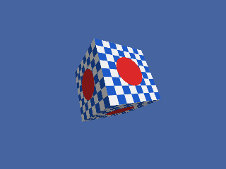
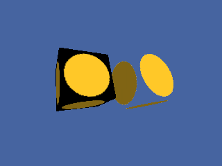

<!-- AUTOGENERATED COPYRIGHT HEADER START -->
<!-- Copyright (C) 2026 Claude <noreply@anthropic.com> -->
<!-- AUTOGENERATED COPYRIGHT HEADER END -->
<!-- Generated by tools/wiki/wiki.py. Edit tools/wiki/text/ instead of this file. -->
# Blitz3D: Textures

Creating, loading, transforming and filtering textures.


Back to [[Blitz3D]] or the [[Command-Index]].

| Command | Returns | Summary |
|---|---|---|
| [ClearTextureFilters](Blitz3D-Textures#cleartexturefilters) | None | Removes every rule that was added with [TextureFilter](Blitz3D-Textures#texturefilter). |
| [CreateTexture](Blitz3D-Textures#createtexture) | Int | Makes an empty texture of the given size and returns its handle. |
| [FreeTexture](Blitz3D-Textures#freetexture) | None | Releases a texture and its memory. |
| [LoadAnimTexture](Blitz3D-Textures#loadanimtexture) | Int | Loads one picture that holds several frames laid out left to right, top to bottom, and returns a texture that can show any of them. |
| [LoadTexture](Blitz3D-Textures#loadtexture) | Int | Loads a picture file as a texture and returns its handle, or 0 if the file cannot be read. |
| [PositionTexture](Blitz3D-Textures#positiontexture) | None | Moves the texture coordinates by an absolute offset. |
| [RotateTexture](Blitz3D-Textures#rotatetexture) | None | Turns the texture coordinates by an absolute angle in degrees. |
| [ScaleTexture](Blitz3D-Textures#scaletexture) | None | Sets how large the texture appears on a surface. |
| [SetCubeFace](Blitz3D-Textures#setcubeface) | None | Chooses which of the six faces of a cube map the next drawing on the texture buffer goes to: 0 left, 1 forward, 2 right, 3 backward, 4 up, 5 down. |
| [SetCubeMode](Blitz3D-Textures#setcubemode) | None | Selects how a cube map reflects light: 1 specular (shiny), 2 diffuse, 3 refraction. |
| [TextureBlend](Blitz3D-Textures#textureblend) | None | Chooses how this texture combines with what lies below it. |
| [TextureBuffer](Blitz3D-Textures#texturebuffer) | Int | Returns a buffer handle for the texture so that the normal 2D drawing commands can paint into it: pass it to [SetBuffer](BlitzBasic-Buffers-and-Pixels#setbuffer). |
| [TextureCoords](Blitz3D-Textures#texturecoords) | None | Chooses which set of texture coordinates of the mesh the texture reads: 0 for the first set, 1 for the second. |
| [TextureFilter](Blitz3D-Textures#texturefilter) | None | Adds a rule: every texture loaded afterwards whose file name contains the given text gets the extra flags. |
| [TextureHeight](Blitz3D-Textures#textureheight) | Int |  |
| [TextureName](Blitz3D-Textures#texturename) | String | Tells you which file the texture was loaded from, which is handy after loading a mesh that brings its own textures. |
| [TextureWidth](Blitz3D-Textures#texturewidth) | Int |  |

### ClearTextureFilters

```blitzbasic
ClearTextureFilters
```

**Works in:** Blitz3D

Removes every rule that was added with [TextureFilter](Blitz3D-Textures#texturefilter). Textures loaded after this call only get the flags you pass.

**Differences and known gaps:**

* Because the default rule is not installed here, there is nothing to restore after a graphics mode change, as the original does.

### CreateTexture

```blitzbasic
CreateTexture width%, height%, flags%=0, frames%=1  ; returns Int
```

**Works in:** Blitz3D

Makes an empty texture of the given size and returns its handle. Fill it by drawing on its buffer: call [SetBuffer](BlitzBasic-Buffers-and-Pixels#setbuffer) with [TextureBuffer](Blitz3D-Textures#texturebuffer) and use the normal 2D commands, then switch back to the back buffer and put the texture on something with [EntityTexture](Blitz3D-Entities#entitytexture) or a brush.

The flags are added together, so `1 + 2` is a color texture that also has an alpha channel:

| Flag | Meaning |
|---|---|
| 1 | Color, the default. |
| 2 | Alpha. Dark texels are see-through, bright texels are solid. |
| 4 | Masked. Texels that are exactly black are not drawn. |
| 8 | Mipmapped. Distant surfaces use smaller, blurrier copies. |
| 16 | Clamp U. Coordinates outside 0 to 1 repeat the edge texel instead of tiling. |
| 32 | Clamp V. The same for the vertical direction. |
| 64 | Spherical environment map. |
| 128 | Cubic environment map. |
| 256 | Keep the texture in video memory. |
| 512 | Use a high color format even in low color modes. |
| 1024 | Point sampling: no smoothing between texels. |

The texture is created at the size you ask for, so [TextureWidth](Blitz3D-Textures#texturewidth) and [TextureHeight](Blitz3D-Textures#textureheight) return exactly what you passed. Power-of-two sizes are the safest choice for other Blitz3D implementations.

```blitzbasic
Graphics3D 320, 240, 0, 2
SetBuffer BackBuffer()
camera = CreateCamera()
CameraClsColor camera, 70, 100, 160
light = CreateLight()
RotateEntity light, 40, 30, 0
cube = CreateCube()
PositionEntity cube, 0, 0, 4.2
TurnEntity cube, 25, 35, 0

tex = CreateTexture(128, 128)
SetBuffer TextureBuffer(tex)
ClsColor 240, 240, 240
Cls
Color 30, 90, 200
For y = 0 To 7
	For x = 0 To 7
		If (x + y) Mod 2 = 0 Then Rect x * 16, y * 16, 16, 16, 1
	Next
Next
Color 220, 40, 40
Oval 32, 32, 64, 64, 1

SetBuffer BackBuffer()
EntityTexture cube, tex
RenderWorld
Flip
WaitKey
```



| Parameter | Type | Default | Description |
|---|---|---|---|
| `width` | Int | required | Width in pixels. |
| `height` | Int | required | Height in pixels. |
| `flags` | Int | `0` | Sum of the flags above. Defaults to 1. |
| `frames` | Int | `1` | Number of animation frames. Defaults to 1. |

**Returns:** A texture handle.

**Differences and known gaps:**

* Only flags 2, 4, 16 and 32 change how the texture looks. Mipmapping (8), environment maps (64 and 128), video memory (256), high color (512) and point sampling (1024) are accepted and stored, but the texture is always drawn with linear filtering and no mipmaps.
* The frames argument is accepted, but the texture always has a single frame.
* The alpha (2) and masked (4) flags are only applied to pictures that LoadTexture or LoadAnimTexture read from a file. A texture made with CreateTexture and drawn on stays opaque everywhere, including where you drew black.

### FreeTexture

```blitzbasic
FreeTexture texture%
```

**Works in:** Blitz3D

Releases a texture and its memory. In the original, entities that were already painted with the texture keep showing it; only the handle becomes unusable. Do not use the handle itself after freeing it.

Textures are also freed by [ClearWorld](Blitz3D-World#clearworld) and when the program ends, but freeing the ones you no longer need keeps memory use down.

| Parameter | Type | Default | Description |
|---|---|---|---|
| `texture` | Int | required | The texture to free. |

**Differences and known gaps:**

* After FreeTexture the image is really gone: entities and brushes that used the texture are drawn plain white instead of keeping it. Free a texture only when nothing uses it any more.

### LoadAnimTexture

```blitzbasic
LoadAnimTexture file$, flags%, width%, height%, first%, count%  ; returns Int
```

**Works in:** Blitz3D

Loads one picture that holds several frames laid out left to right, top to bottom, and returns a texture that can show any of them. Choose the frame to show with the frame argument of [EntityTexture](Blitz3D-Entities#entitytexture), [BrushTexture](Blitz3D-Brushes#brushtexture) or [TextureBuffer](Blitz3D-Textures#texturebuffer). The flags are the same as for [CreateTexture](Blitz3D-Textures#createtexture).

`first_frame` is the cell that counts as frame 0, and `frame_count` is how many cells are used from there. A sheet 256 pixels wide with 64 pixel frames has four cells per row, so cell 5 is the second cell of the second row.

```blitzbasic
Graphics3D 320, 240, 0, 2
SetBuffer BackBuffer()
camera = CreateCamera()
CameraClsColor camera, 70, 100, 160
light = CreateLight()
RotateEntity light, 40, 30, 0
cube = CreateCube()
PositionEntity cube, 0, 0, 4.2
TurnEntity cube, 20, 30, 0

; Draw a sheet of 4 frames, 64 pixels each, and keep it in a file.
sheet = CreateTexture(256, 64)
SetBuffer TextureBuffer(sheet)
ClsColor 0, 0, 0
Cls
For f = 0 To 3
	Color 40 + f * 60, 200 - f * 40, 80
	Rect f * 64 + 4, 4, 56, 56, 1
	Color 255, 255, 255
	Text f * 64 + 32, 32, Str(f), 1, 1
Next
SaveBuffer TextureBuffer(sheet), "wiki_sheet.bmp"
SetBuffer BackBuffer()
FreeTexture sheet

anim = LoadAnimTexture("wiki_sheet.bmp", 1, 64, 64, 0, 4)
For i = 0 To 39
	EntityTexture cube, anim, (i / 10) Mod 4
	TurnEntity cube, 0, 2, 0
	RenderWorld
	Flip
Next
```


| Parameter | Type | Default | Description |
|---|---|---|---|
| `file` | String | required | Picture file that contains all frames. |
| `flags` | Int | required | Texture flags, see CreateTexture. |
| `width` | Int | required |  |
| `height` | Int | required |  |
| `first` | Int | required |  |
| `count` | Int | required |  |

**Returns:** A texture handle, or 0 if the file could not be loaded.

**Differences and known gaps:**

* Frame sizes or counts that do not fit into the picture stop the program with a runtime error here. The original does not check this and only returns 0 when the file cannot be loaded.
* TextureWidth and TextureHeight report the size of one frame, not of the whole sheet.

### LoadTexture

```blitzbasic
LoadTexture file$, flags%=1  ; returns Int
```

**Works in:** Blitz3D

Loads a picture file as a texture and returns its handle, or 0 if the file cannot be read. PNG, JPG, BMP and TGA are supported, and so are the other formats SDL_image reads. Loading the same file twice gives two separate textures.

How transparency is taken from the file depends on the flags. Without flag 2 the picture is opaque even if the file has an alpha channel. With flag 2 an existing alpha channel is used, and a picture without one gets its alpha from how bright each texel is. Flag 4 makes every pure black texel transparent and everything else opaque.

Textures that [TextureFilter](Blitz3D-Textures#texturefilter) matches by file name get extra flags added.

```blitzbasic
Graphics3D 320, 240, 0, 2
SetBuffer BackBuffer()
camera = CreateCamera()
CameraClsColor camera, 70, 100, 160
light = CreateLight()
RotateEntity light, 40, 30, 0

; Make a file with a white disc on black, then load it back as a masked texture.
src = CreateTexture(64, 64)
SetBuffer TextureBuffer(src)
ClsColor 0, 0, 0
Cls
Color 255, 200, 40
Oval 4, 4, 56, 56, 1
SaveBuffer TextureBuffer(src), "wiki_disc.bmp"
SetBuffer BackBuffer()

solid = LoadTexture("wiki_disc.bmp", 1)
masked = LoadTexture("wiki_disc.bmp", 1 + 4)
a = CreateCube() : PositionEntity a, -1.3, 0, 5 : EntityTexture a, solid
b = CreateCube() : PositionEntity b, 1.3, 0, 5 : EntityTexture b, masked
TurnEntity a, 20, 30, 0
TurnEntity b, 20, 30, 0
RenderWorld
Flip
WaitKey
```



| Parameter | Type | Default | Description |
|---|---|---|---|
| `file` | String | required | Picture file to load. |
| `flags` | Int | `1` | Sum of the texture flags, see CreateTexture. Defaults to 1. |

**Returns:** A texture handle, or 0 if the file could not be loaded.

**Differences and known gaps:**

* The built-in default filter of the original, `TextureFilter "", 1 + 8`, is not installed, so loaded textures only have the flags you pass or that a filter you added contributes.
* Mipmapping , environment map, video memory, high color and point sampling flags are stored but have no effect, see CreateTexture.

### PositionTexture

```blitzbasic
PositionTexture texture%, u_offset#, v_offset#
```

**Works in:** Blitz3D

Moves the texture coordinates by an absolute offset. The image appears to slide across the surface, which is how scrolling water or conveyor belts are done. The offset is a fraction of the texture: 1 moves it by one full repeat, which looks the same as 0. Every entity that uses the texture changes at once.

```blitzbasic
Graphics3D 320, 240, 0, 2
SetBuffer BackBuffer()
camera = CreateCamera()
CameraClsColor camera, 70, 100, 160
light = CreateLight()
plane = CreateCube()
ScaleEntity plane, 2.2, 1.2, 0.05
PositionEntity plane, 0, 0, 4

tex = CreateTexture(64, 64)
SetBuffer TextureBuffer(tex)
ClsColor 30, 120, 200
Cls
Color 255, 255, 255
For i = 0 To 3
	Rect i * 16 + 4, 0, 8, 64, 1
Next
SetBuffer BackBuffer()
EntityTexture plane, tex
For i = 0 To 39
	PositionTexture tex, i / 40.0, 0
	RenderWorld
	Flip
Next
```


| Parameter | Type | Default | Description |
|---|---|---|---|
| `texture` | Int | required | The texture to move. |
| `u_offset` | Float | required |  |
| `v_offset` | Float | required |  |

### RotateTexture

```blitzbasic
RotateTexture texture%, angle#
```

**Works in:** Blitz3D

Turns the texture coordinates by an absolute angle in degrees. Meant for swirling effects such as smoke.

| Parameter | Type | Default | Description |
|---|---|---|---|
| `texture` | Int | required | The texture to turn. |
| `angle` | Float | required | Angle in degrees. |

**Differences and known gaps:**

* RotateTexture is accepted and checks that the texture exists, but it does nothing. The texture is never rotated.

### ScaleTexture

```blitzbasic
ScaleTexture texture%, u_scale#, v_scale#
```

**Works in:** Blitz3D

Sets how large the texture appears on a surface. Values above 1 enlarge the image, so it repeats less often; values below 1 shrink it, so it repeats more often. The call replaces the previous scale, and every entity that uses the texture is affected at once.

```blitzbasic
Graphics3D 320, 240, 0, 2
SetBuffer BackBuffer()
camera = CreateCamera()
CameraClsColor camera, 70, 100, 160
light = CreateLight()
RotateEntity light, 40, 30, 0

tex = CreateTexture(64, 64)
SetBuffer TextureBuffer(tex)
ClsColor 240, 240, 240
Cls
Color 200, 50, 50
Rect 0, 0, 32, 32, 1
Rect 32, 32, 32, 32, 1
SetBuffer BackBuffer()

a = CreateCube() : PositionEntity a, -1.4, 0, 5 : TurnEntity a, 20, 30, 0
b = CreateCube() : PositionEntity b, 1.4, 0, 5 : TurnEntity b, 20, 30, 0
EntityTexture a, tex
tex2 = CreateTexture(64, 64)
SetBuffer TextureBuffer(tex2)
ClsColor 240, 240, 240
Cls
Color 200, 50, 50
Rect 0, 0, 32, 32, 1
Rect 32, 32, 32, 32, 1
SetBuffer BackBuffer()
ScaleTexture tex2, 0.25, 0.25
EntityTexture b, tex2
RenderWorld
Flip
WaitKey
```


| Parameter | Type | Default | Description |
|---|---|---|---|
| `texture` | Int | required | The texture to scale. |
| `u_scale` | Float | required | Horizontal size factor. 1 is unchanged, 2 is twice as wide. |
| `v_scale` | Float | required | Vertical size factor. |

### SetCubeFace

```blitzbasic
SetCubeFace texture%, face%
```

**Works in:** Blitz3D

Chooses which of the six faces of a cube map the next drawing on the texture buffer goes to: 0 left, 1 forward, 2 right, 3 backward, 4 up, 5 down. It is only useful for textures made with the cube map flag (128).

| Parameter | Type | Default | Description |
|---|---|---|---|
| `texture` | Int | required | The cube map texture. |
| `face` | Int | required | Face number, 0 to 5. The default is 1. |

**Differences and known gaps:**

* Cube maps are not implemented. The call checks the texture handle and then does nothing, so drawing always goes to the single image.

### SetCubeMode

```blitzbasic
SetCubeMode texture%, mode%
```

**Works in:** Blitz3D

Selects how a cube map reflects light: 1 specular (shiny), 2 diffuse, 3 refraction. The original help calls this command undocumented.

| Parameter | Type | Default | Description |
|---|---|---|---|
| `texture` | Int | required | The cube map texture. |
| `mode` | Int | required | 1, 2 or 3. The default is 1. |

**Differences and known gaps:**

* Cube maps are not implemented. The call checks the texture handle and has no other effect.

### TextureBlend

```blitzbasic
TextureBlend texture%, blend%
```

**Works in:** Blitz3D

Chooses how this texture combines with what lies below it. A texture on layer 0 blends with the surface itself, a texture on layer 1 blends with layer 0, and so on up to layer 7. Layers are set with the index argument of [EntityTexture](Blitz3D-Entities#entitytexture) or [BrushTexture](Blitz3D-Brushes#brushtexture).

| Blend | Result |
|---|---|
| 0 | No blending. |
| 1 | Alpha: uses the alpha of the texture. |
| 2 | Multiply, the default. |
| 3 | Add. |
| 4 | Dot3 bump mapping. |
| 5 | Multiply twice as bright (x2). |

```blitzbasic
Graphics3D 320, 240, 0, 2
SetBuffer BackBuffer()
camera = CreateCamera()
CameraClsColor camera, 70, 100, 160
light = CreateLight()
RotateEntity light, 40, 30, 0

base = CreateTexture(64, 64)
SetBuffer TextureBuffer(base)
ClsColor 230, 200, 120
Cls
Color 160, 120, 40
For i = 0 To 63 Step 16
	Rect 0, i, 64, 8, 1
Next
over = CreateTexture(64, 64)
SetBuffer TextureBuffer(over)
ClsColor 60, 60, 60
Cls
Color 255, 255, 255
Oval 8, 8, 48, 48, 1
SetBuffer BackBuffer()
TextureBlend over, 3

cube = CreateCube() : PositionEntity cube, 0, 0, 4.4 : TurnEntity cube, 25, 35, 0
EntityTexture cube, base, 0, 0
EntityTexture cube, over, 0, 1
RenderWorld
Flip
WaitKey
```


| Parameter | Type | Default | Description |
|---|---|---|---|
| `texture` | Int | required | The texture to change. |
| `blend` | Int | required | Blend mode from the table above. |

**Differences and known gaps:**

* Modes 1, 2, 3 and 5 are drawn on layers above the first. Mode 0 and mode 4 (Dot3) are drawn like mode 2, because there is no bump mapping. Layer 0 is blended by the entity or brush blend mode, not by TextureBlend.

### TextureBuffer

```blitzbasic
TextureBuffer texture%, frame%=0  ; returns Int
```

**Works in:** Blitz3D

Returns a buffer handle for the texture so that the normal 2D drawing commands can paint into it: pass it to [SetBuffer](BlitzBasic-Buffers-and-Pixels#setbuffer). To get 3D into a texture, render to the back buffer and copy it across with [CopyRect](BlitzBasic-Buffers-and-Pixels#copyrect); 3D cannot be rendered straight into a texture buffer. Drawing on an image first and copying it over is usually faster than many small drawing calls.

Remember to set the buffer back to [BackBuffer](BlitzBasic-Buffers-and-Pixels#backbuffer) before you render the world or flip.

| Parameter | Type | Default | Description |
|---|---|---|---|
| `texture` | Int | required | The texture. |
| `frame` | Int | `0` | Frame of an animated texture. Defaults to 0. |

**Returns:** A buffer handle for SetBuffer, SaveBuffer, CopyRect and the pixel commands.

**Differences and known gaps:**

* The frame argument is ignored. The buffer always covers the whole texture, which for a LoadAnimTexture sheet means all frames together.

### TextureCoords

```blitzbasic
TextureCoords texture%, coords%
```

**Works in:** Blitz3D

Chooses which set of texture coordinates of the mesh the texture reads: 0 for the first set, 1 for the second.

| Parameter | Type | Default | Description |
|---|---|---|---|
| `texture` | Int | required | The texture. |
| `coords` | Int | required | 0 or 1. |

**Differences and known gaps:**

* Meshes only have a single set of texture coordinates here. The call checks the texture and otherwise has no effect.

### TextureFilter

```blitzbasic
TextureFilter match_text$, texture_flags%=0
```

**Works in:** Blitz3D

Adds a rule: every texture loaded afterwards whose file name contains the given text gets the extra flags. The test ignores upper and lower case, an empty text matches every file, and the rules add up, so a file that matches several rules gets all of their flags. The rules are only applied by [LoadTexture](Blitz3D-Textures#loadtexture), [LoadAnimTexture](Blitz3D-Textures#loadanimtexture), brushes and mesh loading, and they do not change textures that already exist. [ClearTextureFilters](Blitz3D-Textures#cleartexturefilters) removes them all.

This is mostly useful when loading a mesh, since you do not choose the flags of the textures it pulls in. A rule such as `TextureFilter "_alpha", 1 + 2` makes every file with `_alpha` in its name an alpha texture.

| Parameter | Type | Default | Description |
|---|---|---|---|
| `match_text` | String | required | Text to look for in the file name. |
| `texture_flags` | Int | `0` |  |

**Differences and known gaps:**

* The original starts with the rule `TextureFilter "", 1 + 8`. That rule is not present here.

### TextureHeight

```blitzbasic
TextureHeight texture%  ; returns Int
```

**Works in:** Blitz3D

_Not documented yet._

| Parameter | Type | Default | Description |
|---|---|---|---|
| `texture` | Int | required | The texture. |

**Returns:** The height of the texture in pixels, as it was created or loaded. For a texture made with LoadAnimTexture it is the height of one frame. Returns 0 for a handle that does not exist.

### TextureName

```blitzbasic
TextureName texture%  ; returns String
```

**Works in:** Blitz3D

Tells you which file the texture was loaded from, which is handy after loading a mesh that brings its own textures. Textures made with CreateTexture have no file and give an empty string.

| Parameter | Type | Default | Description |
|---|---|---|---|
| `texture` | Int | required | The texture. |

**Returns:** The file name, as it was given when the texture was loaded.

**Differences and known gaps:**

* The original returns the absolute path of the file. Here the name comes back exactly as it was passed to LoadTexture.

### TextureWidth

```blitzbasic
TextureWidth texture%  ; returns Int
```

**Works in:** Blitz3D

_Not documented yet._

| Parameter | Type | Default | Description |
|---|---|---|---|
| `texture` | Int | required | The texture. |

**Returns:** The width of the texture in pixels, as it was created or loaded. For a texture made with LoadAnimTexture it is the width of one frame. Returns 0 for a handle that does not exist.
