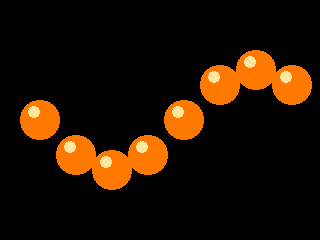
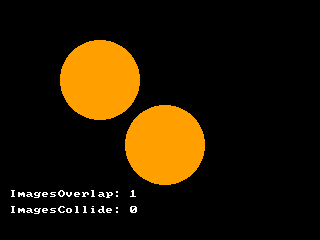
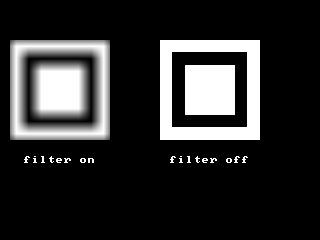
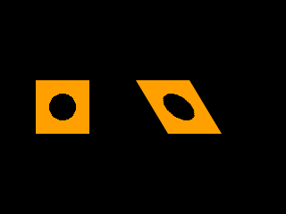

<!-- AUTOGENERATED COPYRIGHT HEADER START -->
<!-- Copyright (C) 2026 Claude <noreply@anthropic.com> -->
<!-- AUTOGENERATED COPYRIGHT HEADER END -->
<!-- Generated by tools/wiki/wiki.py. Edit tools/wiki/text/ instead of this file. -->
# BlitzBasic: Images

Loading, drawing, transforming and colliding images.


Back to [[BlitzBasic]] or the [[Command-Index]].

| Command | Returns | Summary |
|---|---|---|
| [AutoMidHandle](BlitzBasic-Images#automidhandle) | None | Turns on or off the automatic centering of the handle of every image that is loaded, created or copied from now on. |
| [CopyImage](BlitzBasic-Images#copyimage) | Int | Makes a new image that has the same pictures, handle and mask color as an existing one. |
| [CreateImage](BlitzBasic-Images#createimage) | Int | Creates an empty image that is filled with black, which is the default mask color and so draws as transparent. |
| [DrawBlock](BlitzBasic-Images#drawblock) | None | Draws a frame of an image without any transparency, so the mask color is drawn like any other. |
| [DrawBlockRect](BlitzBasic-Images#drawblockrect) | None | Draws only a rectangle of a frame, without any transparency. |
| [DrawImage](BlitzBasic-Images#drawimage) | None | Draws a frame of an image at a position. |
| [DrawImageRect](BlitzBasic-Images#drawimagerect) | None | Draws only a rectangle of a frame, with the mask color left out. |
| [FreeImage](BlitzBasic-Images#freeimage) | None | Releases an image and its video memory. |
| [GrabImage](BlitzBasic-Images#grabimage) | None | Copies a part of the current buffer into a frame of an image. |
| [HandleImage](BlitzBasic-Images#handleimage) | None | Sets the handle of an image: the point of the image that is placed at the position given to [DrawImage](BlitzBasic-Images#drawimage). |
| [ImageBuffer](BlitzBasic-Images#imagebuffer) | Int | Returns the buffer of one frame of an image, which [SetBuffer](BlitzBasic-Buffers-and-Pixels#setbuffer) can make the target of all drawing commands. |
| [ImageHeight](BlitzBasic-Images#imageheight) | Int | The height of one frame of an image in pixels. |
| [ImageRectCollide](BlitzBasic-Images#imagerectcollide) | Int | Tells whether a rectangle touches any visible (not masked) pixel of a frame of an image placed at a position. |
| [ImageRectOverlap](BlitzBasic-Images#imagerectoverlap) | Int | Tells whether a rectangle touches the box of an image at a position. |
| [ImagesCollide](BlitzBasic-Images#imagescollide) | Int | Tells whether two images touch, looking at the pixels that are visible. |
| [ImagesOverlap](BlitzBasic-Images#imagesoverlap) | Int | Tells whether the boxes of two images touch, which is quick but counts transparent pixels as well. |
| [ImageWidth](BlitzBasic-Images#imagewidth) | Int | The width of one frame of an image in pixels. |
| [ImageXHandle](BlitzBasic-Images#imagexhandle) | Int | The horizontal position of the handle of an image, counted from its left edge. |
| [ImageYHandle](BlitzBasic-Images#imageyhandle) | Int | The vertical position of the handle of an image, counted from its top edge. |
| [LoadAnimImage](BlitzBasic-Images#loadanimimage) | Int | Loads a picture file that contains several frames next to each other and cuts it into the frames of one image. |
| [LoadImage](BlitzBasic-Images#loadimage) | Int | Loads a picture file into an image with one frame. |
| [MaskImage](BlitzBasic-Images#maskimage) | None | Chooses the color that [DrawImage](BlitzBasic-Images#drawimage) leaves out when it draws the image. |
| [MidHandle](BlitzBasic-Images#midhandle) | None | Puts the handle of an image in its middle. |
| [RectsOverlap](BlitzBasic-Images#rectsoverlap) | Int | Tells whether two rectangles touch. |
| [ResizeImage](BlitzBasic-Images#resizeimage) | None | Changes the size of every frame of an image to a new width and height in pixels, stretching the picture. |
| [RotateImage](BlitzBasic-Images#rotateimage) | None | Turns every frame of an image around its handle by an angle in degrees, clockwise when positive. |
| [SaveImage](BlitzBasic-Images#saveimage) | Int | Writes one frame of an image into a picture file. |
| [ScaleImage](BlitzBasic-Images#scaleimage) | None | Scales every frame of an image by a factor: 2 doubles its size, 0.5 halves it, and a negative factor flips the picture, which then extends to the left or up from the handle. |
| [TFormFilter](BlitzBasic-Images#tformfilter) | None | Chooses how [TFormImage](BlitzBasic-Images#tformimage), [ScaleImage](BlitzBasic-Images#scaleimage) and [RotateImage](BlitzBasic-Images#rotateimage) look pixels up. |
| [TFormImage](BlitzBasic-Images#tformimage) | None | Transforms every frame of an image with a 2x2 matrix. |
| [TileBlock](BlitzBasic-Images#tileblock) | None | Fills the whole current buffer with copies of a frame of an image, drawn without transparency. |
| [TileImage](BlitzBasic-Images#tileimage) | None | Like [TileBlock](BlitzBasic-Images#tileblock), but the mask color is left out, so what is behind the tiles shows through. |

### AutoMidHandle

```blitzbasic
AutoMidHandle enable%
```

**Works in:** Blitz2D, BlitzPlus, Blitz3D

Turns on or off the automatic centering of the handle of every image that is loaded, created or copied from now on. The handle is the point of an image that sits at the position given to [DrawImage](BlitzBasic-Images#drawimage). It starts in the top left corner. With AutoMidHandle on, it is in the middle of the image, which is what rotating and scaling sprites usually need. Images that already exist keep their handle.

```blitzbasic
Graphics 320, 240, 0, 2
SetBuffer BackBuffer()
AutoMidHandle True
Local a = CreateImage(64, 64)
SetBuffer ImageBuffer(a)
Color 255, 160, 0
Oval 0, 0, 64, 64, 1
SetBuffer BackBuffer()
AutoMidHandle False
Local b = CreateImage(64, 64)
SetBuffer ImageBuffer(b)
Color 0, 160, 255
Oval 0, 0, 64, 64, 1
SetBuffer BackBuffer()
Cls
Color 255, 255, 255
Line 160, 0, 160, 239
Line 0, 120, 319, 120
DrawImage a, 80, 120
DrawImage b, 240, 120
Text 80, 200, "centered", 1, 1
Text 240, 200, "corner", 1, 1
Flip
WaitKey
```


| Parameter | Type | Default | Description |
|---|---|---|---|
| `enable` | Int | required | True to center the handle of new images, False to put it in the top left corner (the default). |

### CopyImage

```blitzbasic
CopyImage image%  ; returns Int
```

**Works in:** Blitz2D, BlitzPlus, Blitz3D

Makes a new image that has the same pictures, handle and mask color as an existing one. Changes to the copy, such as [ScaleImage](BlitzBasic-Images#scaleimage), do not change the original, so copy an image before you transform it for several uses.

```blitzbasic
Graphics 320, 240, 0, 2
SetBuffer BackBuffer()
Local original = CreateImage(32, 32)
Local copy = CopyImage(original)
ScaleImage copy, 2, 2
Print ImageWidth(original) + " and " + ImageWidth(copy)
WaitKey
```

| Parameter | Type | Default | Description |
|---|---|---|---|
| `image` | Int | required | The image to copy. |

**Returns:** A handle for the new image.

### CreateImage

```blitzbasic
CreateImage width%, height%, frames%=1  ; returns Int
```

**Works in:** Blitz2D, BlitzPlus, Blitz3D

Creates an empty image that is filled with black, which is the default mask color and so draws as transparent. Draw into it by making it the current buffer with [ImageBuffer](BlitzBasic-Images#imagebuffer). An image can hold several frames of the same size next to each other, such as the steps of an animation, which are chosen with the frame number of [DrawImage](BlitzBasic-Images#drawimage).

```blitzbasic
Graphics 320, 240, 0, 2
SetBuffer BackBuffer()
Local img = CreateImage(64, 64, 8)
For f = 0 To 7
	SetBuffer ImageBuffer(img, f)
	Color 255, 200, 40
	Oval 0, 0, 64, 64, 1
	Color 0, 0, 0
	Oval 16 + f * 4, 8 + f, 24, 40, 1
Next
SetBuffer BackBuffer()
Local n = 0
While n < 40
	Cls
	Color 255, 255, 255
	DrawImage img, 128, 88, (n / 2) Mod 8
	Text 160, 190, "frame " + ((n / 2) Mod 8), 1, 1
	Flip
	n = n + 1
Wend
```


| Parameter | Type | Default | Description |
|---|---|---|---|
| `width` | Int | required | Width of one frame in pixels. |
| `height` | Int | required | Height of one frame in pixels. |
| `frames` | Int | `1` | Number of frames. Defaults to 1. |

**Returns:** A handle for the image.

**Differences and known gaps:**

* A graphics window must be open, because images live in video memory. A size that is zero or negative stops the program with an error.

### DrawBlock

```blitzbasic
DrawBlock image%, x%, y%, frame%=0
```

**Works in:** Blitz2D, BlitzPlus, Blitz3D

Draws a frame of an image without any transparency, so the mask color is drawn like any other. It is faster than [DrawImage](BlitzBasic-Images#drawimage) for pictures that fill a rectangle completely, such as backgrounds.

```blitzbasic
Graphics 320, 240, 0, 2
SetBuffer BackBuffer()
Local img = CreateImage(100, 100)
SetBuffer ImageBuffer(img)
Color 255, 160, 0
Oval 5, 5, 90, 90, 1
SetBuffer BackBuffer()
Cls
Color 40, 90, 160
Rect 0, 0, 320, 240, 1
DrawImage img, 30, 70
DrawBlock img, 190, 70
Color 255, 255, 255
Text 80, 200, "DrawImage", 1, 1
Text 240, 200, "DrawBlock", 1, 1
Flip
WaitKey
```


| Parameter | Type | Default | Description |
|---|---|---|---|
| `image` | Int | required | The image to draw. |
| `x` | Int | required | Horizontal position of the handle of the image. |
| `y` | Int | required | Vertical position of the handle of the image. |
| `frame` | Int | `0` | Which frame to draw. Defaults to 0. |

### DrawBlockRect

```blitzbasic
DrawBlockRect image%, x%, y%, rect_x%, rect_y%, rect_width%, rect_height%, frame%=0
```

**Works in:** Blitz2D, BlitzPlus, Blitz3D

Draws only a rectangle of a frame, without any transparency. See [DrawBlock](BlitzBasic-Images#drawblock) and [DrawImageRect](BlitzBasic-Images#drawimagerect). The handle of the image is not used: the top left corner of the rectangle goes to the given position.

| Parameter | Type | Default | Description |
|---|---|---|---|
| `image` | Int | required | The image to draw. |
| `x` | Int | required | Horizontal position on the screen of the top left corner of the part. |
| `y` | Int | required | Vertical position on the screen of the top left corner of the part. |
| `rect_x` | Int | required | Left edge of the part inside the frame. |
| `rect_y` | Int | required | Top edge of the part inside the frame. |
| `rect_width` | Int | required | Width of the part. |
| `rect_height` | Int | required | Height of the part. |
| `frame` | Int | `0` | Which frame to draw. Defaults to 0. |

**Differences and known gaps:**

* Only the part that lies inside the frame is drawn. A rectangle that reaches over the edge is cut off.

### DrawImage

```blitzbasic
DrawImage image%, x%, y%, frame%=0
```

**Works in:** Blitz2D, BlitzPlus, Blitz3D

Draws a frame of an image at a position. The handle of the image, which is its top left corner unless [HandleImage](BlitzBasic-Images#handleimage), [MidHandle](BlitzBasic-Images#midhandle) or [AutoMidHandle](BlitzBasic-Images#automidhandle) says otherwise, ends up at the position. Pixels with the mask color of the image (black unless [MaskImage](BlitzBasic-Images#maskimage) changed it) are left out, so the picture can have any shape. Drawing is clipped by the viewport, and the [Origin](BlitzBasic-Drawing#origin) moves it.

```blitzbasic
Graphics 320, 240, 0, 2
SetBuffer BackBuffer()
Local ball = CreateImage(40, 40)
SetBuffer ImageBuffer(ball)
Color 255, 120, 0
Oval 0, 0, 40, 40, 1
Color 255, 230, 160
Oval 8, 6, 12, 12, 1
SetBuffer BackBuffer()
Cls
For i = 0 To 7
	DrawImage ball, 20 + i * 36, 100 + Sin(i * 45) * 50
Next
Flip
WaitKey
```



| Parameter | Type | Default | Description |
|---|---|---|---|
| `image` | Int | required | The image to draw. |
| `x` | Int | required | Horizontal position of the handle of the image. |
| `y` | Int | required | Vertical position of the handle of the image. |
| `frame` | Int | `0` | Which frame to draw. Defaults to 0. |

**Differences and known gaps:**

* A frame number that does not exist stops the program with an error message.

### DrawImageRect

```blitzbasic
DrawImageRect image%, x%, y%, rect_x%, rect_y%, rect_width%, rect_height%, frame%=0
```

**Works in:** Blitz2D, BlitzPlus, Blitz3D

Draws only a rectangle of a frame, with the mask color left out. It can show a part of a big picture or cut a sheet into tiles. The handle of the image is not used: the top left corner of the rectangle goes to the given position.

```blitzbasic
Graphics 320, 240, 0, 2
SetBuffer BackBuffer()
Local img = CreateImage(120, 120)
SetBuffer ImageBuffer(img)
For i = 0 To 5
	Color 255 - i * 40, 100 + i * 25, 60 + i * 30
	Rect i * 10, i * 10, 120 - i * 20, 120 - i * 20, 1
Next
SetBuffer BackBuffer()
Cls
DrawImage img, 20, 60
DrawImageRect img, 180, 80, 40, 40, 80, 80
Color 255, 255, 255
Rect 180 - 1, 80 - 1, 82, 82, 0
Flip
WaitKey
```


| Parameter | Type | Default | Description |
|---|---|---|---|
| `image` | Int | required | The image to draw. |
| `x` | Int | required | Horizontal position on the screen of the top left corner of the part. |
| `y` | Int | required | Vertical position on the screen of the top left corner of the part. |
| `rect_x` | Int | required | Left edge of the part inside the frame. |
| `rect_y` | Int | required | Top edge of the part inside the frame. |
| `rect_width` | Int | required | Width of the part. |
| `rect_height` | Int | required | Height of the part. |
| `frame` | Int | `0` | Which frame to draw. Defaults to 0. |

**Differences and known gaps:**

* Only the part that lies inside the frame is drawn. A rectangle that reaches over the edge is cut off.

### FreeImage

```blitzbasic
FreeImage image%
```

**Works in:** Blitz2D, BlitzPlus, Blitz3D

Releases an image and its video memory. The handle must not be used afterwards.

| Parameter | Type | Default | Description |
|---|---|---|---|
| `image` | Int | required | The image to free. |

**Differences and known gaps:**

* Freeing a handle that is 0 or was already freed does nothing, while other commands stop with an error when they get such a handle.

### GrabImage

```blitzbasic
GrabImage image%, x%, y%, frame%=0
```

**Works in:** Blitz2D, BlitzPlus, Blitz3D

Copies a part of the current buffer into a frame of an image. The part has the size of the image and starts at the given position, so this is the way to take a screenshot into an image or to build a sprite from something that was drawn.

```blitzbasic
Graphics 320, 240, 0, 2
SetBuffer BackBuffer()
Local shot = CreateImage(80, 80)
Cls
Color 255, 80, 80
Oval 20, 20, 80, 80, 1
Color 80, 200, 255
Rect 60, 60, 60, 60, 1
GrabImage shot, 40, 40
Cls
For i = 0 To 2
	DrawBlock shot, 20 + i * 100, 80
Next
Flip
WaitKey
```


| Parameter | Type | Default | Description |
|---|---|---|---|
| `image` | Int | required | The image to copy into. |
| `x` | Int | required | Left edge of the part of the buffer to copy. |
| `y` | Int | required | Top edge of the part of the buffer to copy. |
| `frame` | Int | `0` | The frame to copy into. Defaults to 0. |

**Differences and known gaps:**

* Parts that lie outside of the buffer are not copied and keep what the frame had before.

### HandleImage

```blitzbasic
HandleImage image%, x%, y%
```

**Works in:** Blitz2D, BlitzPlus, Blitz3D

Sets the handle of an image: the point of the image that is placed at the position given to [DrawImage](BlitzBasic-Images#drawimage). The handle is measured from the top left corner of the image, and it is also the point around which [RotateImage](BlitzBasic-Images#rotateimage) and [ScaleImage](BlitzBasic-Images#scaleimage) work. It may lie outside of the image.

```blitzbasic
Graphics 320, 240, 0, 2
SetBuffer BackBuffer()
Local img = CreateImage(60, 40)
SetBuffer ImageBuffer(img)
Color 255, 160, 0
Rect 0, 0, 60, 40, 1
Color 0, 0, 0
Rect 20, 12, 20, 16, 1
SetBuffer BackBuffer()
Cls
HandleImage img, 0, 0
DrawImage img, 100, 60
HandleImage img, 30, 20
DrawImage img, 100, 160
Color 255, 255, 255
Line 80, 60, 120, 60 : Line 100, 40, 100, 80
Line 80, 160, 120, 160 : Line 100, 140, 100, 180
Text 180, 60, "handle 0, 0", 0, 1
Text 180, 160, "handle 30, 20", 0, 1
Flip
WaitKey
```


| Parameter | Type | Default | Description |
|---|---|---|---|
| `image` | Int | required | The image. |
| `x` | Int | required | Horizontal position of the handle, counted from the left edge. |
| `y` | Int | required | Vertical position of the handle, counted from the top edge. |

### ImageBuffer

```blitzbasic
ImageBuffer image%, frame%=0  ; returns Int
```

**Works in:** Blitz2D, BlitzPlus, Blitz3D

Returns the buffer of one frame of an image, which [SetBuffer](BlitzBasic-Buffers-and-Pixels#setbuffer) can make the target of all drawing commands. The buffer is also the one that [LockBuffer](BlitzBasic-Buffers-and-Pixels#lockbuffer) and [ReadPixel](BlitzBasic-Buffers-and-Pixels#readpixel) work on.

```blitzbasic
Graphics 320, 240, 0, 2
SetBuffer BackBuffer()
Local img = CreateImage(32, 32, 2)
SetBuffer ImageBuffer(img, 0)
Color 255, 0, 0
Rect 0, 0, 32, 32, 1
SetBuffer ImageBuffer(img, 1)
Color 0, 0, 255
Rect 0, 0, 32, 32, 1
SetBuffer BackBuffer()
Cls
DrawImage img, 60, 100, 0
DrawImage img, 140, 100, 1
Flip
WaitKey
```

| Parameter | Type | Default | Description |
|---|---|---|---|
| `image` | Int | required | The image. |
| `frame` | Int | `0` | The frame whose buffer to return. Defaults to 0. |

**Returns:** A buffer handle for [SetBuffer](BlitzBasic-Buffers-and-Pixels#setbuffer) and the pixel commands.

**Differences and known gaps:**

* A frame number that does not exist stops the program with an error message.

### ImageHeight

```blitzbasic
ImageHeight image%  ; returns Int
```

**Works in:** Blitz2D, BlitzPlus, Blitz3D

The height of one frame of an image in pixels.

| Parameter | Type | Default | Description |
|---|---|---|---|
| `image` | Int | required | The image. |

**Returns:** The height of a frame.

### ImageRectCollide

```blitzbasic
ImageRectCollide image%, x%, y%, frame%, rect_x%, rect_y%, rect_width%, rect_height%  ; returns Int
```

**Works in:** Blitz2D, BlitzPlus, Blitz3D

Tells whether a rectangle touches any visible (not masked) pixel of a frame of an image placed at a position. It is exact, unlike [ImageRectOverlap](BlitzBasic-Images#imagerectoverlap), which only compares the box of the image.

```blitzbasic
Graphics 320, 240, 0, 2
SetBuffer BackBuffer()
Local ring = CreateImage(100, 100)
SetBuffer ImageBuffer(ring)
Color 255, 255, 0
Oval 0, 0, 100, 100, 0
SetBuffer BackBuffer()
; The middle of the ring is empty, so the box of the image is touched but not the ring.
Print ImageRectOverlap(ring, 50, 50, 90, 90, 10, 10)
Print ImageRectCollide(ring, 50, 50, 0, 90, 90, 10, 10)
Print ImageRectCollide(ring, 50, 50, 0, 50, 95, 10, 10)
WaitKey
```

| Parameter | Type | Default | Description |
|---|---|---|---|
| `image` | Int | required | The image. |
| `x` | Int | required | Horizontal position where the image is drawn. |
| `y` | Int | required | Vertical position where the image is drawn. |
| `frame` | Int | required | The frame to test. |
| `rect_x` | Int | required | Left edge of the rectangle. |
| `rect_y` | Int | required | Top edge of the rectangle. |
| `rect_width` | Int | required | Width of the rectangle. |
| `rect_height` | Int | required | Height of the rectangle. |

**Returns:** 1 if the rectangle touches a pixel of the image, otherwise 0.

### ImageRectOverlap

```blitzbasic
ImageRectOverlap image%, x%, y%, rect_x%, rect_y%, rect_width%, rect_height%  ; returns Int
```

**Works in:** Blitz2D, BlitzPlus, Blitz3D

Tells whether a rectangle touches the box of an image at a position. Transparent pixels count, so this is the quick first check before the exact [ImageRectCollide](BlitzBasic-Images#imagerectcollide).

| Parameter | Type | Default | Description |
|---|---|---|---|
| `image` | Int | required | The image. |
| `x` | Int | required | Horizontal position where the image is drawn. |
| `y` | Int | required | Vertical position where the image is drawn. |
| `rect_x` | Int | required | Left edge of the rectangle. |
| `rect_y` | Int | required | Top edge of the rectangle. |
| `rect_width` | Int | required | Width of the rectangle. |
| `rect_height` | Int | required | Height of the rectangle. |

**Returns:** 1 if the rectangle touches the box of the image, otherwise 0.

### ImagesCollide

```blitzbasic
ImagesCollide image1%, x1%, y1%, frame1%, image2%, x2%, y2%, frame2%  ; returns Int
```

**Works in:** Blitz2D, BlitzPlus, Blitz3D

Tells whether two images touch, looking at the pixels that are visible. Both images are taken at their handle, and the frame to test is given for each.

```blitzbasic
Graphics 320, 240, 0, 2
SetBuffer BackBuffer()
Local a = CreateImage(80, 80)
SetBuffer ImageBuffer(a)
Color 255, 160, 0
Oval 0, 0, 80, 80, 1
SetBuffer BackBuffer()
Local b = CopyImage(a)
Cls
DrawImage a, 60, 40
DrawImage b, 125, 105
Color 255, 255, 255
Text 10, 190, "ImagesOverlap: " + ImagesOverlap(a, 60, 40, b, 125, 105)
Text 10, 206, "ImagesCollide: " + ImagesCollide(a, 60, 40, 0, b, 125, 105, 0)
Flip
WaitKey
```



| Parameter | Type | Default | Description |
|---|---|---|---|
| `image1` | Int | required | The first image. |
| `x1` | Int | required | Horizontal position where the first image is drawn. |
| `y1` | Int | required | Vertical position where the first image is drawn. |
| `frame1` | Int | required | The frame of the first image. |
| `image2` | Int | required | The second image. |
| `x2` | Int | required | Horizontal position where the second image is drawn. |
| `y2` | Int | required | Vertical position where the second image is drawn. |
| `frame2` | Int | required | The frame of the second image. |

**Returns:** 1 if visible pixels of the two images are on top of each other, otherwise 0.

**Differences and known gaps:**

* A frame number that does not exist stops the program with an error message.

### ImagesOverlap

```blitzbasic
ImagesOverlap image1%, x1%, y1%, image2%, x2%, y2%  ; returns Int
```

**Works in:** Blitz2D, BlitzPlus, Blitz3D

Tells whether the boxes of two images touch, which is quick but counts transparent pixels as well. Use it to decide whether the exact [ImagesCollide](BlitzBasic-Images#imagescollide) is needed.

| Parameter | Type | Default | Description |
|---|---|---|---|
| `image1` | Int | required | The first image. |
| `x1` | Int | required | Horizontal position where the first image is drawn. |
| `y1` | Int | required | Vertical position where the first image is drawn. |
| `image2` | Int | required | The second image. |
| `x2` | Int | required | Horizontal position where the second image is drawn. |
| `y2` | Int | required | Vertical position where the second image is drawn. |

**Returns:** 1 if the boxes overlap, otherwise 0.

### ImageWidth

```blitzbasic
ImageWidth image%  ; returns Int
```

**Works in:** Blitz2D, BlitzPlus, Blitz3D

The width of one frame of an image in pixels.

| Parameter | Type | Default | Description |
|---|---|---|---|
| `image` | Int | required | The image. |

**Returns:** The width of a frame.

### ImageXHandle

```blitzbasic
ImageXHandle image%  ; returns Int
```

**Works in:** Blitz2D, BlitzPlus, Blitz3D

The horizontal position of the handle of an image, counted from its left edge.

| Parameter | Type | Default | Description |
|---|---|---|---|
| `image` | Int | required | The image. |

**Returns:** The x position of the handle.

### ImageYHandle

```blitzbasic
ImageYHandle image%  ; returns Int
```

**Works in:** Blitz2D, BlitzPlus, Blitz3D

The vertical position of the handle of an image, counted from its top edge.

| Parameter | Type | Default | Description |
|---|---|---|---|
| `image` | Int | required | The image. |

**Returns:** The y position of the handle.

### LoadAnimImage

```blitzbasic
LoadAnimImage bmpfile$, cellwidth%, cellheight%, first%, count%  ; returns Int
```

**Works in:** Blitz2D, BlitzPlus, Blitz3D

Loads a picture file that contains several frames next to each other and cuts it into the frames of one image. Frames are counted from left to right, then from top to bottom, and each is `cellwidth` by `cellheight` pixels. Choose one with the frame number of [DrawImage](BlitzBasic-Images#drawimage).

The example makes its own sheet first with [CreateImage](BlitzBasic-Images#createimage) and [SaveImage](BlitzBasic-Images#saveimage), so that it needs no other file.

```blitzbasic
Graphics 320, 240, 0, 2
SetBuffer BackBuffer()
; Four frames of 32x32 next to each other, saved as a 128x32 picture.
Local sheet = CreateImage(128, 32)
SetBuffer ImageBuffer(sheet)
For f = 0 To 3
	Color 60 + f * 60, 200 - f * 40, 80
	Oval f * 32 + 16 - f * 3, 16 - f * 3, f * 6 + 2, f * 6 + 2, 1
Next
SetBuffer BackBuffer()
SaveImage sheet, "sheet.bmp"
Local anim = LoadAnimImage("sheet.bmp", 32, 32, 0, 4)
Cls
For f = 0 To 3
	DrawImage anim, 40 + f * 60, 100, f
Next
Flip
WaitKey
```

| Parameter | Type | Default | Description |
|---|---|---|---|
| `bmpfile` | String | required |  |
| `cellwidth` | Int | required | Width of one frame. |
| `cellheight` | Int | required | Height of one frame. |
| `first` | Int | required | Number of the first frame in the sheet, usually 0. |
| `count` | Int | required | How many frames to cut out. |

**Returns:** A handle for the image, or 0 if the file could not be loaded or the frame size does not fit.

### LoadImage

```blitzbasic
LoadImage bmpfile$  ; returns Int
```

**Works in:** Blitz2D, BlitzPlus, Blitz3D

Loads a picture file into an image with one frame. Pixels that are black are drawn as transparent by [DrawImage](BlitzBasic-Images#drawimage) until [MaskImage](BlitzBasic-Images#maskimage) picks another color. Load images once at the start of a program and draw them often. If the file is missing, the result is 0, so check it before drawing.

```blitzbasic
Graphics 320, 240, 0, 2
SetBuffer BackBuffer()
; Make a picture file first so that the example runs without any other file.
Local made = CreateImage(64, 64)
SetBuffer ImageBuffer(made)
Color 80, 200, 120
Oval 0, 0, 64, 64, 1
SetBuffer BackBuffer()
SaveImage made, "dot.bmp"

Local img = LoadImage("dot.bmp")
If img = 0 Then RuntimeError "dot.bmp could not be loaded"
Cls
DrawImage img, 128, 88
Flip
WaitKey
```

| Parameter | Type | Default | Description |
|---|---|---|---|
| `bmpfile` | String | required |  |

**Returns:** A handle for the image, or 0 if the file could not be loaded.

**Differences and known gaps:**

* More file formats load than in the original, which read BMP, PNG, JPEG and TGA. Files are decoded by SDL_image.
* Backslashes in paths are changed into slashes on Linux and macOS.

### MaskImage

```blitzbasic
MaskImage image%, red%, green%, blue%
```

**Works in:** Blitz2D, BlitzPlus, Blitz3D

Chooses the color that [DrawImage](BlitzBasic-Images#drawimage) leaves out when it draws the image. The default is black. Setting a color that the picture does not contain makes every pixel visible, which is how to show black pixels. [DrawBlock](BlitzBasic-Images#drawblock) ignores the mask.

```blitzbasic
Graphics 320, 240, 0, 2
SetBuffer BackBuffer()
Local img = CreateImage(80, 80)
SetBuffer ImageBuffer(img)
Color 255, 0, 255
Rect 0, 0, 80, 80, 1
Color 255, 220, 0
Oval 10, 10, 60, 60, 1
SetBuffer BackBuffer()
Cls
Color 30, 60, 120
Rect 0, 0, 320, 240, 1
DrawImage img, 30, 80
MaskImage img, 255, 0, 255
DrawImage img, 190, 80
Color 255, 255, 255
Text 70, 190, "mask black", 1, 1
Text 230, 190, "mask magenta", 1, 1
Flip
WaitKey
```


| Parameter | Type | Default | Description |
|---|---|---|---|
| `image` | Int | required | The image. |
| `red` | Int | required | Red part of the mask color, 0 to 255. |
| `green` | Int | required | Green part of the mask color, 0 to 255. |
| `blue` | Int | required | Blue part of the mask color, 0 to 255. |

### MidHandle

```blitzbasic
MidHandle image%
```

**Works in:** Blitz2D, BlitzPlus, Blitz3D

Puts the handle of an image in its middle. Images drawn at a position then appear centered on it, and rotate and scale around their middle.

```blitzbasic
Graphics 320, 240, 0, 2
SetBuffer BackBuffer()
Local img = CreateImage(40, 40)
SetBuffer ImageBuffer(img)
Color 255, 160, 0
Rect 0, 0, 40, 40, 1
SetBuffer BackBuffer()
MidHandle img
Cls
DrawImage img, MouseX(), MouseY()
Print ImageXHandle(img) + ", " + ImageYHandle(img)
Flip
WaitKey
```

| Parameter | Type | Default | Description |
|---|---|---|---|
| `image` | Int | required | The image. |

### RectsOverlap

```blitzbasic
RectsOverlap x1%, y1%, width1%, height1%, x2%, y2%, width2%, height2%  ; returns Int
```

**Works in:** Blitz2D, BlitzPlus, Blitz3D

Tells whether two rectangles touch. It works on plain numbers and needs no image, so it is a good quick test for boxes of any kind.

```blitzbasic
Print RectsOverlap(0, 0, 50, 50, 40, 40, 50, 50)
Print RectsOverlap(0, 0, 50, 50, 60, 60, 50, 50)
WaitKey
```

| Parameter | Type | Default | Description |
|---|---|---|---|
| `x1` | Int | required | Left edge of the first rectangle. |
| `y1` | Int | required | Top edge of the first rectangle. |
| `width1` | Int | required | Width of the first rectangle. |
| `height1` | Int | required | Height of the first rectangle. |
| `x2` | Int | required | Left edge of the second rectangle. |
| `y2` | Int | required | Top edge of the second rectangle. |
| `width2` | Int | required | Width of the second rectangle. |
| `height2` | Int | required | Height of the second rectangle. |

**Returns:** 1 if the rectangles overlap, otherwise 0.

### ResizeImage

```blitzbasic
ResizeImage image%, width#, height#
```

**Works in:** Blitz2D, BlitzPlus, Blitz3D

Changes the size of every frame of an image to a new width and height in pixels, stretching the picture. The handle moves with the picture. Resizing again and again loses quality, so keep the original or use [CopyImage](BlitzBasic-Images#copyimage) first.

```blitzbasic
Graphics 320, 240, 0, 2
SetBuffer BackBuffer()
Local img = CreateImage(40, 40)
SetBuffer ImageBuffer(img)
Color 255, 160, 0
Oval 0, 0, 40, 40, 1
Color 0, 0, 0
Oval 12, 12, 16, 16, 1
SetBuffer BackBuffer()
Local wide = CopyImage(img)
ResizeImage wide, 120, 40
Local tall = CopyImage(img)
ResizeImage tall, 40, 120
Cls
DrawImage img, 20, 100
DrawImage wide, 90, 100
DrawImage tall, 240, 60
Flip
WaitKey
```


| Parameter | Type | Default | Description |
|---|---|---|---|
| `image` | Int | required | The image. |
| `width` | Float | required | New width of a frame in pixels. |
| `height` | Float | required | New height of a frame in pixels. |

**Differences and known gaps:**

* The picture is stretched with smooth filtering, where the original used simple pixel picking. Edges of resized images are softer.

### RotateImage

```blitzbasic
RotateImage image%, angle#
```

**Works in:** Blitz2D, BlitzPlus, Blitz3D

Turns every frame of an image around its handle by an angle in degrees, clockwise when positive. The image gets larger so that the whole picture fits, and the corners that are added are masked. The change is permanent and cumulative, and every rotation blurs the picture a little, so rotate a copy of the original image.

```blitzbasic
Graphics 320, 240, 0, 2
SetBuffer BackBuffer()
Local arrow = CreateImage(60, 30)
SetBuffer ImageBuffer(arrow)
Color 255, 160, 0
Rect 0, 8, 40, 14, 1
Rect 36, 0, 8, 30, 1
Rect 44, 4, 8, 22, 1
Rect 52, 10, 8, 10, 1
SetBuffer BackBuffer()
Cls
For i = 0 To 3
	Local r = CopyImage(arrow)
	MidHandle r
	RotateImage r, i * 30
	DrawImage r, 50 + i * 75, 120
Next
Flip
WaitKey
```


| Parameter | Type | Default | Description |
|---|---|---|---|
| `image` | Int | required | The image. |
| `angle` | Float | required | The angle in degrees. |

### SaveImage

```blitzbasic
SaveImage image%, bmpfile$, frame%=0  ; returns Int
```

**Works in:** Blitz2D, BlitzPlus, Blitz3D

Writes one frame of an image into a picture file. The file is a PNG when its name ends with `.png`, otherwise a BMP.

```blitzbasic
Graphics 320, 240, 0, 2
SetBuffer BackBuffer()
Local img = CreateImage(64, 64)
SetBuffer ImageBuffer(img)
Color 255, 255, 0
Oval 0, 0, 64, 64, 1
SetBuffer BackBuffer()
If SaveImage(img, "saved.png") Then Print "saved.png written" Else Print "could not save"
WaitKey
```

| Parameter | Type | Default | Description |
|---|---|---|---|
| `image` | Int | required | The image. |
| `bmpfile` | String | required |  |
| `frame` | Int | `0` | The frame to save. Defaults to 0. |

**Returns:** 1 if the file was written, otherwise 0.

**Differences and known gaps:**

* The original only writes BMP files. A name ending in `.png` gives a PNG here.

### ScaleImage

```blitzbasic
ScaleImage image%, xscale#, yscale#
```

**Works in:** Blitz2D, BlitzPlus, Blitz3D

Scales every frame of an image by a factor: 2 doubles its size, 0.5 halves it, and a negative factor flips the picture, which then extends to the left or up from the handle. The change is permanent, so scale a copy when the original is still needed.

```blitzbasic
Graphics 320, 240, 0, 2
SetBuffer BackBuffer()
Local img = CreateImage(32, 32)
SetBuffer ImageBuffer(img)
Color 255, 160, 0
Rect 0, 0, 32, 32, 1
Color 0, 0, 0
Rect 0, 16, 16, 16, 1
SetBuffer BackBuffer()
Local big = CopyImage(img)
ScaleImage big, 3, 3
Local flip_x = CopyImage(img)
ScaleImage flip_x, -2, 2
Cls
DrawImage img, 20, 100
DrawImage big, 80, 70
DrawImage flip_x, 270, 100
Flip
WaitKey
```


| Parameter | Type | Default | Description |
|---|---|---|---|
| `image` | Int | required | The image. |
| `xscale` | Float | required | Horizontal factor. |
| `yscale` | Float | required | Vertical factor. |

**Differences and known gaps:**

* Scaling uses the same smooth filter as [TFormImage](BlitzBasic-Images#tformimage), which [TFormFilter](BlitzBasic-Images#tformfilter) can turn off.

### TFormFilter

```blitzbasic
TFormFilter enable%
```

**Works in:** Blitz2D, BlitzPlus, Blitz3D

Chooses how [TFormImage](BlitzBasic-Images#tformimage), [ScaleImage](BlitzBasic-Images#scaleimage) and [RotateImage](BlitzBasic-Images#rotateimage) look pixels up. With the filter on, the colors of neighboring pixels are blended for a smooth result. With it off, the nearest pixel is taken, which keeps hard edges and is the right choice for pixel art.

```blitzbasic
Graphics 320, 240, 0, 2
SetBuffer BackBuffer()
Local img = CreateImage(8, 8)
SetBuffer ImageBuffer(img)
Color 255, 255, 255
Rect 0, 0, 8, 8, 0
Rect 2, 2, 4, 4, 1
SetBuffer BackBuffer()
TFormFilter True
Local smooth = CopyImage(img)
ScaleImage smooth, 12.5, 12.5
TFormFilter False
Local sharp = CopyImage(img)
ScaleImage sharp, 12.5, 12.5
Cls
DrawBlock smooth, 10, 40
DrawBlock sharp, 160, 40
Color 255, 255, 255
Text 60, 160, "filter on", 1, 1
Text 210, 160, "filter off", 1, 1
Flip
WaitKey
```



| Parameter | Type | Default | Description |
|---|---|---|---|
| `enable` | Int | required | True for smooth results (the default), False for the nearest pixel. |

### TFormImage

```blitzbasic
TFormImage image%, a#, b#, c#, d#
```

**Works in:** Blitz2D, BlitzPlus, Blitz3D

Transforms every frame of an image with a 2x2 matrix. With the values `a, b, c, d` a point `(x, y)` of the picture, measured from the handle, goes to `(a*x + c*y, b*x + d*y)`. The matrix `a=1, b=0, c=0.6, d=1` tilts the picture to the right, and [ScaleImage](BlitzBasic-Images#scaleimage) and [RotateImage](BlitzBasic-Images#rotateimage) are special cases. The image becomes as large as the result needs.

```blitzbasic
Graphics 320, 240, 0, 2
SetBuffer BackBuffer()
Local img = CreateImage(60, 60)
SetBuffer ImageBuffer(img)
Color 255, 160, 0
Rect 0, 0, 60, 60, 1
Color 0, 0, 0
Oval 15, 15, 30, 30, 1
SetBuffer BackBuffer()
Local tilted = CopyImage(img)
MidHandle tilted
TFormImage tilted, 1, 0, 0.6, 1
Cls
DrawImage img, 40, 90
DrawImage tilted, 200, 120
Flip
WaitKey
```



| Parameter | Type | Default | Description |
|---|---|---|---|
| `image` | Int | required | The image. |
| `a` | Float | required | Horizontal part of the first column of the matrix. |
| `b` | Float | required | Vertical part of the first column of the matrix. |
| `c` | Float | required | Horizontal part of the second column of the matrix. |
| `d` | Float | required | Vertical part of the second column of the matrix. |

**Differences and known gaps:**

* A matrix that cannot be inverted (for example `a=0, b=0`) stops the program with an error message.

### TileBlock

```blitzbasic
TileBlock image%, x%=0, y%=0, frame%=0
```

**Works in:** Blitz2D, BlitzPlus, Blitz3D

Fills the whole current buffer with copies of a frame of an image, drawn without transparency. The pattern starts at the given offset, which makes scrolling backgrounds easy: change the offset a little every frame.

```blitzbasic
Graphics 320, 240, 0, 2
SetBuffer BackBuffer()
Local tile = CreateImage(32, 32)
SetBuffer ImageBuffer(tile)
Color 40, 70, 130
Rect 0, 0, 32, 32, 1
Color 70, 110, 190
Rect 0, 0, 16, 16, 1
Rect 16, 16, 16, 16, 1
SetBuffer BackBuffer()
Local n = 0
While n < 40
	TileBlock tile, n, n / 2
	Flip
	n = n + 1
Wend
```


| Parameter | Type | Default | Description |
|---|---|---|---|
| `image` | Int | required | The image to repeat. |
| `x` | Int | `0` | Horizontal offset of the pattern. Defaults to 0. |
| `y` | Int | `0` | Vertical offset of the pattern. Defaults to 0. |
| `frame` | Int | `0` | Which frame to use. Defaults to 0. |

### TileImage

```blitzbasic
TileImage image%, x%=0, y%=0, frame%=0
```

**Works in:** Blitz2D, BlitzPlus, Blitz3D

Like [TileBlock](BlitzBasic-Images#tileblock), but the mask color is left out, so what is behind the tiles shows through.

```blitzbasic
Graphics 320, 240, 0, 2
SetBuffer BackBuffer()
Local star = CreateImage(24, 24)
SetBuffer ImageBuffer(star)
Color 255, 220, 0
Oval 6, 6, 12, 12, 1
Rect 11, 0, 2, 24, 1
Rect 0, 11, 24, 2, 1
SetBuffer BackBuffer()
Cls
Color 20, 40, 90
Rect 0, 0, 320, 240, 1
TileImage star, 4, 4
Flip
WaitKey
```


| Parameter | Type | Default | Description |
|---|---|---|---|
| `image` | Int | required | The image to repeat. |
| `x` | Int | `0` | Horizontal offset of the pattern. Defaults to 0. |
| `y` | Int | `0` | Vertical offset of the pattern. Defaults to 0. |
| `frame` | Int | `0` | Which frame to use. Defaults to 0. |
