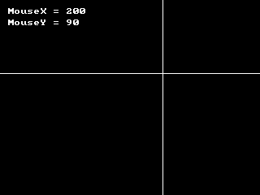

<!-- AUTOGENERATED COPYRIGHT HEADER START -->
<!-- Copyright (C) 2026 Claude <noreply@anthropic.com> -->
<!-- AUTOGENERATED COPYRIGHT HEADER END -->
<!-- Generated by tools/wiki/wiki.py. Edit tools/wiki/text/ instead of this file. -->
# BlitzBasic: Mouse

Mouse position, speed and buttons.

Back to [[BlitzBasic]] or the [[Command-Index]].

| Command | Returns | Summary |
|---|---|---|
| [DirectInputEnabled](BlitzBasic-Mouse#directinputenabled) | Int | Tells whether the program asked for DirectInput style input with [EnableDirectInput](BlitzBasic-Mouse#enabledirectinput). |
| [EnableDirectInput](BlitzBasic-Mouse#enabledirectinput) | None | Switches the DirectInput setting on or off. |
| [FlushMouse](BlitzBasic-Mouse#flushmouse) | None | Forgets mouse button presses that nobody has looked at yet: the queue behind [GetMouse](BlitzBasic-Mouse#getmouse) and [WaitMouse](BlitzBasic-Mouse#waitmouse), the presses counted for [MouseHit](BlitzBasic-Mouse#mousehit), and the movement counted by the speed functions. |
| [GetMouse](BlitzBasic-Mouse#getmouse) | Int | Takes the next mouse button press out of a queue and returns its number: 1 for the left button, 2 for the right and 3 for the middle button. |
| [MouseDown](BlitzBasic-Mouse#mousedown) | Int | Tells whether a mouse button is held down at this moment. |
| [MouseHit](BlitzBasic-Mouse#mousehit) | Int | Counts presses of a mouse button since the last time MouseHit asked about that button. |
| [MouseWait](BlitzBasic-Mouse#mousewait) | Int | The older name of [WaitMouse](BlitzBasic-Mouse#waitmouse). |
| [MouseX](BlitzBasic-Mouse#mousex) | Int | The horizontal position of the pointer in the graphics buffer, from 0 on the left to `GraphicsWidth() - 1`. |
| [MouseXSpeed](BlitzBasic-Mouse#mousexspeed) | Int | How far the pointer moved sideways since the last time this function was called. |
| [MouseY](BlitzBasic-Mouse#mousey) | Int | The vertical position of the pointer in the graphics buffer, from 0 at the top to `GraphicsHeight() - 1`. |
| [MouseYSpeed](BlitzBasic-Mouse#mouseyspeed) | Int | How far the pointer moved up or down since the last call. |
| [MouseZ](BlitzBasic-Mouse#mousez) | Int | The position of the mouse wheel. |
| [MouseZSpeed](BlitzBasic-Mouse#mousezspeed) | Int | How far the wheel moved since the last call, in notches. |
| [MoveMouse](BlitzBasic-Mouse#movemouse) | None | Puts the pointer at a position of the graphics buffer, in buffer pixels. |
| [WaitMouse](BlitzBasic-Mouse#waitmouse) | Int | Stops the program until a mouse button is pressed and returns its number. |

### DirectInputEnabled

```blitzbasic
DirectInputEnabled  ; returns Int
```

**Works in:** Blitz2D, Blitz3D

Tells whether the program asked for DirectInput style input with [EnableDirectInput](BlitzBasic-Mouse#enabledirectinput). It is an undocumented command of the original and only exists so that old programs still compile.

**Returns:** 1 if the setting is on, otherwise 0.

**Differences and known gaps:**

* There is no DirectInput on this platform. The command only reports the value last given to EnableDirectInput (initially 1); input always comes from SDL.

### EnableDirectInput

```blitzbasic
EnableDirectInput enable%
```

**Works in:** Blitz2D, Blitz3D

Switches the DirectInput setting on or off. In the original it chose between two ways of reading the keyboard and mouse. It is an undocumented command that old programs sometimes call at their start.

| Parameter | Type | Default | Description |
|---|---|---|---|
| `enable` | Int | required | 1 to switch it on, 0 to switch it off. |

**Differences and known gaps:**

* Only the value is remembered so that [DirectInputEnabled](BlitzBasic-Mouse#directinputenabled) can report it. Input is read the same way whatever it is set to.

### FlushMouse

```blitzbasic
FlushMouse
```

**Works in:** Blitz2D, BlitzPlus, Blitz3D

Forgets mouse button presses that nobody has looked at yet: the queue behind [GetMouse](BlitzBasic-Mouse#getmouse) and [WaitMouse](BlitzBasic-Mouse#waitmouse), the presses counted for [MouseHit](BlitzBasic-Mouse#mousehit), and the movement counted by the speed functions. Use it before a screen that waits for a click so that earlier clicks do not skip it, but not in the main loop.

```blitzbasic
Graphics 320, 240, 0, 2
SetBuffer BackBuffer()
Text 10, 10, "Click as often as you like..."
Flip
Delay 2000
FlushMouse
Cls
Text 10, 10, "Old clicks are gone. Click once more."
Flip
WaitMouse
```

### GetMouse

```blitzbasic
GetMouse  ; returns Int
```

**Works in:** Blitz2D, BlitzPlus, Blitz3D

Takes the next mouse button press out of a queue and returns its number: 1 for the left button, 2 for the right and 3 for the middle button. It returns 0 if nothing was pressed since the last call. Unlike [MouseHit](BlitzBasic-Mouse#mousehit) it does not need to be told which button to look at.

```blitzbasic
Graphics 320, 240, 0, 2
SetBuffer BackBuffer()
Local prev = 0
While Not KeyHit(1)
	Local b = GetMouse()
	If b Then prev = b
	Cls
	Text 10, 10, "Click with any mouse button"
	Text 10, 30, "Last button: " + prev
	Flip
Wend
```

**Returns:** The number of the button that was pressed, or 0 if there is none.

**Differences and known gaps:**

* The queue holds 15 presses and forgets the oldest ones when it is full.

### MouseDown

```blitzbasic
MouseDown button%  ; returns Int
```

**Works in:** Blitz2D, BlitzPlus, Blitz3D

Tells whether a mouse button is held down at this moment.

```blitzbasic
Graphics 320, 240, 0, 2
SetBuffer BackBuffer()
While Not KeyHit(1)
	Cls
	If MouseDown(1) Then Color 255, 80, 80 Else Color 80, 80, 80
	Rect 20, 60, 80, 80, 1
	If MouseDown(3) Then Color 255, 80, 80 Else Color 80, 80, 80
	Rect 120, 60, 80, 80, 1
	If MouseDown(2) Then Color 255, 80, 80 Else Color 80, 80, 80
	Rect 220, 60, 80, 80, 1
	Color 255, 255, 255
	Text 160, 200, "Hold a mouse button", 1, 1
	Flip
Wend
```

| Parameter | Type | Default | Description |
|---|---|---|---|
| `button` | Int | required | 1 for the left, 2 for the right, 3 for the middle button. |

**Returns:** 1 while the button is held down, otherwise 0.

**Differences and known gaps:**

* A button number outside 1 to 3 always gives 0. Extra buttons of the mouse are not supported.

### MouseHit

```blitzbasic
MouseHit button%  ; returns Int
```

**Works in:** Blitz2D, BlitzPlus, Blitz3D

Counts presses of a mouse button since the last time MouseHit asked about that button. Use it for clicks that should do one thing and not repeat while the button is held, and [MouseDown](BlitzBasic-Mouse#mousedown) for dragging.

```blitzbasic
Graphics 320, 240, 0, 2
SetBuffer BackBuffer()
Local clicks = 0
While Not KeyHit(1)
	If MouseHit(1) Then clicks = clicks + 1
	Cls
	Text 10, 10, "Left clicks: " + clicks
	Flip
Wend
```

| Parameter | Type | Default | Description |
|---|---|---|---|
| `button` | Int | required | 1 for the left, 2 for the right, 3 for the middle button. |

**Returns:** How many times the button was pressed since the last call.

**Differences and known gaps:**

* The result is never more than 1: two clicks between two calls count as one.

### MouseWait

```blitzbasic
MouseWait  ; returns Int
```

**Works in:** Blitz2D, BlitzPlus, Blitz3D

The older name of [WaitMouse](BlitzBasic-Mouse#waitmouse). It stops the program until a mouse button is pressed and returns the button.

```blitzbasic
Graphics 320, 240, 0, 2
SetBuffer BackBuffer()
Text 10, 10, "Click a mouse button"
Flip
Local b = MouseWait()
Cls
Text 10, 10, "That was button " + b
Flip
Delay 1000
```

**Returns:** The number of the button that was pressed.

### MouseX

```blitzbasic
MouseX  ; returns Int
```

**Works in:** Blitz2D, BlitzPlus, Blitz3D

The horizontal position of the pointer in the graphics buffer, from 0 on the left to `GraphicsWidth() - 1`. When the window is scaled, the position is converted back to buffer pixels. [MoveMouse](BlitzBasic-Mouse#movemouse) sets it. BlitzPlus programs can also pass a canvas handle to get the position relative to that canvas.

```blitzbasic
Graphics 320, 240, 0, 2
SetBuffer BackBuffer()
MoveMouse 200, 90
Cls
Color 255, 255, 255
Line MouseX(), 0, MouseX(), 239
Line 0, MouseY(), 319, MouseY()
Text 10, 10, "MouseX = " + MouseX()
Text 10, 24, "MouseY = " + MouseY()
Flip
WaitKey
```



**Returns:** The horizontal position of the pointer.

### MouseXSpeed

```blitzbasic
MouseXSpeed  ; returns Int
```

**Works in:** Blitz2D, BlitzPlus, Blitz3D

How far the pointer moved sideways since the last time this function was called. It gives the same result whether the pointer reached the edge of the window or not, which makes it useful for looking around in a 3D scene: call [MoveMouse](BlitzBasic-Mouse#movemouse) every frame to put the pointer back in the middle and use the speed as the turning amount.

```blitzbasic
Graphics 320, 240, 0, 2
SetBuffer BackBuffer()
Local x = 160
While Not KeyHit(1)
	x = x + MouseXSpeed()
	MoveMouse 160, 120
	Cls
	Text 10, 10, "Move the mouse sideways"
	Oval x - 8, 110, 16, 16, 1
	Flip
Wend
```

**Returns:** The change of the horizontal position since the previous call.

**Differences and known gaps:**

* Putting the pointer somewhere with MoveMouse does not count as movement, the same as in the original. To make that work on every platform the window captures the pointer for as long as the program keeps calling MoveMouse; it lets go about 300 milliseconds after the last call.

### MouseY

```blitzbasic
MouseY  ; returns Int
```

**Works in:** Blitz2D, BlitzPlus, Blitz3D

The vertical position of the pointer in the graphics buffer, from 0 at the top to `GraphicsHeight() - 1`. See [MouseX](BlitzBasic-Mouse#mousex).

**Returns:** The vertical position of the pointer.

### MouseYSpeed

```blitzbasic
MouseYSpeed  ; returns Int
```

**Works in:** Blitz2D, BlitzPlus, Blitz3D

How far the pointer moved up or down since the last call. See [MouseXSpeed](BlitzBasic-Mouse#mousexspeed).

**Returns:** The change of the vertical position since the previous call.

### MouseZ

```blitzbasic
MouseZ  ; returns Int
```

**Works in:** Blitz2D, BlitzPlus, Blitz3D

The position of the mouse wheel. It starts at 0 and counts up when the wheel is rolled away from you and down when it is rolled towards you.

```blitzbasic
Graphics 320, 240, 0, 2
SetBuffer BackBuffer()
While Not KeyHit(1)
	Cls
	Text 10, 10, "Roll the mouse wheel"
	Text 10, 30, "MouseZ = " + MouseZ()
	Flip
Wend
```

**Returns:** The wheel position added up since the program started.

**Differences and known gaps:**

* Fine scrolling wheels and touchpads that report fractions of a notch are rounded to whole steps.

### MouseZSpeed

```blitzbasic
MouseZSpeed  ; returns Int
```

**Works in:** Blitz2D, BlitzPlus, Blitz3D

How far the wheel moved since the last call, in notches. Rolling away from you is positive and towards you negative.

**Returns:** The wheel movement since the previous call.

**Differences and known gaps:**

* The original only ever gives -1, 0 or 1. A wheel that is turned several notches between two calls can give a larger number here.

### MoveMouse

```blitzbasic
MoveMouse x%, y%
```

**Works in:** Blitz2D, BlitzPlus, Blitz3D

Puts the pointer at a position of the graphics buffer, in buffer pixels. After the call [MouseX](BlitzBasic-Mouse#mousex) and [MouseY](BlitzBasic-Mouse#mousey) return the new position straight away.

| Parameter | Type | Default | Description |
|---|---|---|---|
| `x` | Int | required | Horizontal position in the graphics buffer. |
| `y` | Int | required | Vertical position in the graphics buffer. |

**Differences and known gaps:**

* The pointer is not warped on the desktop. The window takes the pointer over while MoveMouse is being called each frame and the position the program sees is calculated from the mouse movement, which keeps MouseXSpeed and MouseYSpeed correct. When MoveMouse is not called for about 300 milliseconds the pointer is given back and placed where the program thought it was.

### WaitMouse

```blitzbasic
WaitMouse  ; returns Int
```

**Works in:** Blitz2D, BlitzPlus, Blitz3D

Stops the program until a mouse button is pressed and returns its number. Presses made before the call count too, so call [FlushMouse](BlitzBasic-Mouse#flushmouse) first if only a new click should end the wait. In a game loop prefer [MouseHit](BlitzBasic-Mouse#mousehit) or [GetMouse](BlitzBasic-Mouse#getmouse), which let the screen keep updating.

```blitzbasic
Graphics 320, 240, 0, 2
SetBuffer BackBuffer()
FlushMouse
Text 10, 10, "Click a mouse button"
Flip
Local b = WaitMouse()
Cls
Text 10, 10, "Button " + b + " was pressed"
Flip
Delay 1000
```

**Returns:** The number of the button that was pressed.
