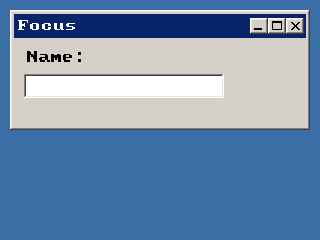

<!-- AUTOGENERATED COPYRIGHT HEADER START -->
<!-- Copyright (C) 2026 Claude <noreply@anthropic.com> -->
<!-- AUTOGENERATED COPYRIGHT HEADER END -->
<!-- Generated by tools/wiki/wiki.py. Edit tools/wiki/text/ instead of this file. -->
# BlitzPlus: Gadgets

Buttons, labels, lists, sliders and the other controls.


Back to [[BlitzPlus]] or the [[Command-Index]].

| Command | Returns | Summary |
|---|---|---|
| [ActivateGadget](BlitzPlus-Gadgets#activategadget) | None | Gives the keyboard focus to a gadget, so that typing goes to it. |
| [AddGadgetItem](BlitzPlus-Gadgets#addgadgetitem) | None | Adds an entry at the end of a list box, combo box or tabber. |
| [ButtonState](BlitzPlus-Gadgets#buttonstate) | Int | Says whether a check box or radio button is ticked. |
| [ClearGadgetItems](BlitzPlus-Gadgets#cleargadgetitems) | None | Removes every entry of a list box, combo box or tabber. |
| [CountGadgetItems](BlitzPlus-Gadgets#countgadgetitems) | Int |  |
| [CreateButton](BlitzPlus-Gadgets#createbutton) | Int | Makes a button with a caption. |
| [CreateComboBox](BlitzPlus-Gadgets#createcombobox) | Int | Makes a drop-down list. |
| [CreateLabel](BlitzPlus-Gadgets#createlabel) | Int | Makes a piece of text that does not react to the user and sends no events. |
| [CreateListBox](BlitzPlus-Gadgets#createlistbox) | Int | Makes a list of entries from which the user can pick one. |
| [CreatePanel](BlitzPlus-Gadgets#createpanel) | Int | Makes a rectangle that other gadgets can be placed on, so you can group them, hide them together or move them together. |
| [CreateProgBar](BlitzPlus-Gadgets#createprogbar) | Int | Makes a bar that shows how far something got. |
| [CreateSlider](BlitzPlus-Gadgets#createslider) | Int | Makes a scroll bar the user can drag. |
| [CreateTabber](BlitzPlus-Gadgets#createtabber) | Int | Makes a row of tabs. |
| [DisableGadget](BlitzPlus-Gadgets#disablegadget) | None | Greys a gadget out so it ignores the user and sends no events. |
| [EnableGadget](BlitzPlus-Gadgets#enablegadget) | None | Turns a gadget that was disabled with [DisableGadget](BlitzPlus-Gadgets#disablegadget) back on. |
| [FreeGadget](BlitzPlus-Gadgets#freegadget) | None | Removes a gadget for good, together with everything inside it. |
| [GadgetFont](BlitzPlus-Gadgets#gadgetfont) | Int | Gives the font a gadget is drawn with. |
| [GadgetGroup](BlitzPlus-Gadgets#gadgetgroup) | Int |  |
| [GadgetHeight](BlitzPlus-Gadgets#gadgetheight) | Int |  |
| [GadgetItemText](BlitzPlus-Gadgets#gadgetitemtext) | String |  |
| [GadgetText](BlitzPlus-Gadgets#gadgettext) | String | Reads the text of a gadget, such as the caption of a button or label, or the title of a window. |
| [GadgetWidth](BlitzPlus-Gadgets#gadgetwidth) | Int |  |
| [GadgetX](BlitzPlus-Gadgets#gadgetx) | Int |  |
| [GadgetY](BlitzPlus-Gadgets#gadgety) | Int |  |
| [HideGadget](BlitzPlus-Gadgets#hidegadget) | None | Makes a gadget invisible, with everything inside it. |
| [InsertGadgetItem](BlitzPlus-Gadgets#insertgadgetitem) | None | Puts a new entry into a list box, combo box or tabber before the entry with the given number. |
| [ModifyGadgetItem](BlitzPlus-Gadgets#modifygadgetitem) | None | Changes the text of an entry. |
| [RemoveGadgetItem](BlitzPlus-Gadgets#removegadgetitem) | None | Takes one entry out of a list box, combo box or tabber. |
| [SelectedGadgetItem](BlitzPlus-Gadgets#selectedgadgetitem) | Int |  |
| [SelectGadgetItem](BlitzPlus-Gadgets#selectgadgetitem) | None | Selects an entry by its number, or with -1 clears the selection. |
| [SetButtonState](BlitzPlus-Gadgets#setbuttonstate) | None | Ticks or unticks a check box or radio button. |
| [SetGadgetFont](BlitzPlus-Gadgets#setgadgetfont) | None | Makes a gadget draw its text with another font. |
| [SetGadgetLayout](BlitzPlus-Gadgets#setgadgetlayout) | None | Says how a gadget follows its group when it changes size. |
| [SetGadgetShape](BlitzPlus-Gadgets#setgadgetshape) | None | Moves and resizes a gadget, also a window. |
| [SetGadgetText](BlitzPlus-Gadgets#setgadgettext) | None | Changes the text of a gadget, like the caption of a button or label or the title of a window. |
| [SetPanelColor](BlitzPlus-Gadgets#setpanelcolor) | None | Fills a panel with a color. |
| [SetPanelImage](BlitzPlus-Gadgets#setpanelimage) | None | Shows a picture from a file in a panel. |
| [SetSliderRange](BlitzPlus-Gadgets#setsliderrange) | None | Says how much the slider covers. |
| [SetSliderValue](BlitzPlus-Gadgets#setslidervalue) | None | Moves the slider to a value from 0 to total minus visible. |
| [ShowGadget](BlitzPlus-Gadgets#showgadget) | None | Shows a gadget that was hidden with [HideGadget](BlitzPlus-Gadgets#hidegadget), together with the gadgets inside it. |
| [SliderValue](BlitzPlus-Gadgets#slidervalue) | Int |  |
| [UpdateProgBar](BlitzPlus-Gadgets#updateprogbar) | None | Sets how full a progress bar is. |

### ActivateGadget

```blitzbasic
ActivateGadget gadget%
```

**Works in:** BlitzPlus

Gives the keyboard focus to a gadget, so that typing goes to it. Use it to put the cursor in a text field when a window opens. Giving the focus to the window itself makes keys like Escape reach the window again.

```blitzbasic
Graphics 320, 240, 32, 2
win = CreateWindow("Focus", 10, 10, 300, 120, Desktop(), 3)
CreateLabel "Name:", 10, 10, 120, 24, win
name = CreateTextField(10, 36, 200, 24, win)
ActivateGadget name
Repeat
Until WaitEvent() = $803
```



| Parameter | Type | Default | Description |
|---|---|---|---|
| `gadget` | Int | required | Handle of the gadget that should get the focus. |

### AddGadgetItem

```blitzbasic
AddGadgetItem gadget%, item$, select%=0, icon%=-1
```

**Works in:** BlitzPlus

Adds an entry at the end of a list box, combo box or tabber. For a tabber the entry is a new tab. Use [InsertGadgetItem](BlitzPlus-Gadgets#insertgadgetitem) to put it somewhere else.

```blitzbasic
Graphics 320, 240, 32, 2
win  = CreateWindow("List", 10, 10, 300, 200, Desktop(), 3)
list = CreateListBox(10, 10, 200, 120, win)
AddGadgetItem list, "Apples"
AddGadgetItem list, "Pears"
AddGadgetItem list, "Plums", True
Repeat
Until WaitEvent() = $803
```


| Parameter | Type | Default | Description |
|---|---|---|---|
| `gadget` | Int | required | Handle of a list box, combo box or tabber. |
| `item` | String | required |  |
| `select` | Int | `0` | True makes it the selected entry. Defaults to False. |
| `icon` | Int | `-1` | Number of an icon in the icon strip given with [SetGadgetIconStrip](BlitzPlus-Toolbars#setgadgeticonstrip). Defaults to -1, which means none. |

### ButtonState

```blitzbasic
ButtonState button%  ; returns Int
```

**Works in:** BlitzPlus

Says whether a check box or radio button is ticked. The state of normal buttons is always 0.

```blitzbasic
Graphics 320, 240, 32, 2
win = CreateWindow("Check", 10, 10, 300, 120, Desktop(), 3)
box = CreateButton("Sound on", 10, 10, 200, 24, win, 2)
SetButtonState box, True
Repeat
	e = WaitEvent()
	If e = $401 And EventSource() = box Then SetGadgetText win, "State " + ButtonState(box)
Until e = $803
```

| Parameter | Type | Default | Description |
|---|---|---|---|
| `button` | Int | required | Handle of a button made with style 2 or 3. |

**Returns:** 1 if it is ticked, 0 if not.

### ClearGadgetItems

```blitzbasic
ClearGadgetItems gadget%
```

**Works in:** BlitzPlus

Removes every entry of a list box, combo box or tabber.

```blitzbasic
Graphics 320, 240, 32, 2
win  = CreateWindow("Clear", 10, 10, 300, 200, Desktop(), 3)
list = CreateListBox(10, 10, 200, 100, win)
AddGadgetItem list, "One"
AddGadgetItem list, "Two"
ClearGadgetItems list
SetGadgetText win, "Items: " + CountGadgetItems(list)
Repeat
Until WaitEvent() = $803
```

| Parameter | Type | Default | Description |
|---|---|---|---|
| `gadget` | Int | required | Handle of a list box, combo box or tabber. |

### CountGadgetItems

```blitzbasic
CountGadgetItems gadget%  ; returns Int
```

**Works in:** BlitzPlus

_Not documented yet._

| Parameter | Type | Default | Description |
|---|---|---|---|
| `gadget` | Int | required | Handle of a list box, combo box or tabber. |

**Returns:** How many entries it has.

### CreateButton

```blitzbasic
CreateButton text$, x%, y%, width%, height%, group%, style%=1  ; returns Int
```

**Works in:** BlitzPlus

Makes a button with a caption. The style picks what it is:

| Style | Kind |
| --- | --- |
| 1 | Push button, sends $401 when clicked. This is the default |
| 2 | Check box, toggles between ticked and not and sends the new state |
| 3 | Radio button, ticking one unticks the others in the same group |
| 4 | Default button, also fires when Enter is pressed inside its group |
| 5 | Cancel button, also fires when Escape is pressed inside its group |

Add 65536 to keep the button from following when its group is resized. Radio buttons that share a group belong together, so put sets of them on different panels to keep them apart. Use [ButtonState](BlitzPlus-Gadgets#buttonstate) and [SetButtonState](BlitzPlus-Gadgets#setbuttonstate) for check boxes and radio buttons.

```blitzbasic
Graphics 320, 240, 32, 2
win = CreateWindow("Buttons", 10, 10, 300, 200, Desktop(), 3)
push = CreateButton("Push", 10, 10, 120, 28, win)
tick = CreateButton("Check box", 10, 50, 140, 24, win, 2)
a    = CreateButton("Radio A", 10, 90, 140, 24, win, 3)
b    = CreateButton("Radio B", 10, 116, 140, 24, win, 3)
SetButtonState a, True
count = 0
Repeat
	e = WaitEvent()
	If e = $401 And EventSource() = push Then count = count + 1 : SetGadgetText push, "Pushed " + count
Until e = $803
```


| Parameter | Type | Default | Description |
|---|---|---|---|
| `text` | String | required | Caption of the button. |
| `x` | Int | required | Horizontal position inside the group. |
| `y` | Int | required | Vertical position inside the group. |
| `width` | Int | required | Width of the button. |
| `height` | Int | required | Height of the button. |
| `group` | Int | required | Window, panel, tabber or canvas that holds it. |
| `style` | Int | `1` | Kind of button, see the table. Defaults to 1. |

**Returns:** A handle for the button.

**Differences and known gaps:**

* Buttons are drawn in the look of the program, not with the controls of the operating system.

### CreateComboBox

```blitzbasic
CreateComboBox x%, y%, width%, height%, group%, style%=0  ; returns Int
```

**Works in:** BlitzPlus

Makes a drop-down list. It shows the selected entry and opens the list when clicked. Fill it with [AddGadgetItem](BlitzPlus-Gadgets#addgadgetitem), and read what was picked with [SelectedGadgetItem](BlitzPlus-Gadgets#selectedgadgetitem) when a $401 event arrives.

```blitzbasic
Graphics 320, 240, 32, 2
win = CreateWindow("Combo", 10, 10, 300, 200, Desktop(), 3)
box = CreateComboBox(10, 10, 160, 24, win)
AddGadgetItem box, "Small"
AddGadgetItem box, "Medium"
AddGadgetItem box, "Large"
SelectGadgetItem box, 0
Repeat
	e = WaitEvent()
	If e = $401 Then SetGadgetText win, "Picked " + GadgetItemText(box, SelectedGadgetItem(box))
Until e = $803
```


| Parameter | Type | Default | Description |
|---|---|---|---|
| `x` | Int | required | Horizontal position inside the group. |
| `y` | Int | required | Vertical position inside the group. |
| `width` | Int | required | Width of the box. |
| `height` | Int | required | Height of the closed box. |
| `group` | Int | required | Window, panel, tabber or canvas that holds it. |
| `style` | Int | `0` | 0, or 65536 to not follow the group when it is resized. Defaults to 0. |

**Returns:** A handle for the combo box.

**Differences and known gaps:**

* The user cannot type into it, only pick from the list.

### CreateLabel

```blitzbasic
CreateLabel text$, x%, y%, width%, height%, group%, style%=0  ; returns Int
```

**Works in:** BlitzPlus

Makes a piece of text that does not react to the user and sends no events. Long text is wrapped inside the box, and `Chr$(13)` breaks a line by hand. The style adds a frame:

| Style | Frame |
| --- | --- |
| 0 | None |
| 1 | Black line |
| 3 | Sunken 3D frame |

Add 65536 to keep it from following when its group is resized.

```blitzbasic
Graphics 320, 240, 32, 2
win = CreateWindow("Labels", 10, 10, 300, 200, Desktop(), 3)
CreateLabel "No frame", 10, 10, 160, 24, win, 0
CreateLabel "Black frame", 10, 40, 160, 24, win, 1
CreateLabel "3D frame", 10, 70, 160, 24, win, 3
CreateLabel "Wraps by itself," + Chr$(13) + "or by hand.", 10, 100, 220, 50, win
Repeat
Until WaitEvent() = $803
```


| Parameter | Type | Default | Description |
|---|---|---|---|
| `text` | String | required | The text to show. |
| `x` | Int | required | Horizontal position inside the group. |
| `y` | Int | required | Vertical position inside the group. |
| `width` | Int | required | Width of the label. |
| `height` | Int | required | Height of the label. |
| `group` | Int | required | Window, panel, tabber or canvas that holds it. |
| `style` | Int | `0` | Frame, see the table. Defaults to 0. |

**Returns:** A handle for the label.

**Differences and known gaps:**

* The built-in font is wider than the font of the Windows interface, so give labels, buttons and lists a little more room than you would on Windows.

### CreateListBox

```blitzbasic
CreateListBox x%, y%, width%, height%, group%, style%=0  ; returns Int
```

**Works in:** BlitzPlus

Makes a list of entries from which the user can pick one. A scroll bar appears when there are more entries than fit. Clicking an entry sends $401 with the gadget as the source, and the entry is given by [SelectedGadgetItem](BlitzPlus-Gadgets#selectedgadgetitem).

```blitzbasic
Graphics 320, 240, 32, 2
win  = CreateWindow("Fruit", 10, 10, 300, 200, Desktop(), 3)
list = CreateListBox(10, 10, 160, 110, win)
AddGadgetItem list, "Apple"
AddGadgetItem list, "Banana"
AddGadgetItem list, "Cherry"
AddGadgetItem list, "Grape"
Repeat
	e = WaitEvent()
	If e = $401 Then SetGadgetText win, "Chose " + GadgetItemText(list, SelectedGadgetItem(list))
Until e = $803
```


| Parameter | Type | Default | Description |
|---|---|---|---|
| `x` | Int | required | Horizontal position inside the group. |
| `y` | Int | required | Vertical position inside the group. |
| `width` | Int | required | Width of the list. |
| `height` | Int | required | Height of the list. |
| `group` | Int | required | Window, panel, tabber or canvas that holds it. |
| `style` | Int | `0` | 0, or 65536 to not follow the group when it is resized. Defaults to 0. |

**Returns:** A handle for the list box.

**Differences and known gaps:**

* Only one entry can be selected at a time.

### CreatePanel

```blitzbasic
CreatePanel x%, y%, width%, height%, group%, style%=0  ; returns Int
```

**Works in:** BlitzPlus

Makes a rectangle that other gadgets can be placed on, so you can group them, hide them together or move them together. Give it a color with [SetPanelColor](BlitzPlus-Gadgets#setpanelcolor) or a picture with [SetPanelImage](BlitzPlus-Gadgets#setpanelimage). Style 1 draws a frame around it.

```blitzbasic
Graphics 320, 240, 32, 2
win   = CreateWindow("Panels", 10, 10, 300, 200, Desktop(), 3)
left  = CreatePanel(10, 10, 130, 140, win, 1)
right = CreatePanel(150, 10, 130, 140, win, 1)
SetPanelColor right, 180, 210, 255
CreateButton "Left", 10, 10, 100, 28, left
CreateButton "Right", 10, 10, 100, 28, right
Repeat
Until WaitEvent() = $803
```


| Parameter | Type | Default | Description |
|---|---|---|---|
| `x` | Int | required | Horizontal position inside the group. |
| `y` | Int | required | Vertical position inside the group. |
| `width` | Int | required | Width of the panel. |
| `height` | Int | required | Height of the panel. |
| `group` | Int | required | Window, tabber, canvas or another panel that holds it. |
| `style` | Int | `0` | 1 draws a frame. Add 65536 to not follow the group when it is resized. Defaults to 0. |

**Returns:** A handle for the panel.

### CreateProgBar

```blitzbasic
CreateProgBar x%, y%, width%, height%, group%, style%=0  ; returns Int
```

**Works in:** BlitzPlus

Makes a bar that shows how far something got. Set how full it is with [UpdateProgBar](BlitzPlus-Gadgets#updateprogbar).

```blitzbasic
Graphics 320, 240, 32, 2
win = CreateWindow("Progress", 10, 10, 300, 120, Desktop(), 3)
bar = CreateProgBar(10, 20, 260, 22, win)
done# = 0
Repeat
	e = WaitEvent(300)
	done# = done# + 0.2
	If done# > 1 Then done# = 1
	UpdateProgBar bar, done#
Until e = $803
```


| Parameter | Type | Default | Description |
|---|---|---|---|
| `x` | Int | required | Horizontal position inside the group. |
| `y` | Int | required | Vertical position inside the group. |
| `width` | Int | required | Width of the bar. |
| `height` | Int | required | Height of the bar. |
| `group` | Int | required | Window, panel, tabber or canvas that holds it. |
| `style` | Int | `0` | 0, or 65536 to not follow the group when it is resized. Defaults to 0. |

**Returns:** A handle for the progress bar.

### CreateSlider

```blitzbasic
CreateSlider x%, y%, width%, height%, group%, style%=1  ; returns Int
```

**Works in:** BlitzPlus

Makes a scroll bar the user can drag. Style 1 is horizontal and 2 is vertical, and 65536 can be added to not follow the group when it is resized. The range is set with [SetSliderRange](BlitzPlus-Gadgets#setsliderrange) and a $401 event with the new value arrives when it moves. [SliderValue](BlitzPlus-Gadgets#slidervalue) reads it at any time.

```blitzbasic
Graphics 320, 240, 32, 2
win = CreateWindow("Slider", 10, 10, 300, 140, Desktop(), 3)
sl  = CreateSlider(10, 10, 270, 22, win, 1)
SetSliderRange sl, 10, 110
Repeat
	e = WaitEvent()
	If e = $401 Then SetGadgetText win, "Value " + SliderValue(sl)
Until e = $803
```


| Parameter | Type | Default | Description |
|---|---|---|---|
| `x` | Int | required | Horizontal position inside the group. |
| `y` | Int | required | Vertical position inside the group. |
| `width` | Int | required | Width of the slider. |
| `height` | Int | required | Height of the slider. |
| `group` | Int | required | Window, panel, tabber or canvas that holds it. |
| `style` | Int | `1` | 1 for horizontal or 2 for vertical, plus 65536 for not following the group. Defaults to 1. |

**Returns:** A handle for the slider.

### CreateTabber

```blitzbasic
CreateTabber x%, y%, width%, height%, group%, style%=0  ; returns Int
```

**Works in:** BlitzPlus

Makes a row of tabs. Fill it with [AddGadgetItem](BlitzPlus-Gadgets#addgadgetitem), one entry for each tab. The tabber does not hold the contents of the tabs for you: put a panel for each tab in the same window and show only the one that matches the selected tab, when the tabber sends $401.

```blitzbasic
Graphics 320, 240, 32, 2
win = CreateWindow("Tabs", 10, 10, 300, 200, Desktop(), 3)
tabs = CreateTabber(10, 10, 270, 150, win)
AddGadgetItem tabs, "General"
AddGadgetItem tabs, "Sound"
general = CreatePanel(14, 40, 262, 106, win, 1)
CreateLabel "General settings", 10, 10, 200, 20, general
sound = CreatePanel(14, 40, 262, 106, win, 1)
CreateLabel "Sound settings", 10, 10, 200, 20, sound
HideGadget sound
Repeat
	e = WaitEvent()
	If e = $401 And EventSource() = tabs Then
		If SelectedGadgetItem(tabs) = 0 Then ShowGadget general : HideGadget sound
		If SelectedGadgetItem(tabs) = 1 Then ShowGadget sound : HideGadget general
	EndIf
Until e = $803
```


| Parameter | Type | Default | Description |
|---|---|---|---|
| `x` | Int | required | Horizontal position inside the group. |
| `y` | Int | required | Vertical position inside the group. |
| `width` | Int | required | Width of the tabber. |
| `height` | Int | required | Height of the tabber. |
| `group` | Int | required | Window, panel or canvas that holds it. |
| `style` | Int | `0` | 0, or 65536 to not follow the group when it is resized. Defaults to 0. |

**Returns:** A handle for the tabber.

**Differences and known gaps:**

* Gadgets created with the tabber as their group are drawn on it all the time, as in the original. They are not tied to a tab.

### DisableGadget

```blitzbasic
DisableGadget gadget%
```

**Works in:** BlitzPlus

Greys a gadget out so it ignores the user and sends no events. A disabled window disables everything inside it. Combined with a child window this makes a dialog that blocks the window behind it.

```blitzbasic
Graphics 320, 240, 32, 2
win = CreateWindow("Disabled", 10, 10, 300, 140, Desktop(), 3)
ok  = CreateButton("Works", 10, 10, 120, 28, win)
no  = CreateButton("Disabled", 10, 50, 120, 28, win)
DisableGadget no
Repeat
Until WaitEvent() = $803
```


| Parameter | Type | Default | Description |
|---|---|---|---|
| `gadget` | Int | required | Handle of the gadget. |

### EnableGadget

```blitzbasic
EnableGadget gadget%
```

**Works in:** BlitzPlus

Turns a gadget that was disabled with [DisableGadget](BlitzPlus-Gadgets#disablegadget) back on.

```blitzbasic
Graphics 320, 240, 32, 2
win = CreateWindow("Enable", 10, 10, 300, 140, Desktop(), 3)
a   = CreateButton("Unlock", 10, 10, 120, 28, win)
b   = CreateButton("Locked", 10, 50, 120, 28, win)
DisableGadget b
Repeat
	e = WaitEvent()
	If e = $401 And EventSource() = a Then EnableGadget b
Until e = $803
```

| Parameter | Type | Default | Description |
|---|---|---|---|
| `gadget` | Int | required | Handle of the gadget. |

### FreeGadget

```blitzbasic
FreeGadget gadget%
```

**Works in:** BlitzPlus

Removes a gadget for good, together with everything inside it. If you only want it gone for a while use [HideGadget](BlitzPlus-Gadgets#hidegadget). The handle must not be used afterwards.

```blitzbasic
Graphics 320, 240, 32, 2
win = CreateWindow("Free", 10, 10, 300, 140, Desktop(), 3)
b   = CreateButton("Remove me", 10, 10, 120, 28, win)
Repeat
	e = WaitEvent()
	If e = $401 Then FreeGadget b
Until e = $803
```

| Parameter | Type | Default | Description |
|---|---|---|---|
| `gadget` | Int | required | Handle of the gadget. A window can be freed too. |

### GadgetFont

```blitzbasic
GadgetFont gadget%  ; returns Int
```

**Works in:** BlitzPlus

Gives the font a gadget is drawn with. The official help lists the command as undocumented.

| Parameter | Type | Default | Description |
|---|---|---|---|
| `gadget` | Int | required | Handle of the gadget. |

**Returns:** A font handle, or 0 if it uses the default font.

### GadgetGroup

```blitzbasic
GadgetGroup gadget%  ; returns Int
```

**Works in:** BlitzPlus

_Not documented yet._

| Parameter | Type | Default | Description |
|---|---|---|---|
| `gadget` | Int | required | Handle of the gadget. |

**Returns:** The handle of the group (window, panel, tabber or canvas) that holds the gadget.

### GadgetHeight

```blitzbasic
GadgetHeight gadget%  ; returns Int
```

**Works in:** BlitzPlus

_Not documented yet._

| Parameter | Type | Default | Description |
|---|---|---|---|
| `gadget` | Int | required | Handle of the gadget. |

**Returns:** The height of the whole gadget including its frame. For the height of the inside use [ClientHeight](BlitzPlus-Windows#clientheight).

### GadgetItemText

```blitzbasic
GadgetItemText gadget%, index%  ; returns String
```

**Works in:** BlitzPlus

_Not documented yet._

| Parameter | Type | Default | Description |
|---|---|---|---|
| `gadget` | Int | required | Handle of a list box, combo box or tabber. |
| `index` | Int | required | Number of the entry, starting at 0. |

**Returns:** The text of that entry.

### GadgetText

```blitzbasic
GadgetText gadget%  ; returns String
```

**Works in:** BlitzPlus

Reads the text of a gadget, such as the caption of a button or label, or the title of a window. For text fields and text areas, use [TextFieldText](BlitzPlus-Text-Areas#textfieldtext) and [TextAreaText](BlitzPlus-Text-Areas#textareatext) to read what the user typed. The official help lists the command as undocumented.

```blitzbasic
Graphics 320, 240, 32, 2
win = CreateWindow("Text", 10, 10, 300, 100, Desktop(), 3)
b   = CreateButton("Hello", 10, 10, 120, 28, win)
Repeat
	e = WaitEvent()
	If e = $401 Then SetGadgetText win, GadgetText(b) + " again"
Until e = $803
```

| Parameter | Type | Default | Description |
|---|---|---|---|
| `gadget` | Int | required | Handle of the gadget. |

**Returns:** The text of the gadget.

### GadgetWidth

```blitzbasic
GadgetWidth gadget%  ; returns Int
```

**Works in:** BlitzPlus

_Not documented yet._

| Parameter | Type | Default | Description |
|---|---|---|---|
| `gadget` | Int | required | Handle of the gadget. |

**Returns:** The width of the whole gadget including its frame. For the width of the inside use [ClientWidth](BlitzPlus-Windows#clientwidth).

### GadgetX

```blitzbasic
GadgetX gadget%  ; returns Int
```

**Works in:** BlitzPlus

_Not documented yet._

| Parameter | Type | Default | Description |
|---|---|---|---|
| `gadget` | Int | required | Handle of the gadget. |

**Returns:** The horizontal position inside its group, which is not the position on the screen.

### GadgetY

```blitzbasic
GadgetY gadget%  ; returns Int
```

**Works in:** BlitzPlus

_Not documented yet._

| Parameter | Type | Default | Description |
|---|---|---|---|
| `gadget` | Int | required | Handle of the gadget. |

**Returns:** The vertical position inside its group, which is not the position on the screen.

### HideGadget

```blitzbasic
HideGadget gadget%
```

**Works in:** BlitzPlus

Makes a gadget invisible, with everything inside it. It also cannot be used. [ShowGadget](BlitzPlus-Gadgets#showgadget) brings it back. It is quicker than freeing and making it again.

```blitzbasic
Graphics 320, 240, 32, 2
win    = CreateWindow("Hide", 10, 10, 300, 140, Desktop(), 3)
toggle = CreateButton("Toggle", 10, 10, 120, 28, win)
lab    = CreateLabel("Now you see me", 10, 60, 220, 24, win, 3)
shown  = True
Repeat
	e = WaitEvent()
	If e = $401 And EventSource() = toggle Then
		shown = Not shown
		If shown Then ShowGadget lab Else HideGadget lab
	EndIf
Until e = $803
```


| Parameter | Type | Default | Description |
|---|---|---|---|
| `gadget` | Int | required | Handle of the gadget. |

### InsertGadgetItem

```blitzbasic
InsertGadgetItem gadget%, index%, item$, icon%=-1
```

**Works in:** BlitzPlus

Puts a new entry into a list box, combo box or tabber before the entry with the given number.

```blitzbasic
Graphics 320, 240, 32, 2
win  = CreateWindow("Insert", 10, 10, 300, 200, Desktop(), 3)
list = CreateListBox(10, 10, 200, 100, win)
AddGadgetItem list, "First"
AddGadgetItem list, "Third"
InsertGadgetItem list, 1, "Second"
Repeat
Until WaitEvent() = $803
```

| Parameter | Type | Default | Description |
|---|---|---|---|
| `gadget` | Int | required | Handle of a list box, combo box or tabber. |
| `index` | Int | required | Where the entry goes, starting at 0. |
| `item` | String | required |  |
| `icon` | Int | `-1` | Number of an icon of the gadget. Defaults to -1, which means none. |

### ModifyGadgetItem

```blitzbasic
ModifyGadgetItem gadget%, index%, item$, icon%=-1
```

**Works in:** BlitzPlus

Changes the text of an entry.

```blitzbasic
Graphics 320, 240, 32, 2
win  = CreateWindow("Modify", 10, 10, 300, 200, Desktop(), 3)
list = CreateListBox(10, 10, 200, 100, win)
AddGadgetItem list, "Old name"
ModifyGadgetItem list, 0, "New name"
Repeat
Until WaitEvent() = $803
```

| Parameter | Type | Default | Description |
|---|---|---|---|
| `gadget` | Int | required | Handle of a list box, combo box or tabber. |
| `index` | Int | required | Number of the entry, starting at 0. |
| `item` | String | required |  |
| `icon` | Int | `-1` | Number of an icon of the gadget. Defaults to -1, which means none. |

### RemoveGadgetItem

```blitzbasic
RemoveGadgetItem gadget%, index%
```

**Works in:** BlitzPlus

Takes one entry out of a list box, combo box or tabber. The entries after it move up by one.

```blitzbasic
Graphics 320, 240, 32, 2
win  = CreateWindow("Remove", 10, 10, 300, 200, Desktop(), 3)
list = CreateListBox(10, 10, 200, 100, win)
AddGadgetItem list, "Stays"
AddGadgetItem list, "Goes"
RemoveGadgetItem list, 1
Repeat
Until WaitEvent() = $803
```

| Parameter | Type | Default | Description |
|---|---|---|---|
| `gadget` | Int | required | Handle of a list box, combo box or tabber. |
| `index` | Int | required | Number of the entry, starting at 0. |

### SelectedGadgetItem

```blitzbasic
SelectedGadgetItem gadget%  ; returns Int
```

**Works in:** BlitzPlus

_Not documented yet._

| Parameter | Type | Default | Description |
|---|---|---|---|
| `gadget` | Int | required | Handle of a list box, combo box or tabber. |

**Returns:** The number of the selected entry starting at 0, or -1 if nothing is selected.

### SelectGadgetItem

```blitzbasic
SelectGadgetItem gadget%, index%
```

**Works in:** BlitzPlus

Selects an entry by its number, or with -1 clears the selection. It does not send an event.

```blitzbasic
Graphics 320, 240, 32, 2
win  = CreateWindow("Select", 10, 10, 300, 200, Desktop(), 3)
list = CreateListBox(10, 10, 200, 100, win)
AddGadgetItem list, "One"
AddGadgetItem list, "Two"
SelectGadgetItem list, 1
Repeat
Until WaitEvent() = $803
```

| Parameter | Type | Default | Description |
|---|---|---|---|
| `gadget` | Int | required | Handle of a list box, combo box or tabber. |
| `index` | Int | required | Number of the entry starting at 0, or -1 for no selection. |

### SetButtonState

```blitzbasic
SetButtonState button%, state%
```

**Works in:** BlitzPlus

Ticks or unticks a check box or radio button. Making a radio button ticked unticks the others in its group. It does not send an event.

| Parameter | Type | Default | Description |
|---|---|---|---|
| `button` | Int | required | Handle of a button of style 2 or 3. |
| `state` | Int | required | 1 for ticked, 0 for not. |

### SetGadgetFont

```blitzbasic
SetGadgetFont gadget%, font%
```

**Works in:** BlitzPlus

Makes a gadget draw its text with another font.

```blitzbasic
Graphics 320, 240, 32, 2
win = CreateWindow("Fonts", 10, 10, 300, 140, Desktop(), 3)
big = LoadFont("Arial", 20)
lab = CreateLabel("Big text", 10, 10, 250, 40, win)
SetGadgetFont lab, big
Repeat
Until WaitEvent() = $803
```


| Parameter | Type | Default | Description |
|---|---|---|---|
| `gadget` | Int | required | Handle of the gadget. |
| `font` | Int | required | Font handle from `LoadFont` or [RequestFont](BlitzPlus-Dialogs#requestfont). |

**Differences and known gaps:**

* Only the size of the font is used. Every font is drawn with the built-in typeface.

### SetGadgetLayout

```blitzbasic
SetGadgetLayout gadget%, left%, right%, top%, bottom%
```

**Works in:** BlitzPlus

Says how a gadget follows its group when it changes size. Each side can be 0 for free (the distance to that edge changes), 1 for locked (the distance stays) or 2 for proportional (it scales with the group). The default is left and top locked.

```blitzbasic
Graphics 320, 240, 32, 2
win = CreateWindow("Resize me", 10, 10, 200, 150, Desktop(), 3)
box = CreateTextArea(10, 10, 170, 70, win)
SetGadgetLayout box, 1, 1, 1, 1
ok  = CreateButton("OK", 100, 90, 80, 28, win)
SetGadgetLayout ok, 0, 1, 0, 1
Repeat
Until WaitEvent() = $803
```


| Parameter | Type | Default | Description |
|---|---|---|---|
| `gadget` | Int | required | Handle of the gadget. |
| `left` | Int | required | Behavior of the left edge: 0, 1 or 2. |
| `right` | Int | required | Behavior of the right edge: 0, 1 or 2. |
| `top` | Int | required | Behavior of the top edge: 0, 1 or 2. |
| `bottom` | Int | required | Behavior of the bottom edge: 0, 1 or 2. |

### SetGadgetShape

```blitzbasic
SetGadgetShape gadget%, x%, y%, width%, height%
```

**Works in:** BlitzPlus

Moves and resizes a gadget, also a window. The numbers are relative to the group.

```blitzbasic
Graphics 320, 240, 32, 2
win = CreateWindow("Shape", 10, 10, 300, 140, Desktop(), 3)
b   = CreateButton("Jump", 10, 10, 100, 28, win)
Repeat
	e = WaitEvent()
	If e = $401 Then SetGadgetShape b, Rand(0, 150), Rand(0, 60), 100, 28
Until e = $803
```

| Parameter | Type | Default | Description |
|---|---|---|---|
| `gadget` | Int | required | Handle of the gadget. |
| `x` | Int | required | New horizontal position. |
| `y` | Int | required | New vertical position. |
| `width` | Int | required | New width. |
| `height` | Int | required | New height. |

### SetGadgetText

```blitzbasic
SetGadgetText gadget%, text$
```

**Works in:** BlitzPlus

Changes the text of a gadget, like the caption of a button or label or the title of a window. Text fields and text areas have commands of their own, but this works on them too.

```blitzbasic
Graphics 320, 240, 32, 2
win = CreateWindow("Text", 10, 10, 300, 100, Desktop(), 3)
lab = CreateLabel("Before", 10, 10, 200, 24, win)
SetGadgetText lab, "After"
Repeat
Until WaitEvent() = $803
```

| Parameter | Type | Default | Description |
|---|---|---|---|
| `gadget` | Int | required | Handle of a gadget that has text. |
| `text` | String | required | The new text. |

### SetPanelColor

```blitzbasic
SetPanelColor panel%, red%, green%, blue%
```

**Works in:** BlitzPlus

Fills a panel with a color.

```blitzbasic
Graphics 320, 240, 32, 2
win = CreateWindow("Color", 10, 10, 300, 140, Desktop(), 3)
p   = CreatePanel(10, 10, 100, 80, win)
SetPanelColor p, 255, 120, 0
Repeat
Until WaitEvent() = $803
```

| Parameter | Type | Default | Description |
|---|---|---|---|
| `panel` | Int | required | Handle of a panel. |
| `red` | Int | required | Red part, 0 to 255. |
| `green` | Int | required | Green part, 0 to 255. |
| `blue` | Int | required | Blue part, 0 to 255. |

### SetPanelImage

```blitzbasic
SetPanelImage panel%, file$
```

**Works in:** BlitzPlus

Shows a picture from a file in a panel. If the panel is bigger than the picture it is repeated like tiles.

```blitzbasic
Graphics 320, 240, 32, 2
tile = CreateImage(16, 16)
SetBuffer ImageBuffer(tile)
Color 40, 90, 160
Rect 0, 0, 16, 16, 1
Color 255, 255, 255
Oval 4, 4, 8, 8, 1
SaveImage tile, "tile.bmp"
SetBuffer BackBuffer()
win = CreateWindow("Tiles", 10, 10, 300, 140, Desktop(), 3)
p   = CreatePanel(10, 10, 200, 90, win)
SetPanelImage p, "tile.bmp"
Repeat
Until WaitEvent() = $803
```


| Parameter | Type | Default | Description |
|---|---|---|---|
| `panel` | Int | required | Handle of a panel. |
| `file` | String | required | Name of a picture file. |

### SetSliderRange

```blitzbasic
SetSliderRange slider%, visible%, total%
```

**Works in:** BlitzPlus

Says how much the slider covers. Both numbers are in the units you like, such as the number of lines. The value then goes from 0 to total minus visible, and the size of the handle matches visible compared to total.

```blitzbasic
Graphics 320, 240, 32, 2
win = CreateWindow("Range", 10, 10, 300, 100, Desktop(), 3)
sl  = CreateSlider(10, 10, 270, 22, win)
SetSliderRange sl, 5, 25 ; five out of 25 lines are seen, the value goes to 20
Repeat
	e = WaitEvent()
	If e = $401 Then SetGadgetText win, "Top line " + SliderValue(sl)
Until e = $803
```

| Parameter | Type | Default | Description |
|---|---|---|---|
| `slider` | Int | required | Handle of a slider. |
| `visible` | Int | required | How much is seen at once. |
| `total` | Int | required | How much there is altogether. |

### SetSliderValue

```blitzbasic
SetSliderValue slider%, value%
```

**Works in:** BlitzPlus

Moves the slider to a value from 0 to total minus visible. It does not send an event.

| Parameter | Type | Default | Description |
|---|---|---|---|
| `slider` | Int | required | Handle of a slider. |
| `value` | Int | required | The new position. |

### ShowGadget

```blitzbasic
ShowGadget gadget%
```

**Works in:** BlitzPlus

Shows a gadget that was hidden with [HideGadget](BlitzPlus-Gadgets#hidegadget), together with the gadgets inside it.

| Parameter | Type | Default | Description |
|---|---|---|---|
| `gadget` | Int | required | Handle of the gadget. |

### SliderValue

```blitzbasic
SliderValue slider%  ; returns Int
```

**Works in:** BlitzPlus

_Not documented yet._

| Parameter | Type | Default | Description |
|---|---|---|---|
| `slider` | Int | required | Handle of a slider. |

**Returns:** The current position, from 0 to total minus visible.

### UpdateProgBar

```blitzbasic
UpdateProgBar progbar%, progress#
```

**Works in:** BlitzPlus

Sets how full a progress bar is.

| Parameter | Type | Default | Description |
|---|---|---|---|
| `progbar` | Int | required | Handle of a progress bar. |
| `progress` | Float | required | How far it got from 0 (empty) to 1 (full). |
