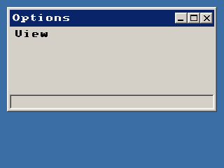

<!-- AUTOGENERATED COPYRIGHT HEADER START -->
<!-- Copyright (C) 2026 Claude <noreply@anthropic.com> -->
<!-- AUTOGENERATED COPYRIGHT HEADER END -->
<!-- Generated by tools/wiki/wiki.py. Edit tools/wiki/text/ instead of this file. -->
# BlitzPlus: Menus

Window menus and menu items.


Back to [[BlitzPlus]] or the [[Command-Index]].

| Command | Returns | Summary |
|---|---|---|
| [CheckMenu](BlitzPlus-Menus#checkmenu) | None | Puts a check mark in front of a menu item, for options that are on or off. |
| [CreateMenu](BlitzPlus-Menus#createmenu) | Int | Makes a menu title or a menu item. |
| [DisableMenu](BlitzPlus-Menus#disablemenu) | None | Greys out a menu item so it cannot be chosen and sends no events. |
| [EnableMenu](BlitzPlus-Menus#enablemenu) | None | Makes a menu item usable again after [DisableMenu](BlitzPlus-Menus#disablemenu). |
| [MenuChecked](BlitzPlus-Menus#menuchecked) | Int |  |
| [MenuEnabled](BlitzPlus-Menus#menuenabled) | Int |  |
| [MenuText](BlitzPlus-Menus#menutext) | String |  |
| [SetMenuText](BlitzPlus-Menus#setmenutext) | None | Changes the text of a menu title or item. |
| [UncheckMenu](BlitzPlus-Menus#uncheckmenu) | None | Removes the check mark that [CheckMenu](BlitzPlus-Menus#checkmenu) put in front of an item. |

### CheckMenu

```blitzbasic
CheckMenu menu%
```

**Works in:** BlitzPlus

Puts a check mark in front of a menu item, for options that are on or off. [UncheckMenu](BlitzPlus-Menus#uncheckmenu) takes it away and [MenuChecked](BlitzPlus-Menus#menuchecked) tells whether it is there. Titles in the menu bar cannot be checked.

```blitzbasic
Graphics 320, 240, 32, 2
win  = CreateWindow("Options", 10, 10, 300, 150, Desktop(), 15)
view = CreateMenu("View", 0, WindowMenu(win))
grid = CreateMenu("Show grid", 1, view)
UpdateWindowMenu win
Repeat
	e = WaitEvent()
	If e = $1001 And EventData() = 1 Then
		If MenuChecked(grid) Then UncheckMenu grid Else CheckMenu grid
		UpdateWindowMenu win
	EndIf
Until e = $803
```



| Parameter | Type | Default | Description |
|---|---|---|---|
| `menu` | Int | required | Handle of a menu item made with [CreateMenu](BlitzPlus-Menus#createmenu). |

### CreateMenu

```blitzbasic
CreateMenu text$, menu_id%, parent_menu%  ; returns Int
```

**Works in:** BlitzPlus

Makes a menu title or a menu item. Give [WindowMenu](BlitzPlus-Windows#windowmenu) as the parent to get a title in the menu bar, and a menu as the parent to put an item or a submenu into it. An item that has items of its own opens a submenu. Choosing an item sends a $1001 event whose [EventData](BlitzPlus-Events#eventdata) is the number you gave. An empty text makes a separator line.

Call [UpdateWindowMenu](BlitzPlus-Windows#updatewindowmenu) once you are done changing menus. The window needs flag 4 in its style to have room for the menu bar.

```blitzbasic
Graphics 320, 240, 32, 2
win  = CreateWindow("Editor", 10, 10, 300, 170, Desktop(), 15)
file = CreateMenu("File", 0, WindowMenu(win))
CreateMenu "New", 1, file
CreateMenu "", 0, file
CreateMenu "Quit", 2, file
UpdateWindowMenu win
Repeat
	e = WaitEvent()
	If e = $1001 Then SetStatusText win, "Menu " + EventData()
Until e = $803 Or (e = $1001 And EventData() = 2)
```


| Parameter | Type | Default | Description |
|---|---|---|---|
| `text` | String | required | Text of the title or item. Put `&` before a letter to underline it for the keyboard. An empty text is a separator. |
| `menu_id` | Int | required |  |
| `parent_menu` | Int | required |  |

**Returns:** A handle for the menu.

**Differences and known gaps:**

* The shortcut underline for `&` is accepted but menus are only used with the mouse and the arrow keys.

### DisableMenu

```blitzbasic
DisableMenu menu%
```

**Works in:** BlitzPlus

Greys out a menu item so it cannot be chosen and sends no events. [EnableMenu](BlitzPlus-Menus#enablemenu) brings it back.

```blitzbasic
Graphics 320, 240, 32, 2
win  = CreateWindow("Disabled", 10, 10, 300, 150, Desktop(), 15)
file = CreateMenu("File", 0, WindowMenu(win))
CreateMenu "Open", 1, file
save = CreateMenu("Save", 2, file)
DisableMenu save
UpdateWindowMenu win
Repeat
Until WaitEvent() = $803
```


| Parameter | Type | Default | Description |
|---|---|---|---|
| `menu` | Int | required | Handle of a menu or item. |

### EnableMenu

```blitzbasic
EnableMenu menu%
```

**Works in:** BlitzPlus

Makes a menu item usable again after [DisableMenu](BlitzPlus-Menus#disablemenu).

| Parameter | Type | Default | Description |
|---|---|---|---|
| `menu` | Int | required | Handle of a menu or item. |

### MenuChecked

```blitzbasic
MenuChecked menu%  ; returns Int
```

**Works in:** BlitzPlus

_Not documented yet._

| Parameter | Type | Default | Description |
|---|---|---|---|
| `menu` | Int | required | Handle of a menu item. |

**Returns:** 1 if it has a check mark, otherwise 0.

### MenuEnabled

```blitzbasic
MenuEnabled menu%  ; returns Int
```

**Works in:** BlitzPlus

_Not documented yet._

| Parameter | Type | Default | Description |
|---|---|---|---|
| `menu` | Int | required | Handle of a menu or item. |

**Returns:** 1 if it can be chosen, 0 if it was disabled.

### MenuText

```blitzbasic
MenuText menu%  ; returns String
```

**Works in:** BlitzPlus

_Not documented yet._

| Parameter | Type | Default | Description |
|---|---|---|---|
| `menu` | Int | required | Handle of a menu or item. |

**Returns:** The text it was made with or last given.

### SetMenuText

```blitzbasic
SetMenuText menu%, text$
```

**Works in:** BlitzPlus

Changes the text of a menu title or item.

```blitzbasic
Graphics 320, 240, 32, 2
win  = CreateWindow("Text", 10, 10, 300, 150, Desktop(), 15)
file = CreateMenu("File", 0, WindowMenu(win))
item = CreateMenu("Start", 1, file)
UpdateWindowMenu win
Repeat
	e = WaitEvent()
	If e = $1001 Then SetMenuText item, "Stop" : UpdateWindowMenu win
Until e = $803
```

| Parameter | Type | Default | Description |
|---|---|---|---|
| `menu` | Int | required | Handle of a menu or item. |
| `text` | String | required | The new text. |

**Differences and known gaps:**

* The text can be read back with [MenuText](BlitzPlus-Menus#menutext) here. The original cannot read it.

### UncheckMenu

```blitzbasic
UncheckMenu menu%
```

**Works in:** BlitzPlus

Removes the check mark that [CheckMenu](BlitzPlus-Menus#checkmenu) put in front of an item.

| Parameter | Type | Default | Description |
|---|---|---|---|
| `menu` | Int | required | Handle of a menu item. |
