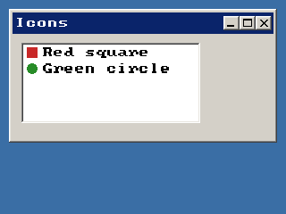

<!-- AUTOGENERATED COPYRIGHT HEADER START -->
<!-- Copyright (C) 2026 Claude <noreply@anthropic.com> -->
<!-- AUTOGENERATED COPYRIGHT HEADER END -->
<!-- Generated by tools/wiki/wiki.py. Edit tools/wiki/text/ instead of this file. -->
# BlitzPlus: Toolbars

Toolbars and icon strips.


Back to [[BlitzPlus]] or the [[Command-Index]].

| Command | Returns | Summary |
|---|---|---|
| [CreateToolBar](BlitzPlus-Toolbars#createtoolbar) | Int | Makes a row of icon buttons from a picture file. |
| [DisableToolBarItem](BlitzPlus-Toolbars#disabletoolbaritem) | None | Greys out one icon of a toolbar. |
| [EnableToolBarItem](BlitzPlus-Toolbars#enabletoolbaritem) | None | Turns an icon that was disabled with [DisableToolBarItem](BlitzPlus-Toolbars#disabletoolbaritem) back on. |
| [FreeIconStrip](BlitzPlus-Toolbars#freeiconstrip) | None | Frees an icon strip that was loaded with [LoadIconStrip](BlitzPlus-Toolbars#loadiconstrip). |
| [LoadIconStrip](BlitzPlus-Toolbars#loadiconstrip) | Int | Loads a picture of icons placed side by side to use for the entries of list boxes, combo boxes and tabbers. |
| [SetGadgetIconStrip](BlitzPlus-Toolbars#setgadgeticonstrip) | None | Gives a list box, combo box or tabber the icons to use for its entries. |
| [SetToolBarTips](BlitzPlus-Toolbars#settoolbartips) | None | Sets the hints for the icons of a toolbar, as a list separated by commas with one for each icon. |

### CreateToolBar

```blitzbasic
CreateToolBar icons$, x%, y%, width%, height%, group%, style%=0  ; returns Int
```

**Works in:** BlitzPlus

Makes a row of icon buttons from a picture file. The picture holds square icons side by side, and the number of icons is its width divided by its height. The pixel in the top left corner is the transparent color, and an icon that is only that color becomes a gap between buttons. Clicking a button sends $401 and [EventData](BlitzPlus-Events#eventdata) is the number of the icon, counted from 0.

```blitzbasic
Graphics 320, 240, 32, 2
; Make a strip of four 16x16 icons: a square, a gap, a circle and a bar.
strip = CreateImage(64, 16)
SetBuffer ImageBuffer(strip)
Color 255, 0, 255 : Rect 0, 0, 64, 16, 1
Color 200, 40, 40 : Rect 2, 2, 12, 12, 1
Color 40, 140, 40 : Oval 34, 2, 12, 12, 1
Color 40, 40, 200 : Rect 50, 6, 12, 4, 1
SaveImage strip, "icons.bmp"
SetBuffer BackBuffer()

win = CreateWindow("Tools", 10, 10, 300, 150, Desktop(), 3)
bar = CreateToolBar("icons.bmp", 0, 0, 280, 28, win)
Repeat
	e = WaitEvent()
	If e = $401 And EventSource() = bar Then SetGadgetText win, "Icon " + EventData()
Until e = $803
```


| Parameter | Type | Default | Description |
|---|---|---|---|
| `icons` | String | required |  |
| `x` | Int | required | Horizontal position inside the group. |
| `y` | Int | required | Vertical position inside the group. |
| `width` | Int | required | Width of the toolbar. |
| `height` | Int | required | Height of the toolbar. |
| `group` | Int | required | Window, panel, tabber or canvas that holds it. |
| `style` | Int | `0` | Reserved. Defaults to 0. |

**Returns:** A handle for the toolbar.

**Differences and known gaps:**

* The tool tips given with [SetToolBarTips](BlitzPlus-Toolbars#settoolbartips) are not shown.

### DisableToolBarItem

```blitzbasic
DisableToolBarItem toolbar%, index%
```

**Works in:** BlitzPlus

Greys out one icon of a toolbar. It no longer reacts and sends no events. [EnableToolBarItem](BlitzPlus-Toolbars#enabletoolbaritem) turns it back on.

```blitzbasic
Graphics 320, 240, 32, 2
strip = CreateImage(32, 16)
SetBuffer ImageBuffer(strip)
Color 255, 0, 255 : Rect 0, 0, 32, 16, 1
Color 200, 40, 40 : Rect 2, 2, 12, 12, 1
Color 40, 140, 40 : Oval 18, 2, 12, 12, 1
SaveImage strip, "icons.bmp"
SetBuffer BackBuffer()
win = CreateWindow("Off", 10, 10, 300, 100, Desktop(), 3)
bar = CreateToolBar("icons.bmp", 0, 0, 280, 28, win)
DisableToolBarItem bar, 1
Repeat
Until WaitEvent() = $803
```

| Parameter | Type | Default | Description |
|---|---|---|---|
| `toolbar` | Int | required | Handle of a toolbar. |
| `index` | Int | required | Number of the icon, counted from 0 and not counting gaps. |

### EnableToolBarItem

```blitzbasic
EnableToolBarItem toolbar%, index%
```

**Works in:** BlitzPlus

Turns an icon that was disabled with [DisableToolBarItem](BlitzPlus-Toolbars#disabletoolbaritem) back on.

| Parameter | Type | Default | Description |
|---|---|---|---|
| `toolbar` | Int | required | Handle of a toolbar. |
| `index` | Int | required | Number of the icon, counted from 0 and not counting gaps. |

### FreeIconStrip

```blitzbasic
FreeIconStrip icon_strip%
```

**Works in:** BlitzPlus

Frees an icon strip that was loaded with [LoadIconStrip](BlitzPlus-Toolbars#loadiconstrip). Only needed when you load many during the run of a program, otherwise they are freed when it ends.

| Parameter | Type | Default | Description |
|---|---|---|---|
| `icon_strip` | Int | required |  |

### LoadIconStrip

```blitzbasic
LoadIconStrip file$  ; returns Int
```

**Works in:** BlitzPlus

Loads a picture of icons placed side by side to use for the entries of list boxes, combo boxes and tabbers. Hand the result to [SetGadgetIconStrip](BlitzPlus-Toolbars#setgadgeticonstrip). The icons are squares with the height of the picture.

```blitzbasic
Graphics 320, 240, 32, 2
strip = CreateImage(32, 16)
SetBuffer ImageBuffer(strip)
Color 255, 0, 255 : Rect 0, 0, 32, 16, 1
Color 200, 40, 40 : Rect 2, 2, 12, 12, 1
Color 40, 140, 40 : Oval 18, 2, 12, 12, 1
SaveImage strip, "icons.bmp"
SetBuffer BackBuffer()
icons = LoadIconStrip("icons.bmp")
Notify "Strip " + icons
FreeIconStrip icons
```

| Parameter | Type | Default | Description |
|---|---|---|---|
| `file` | String | required | Picture file with the icons. |

**Returns:** A handle for the icon strip.

### SetGadgetIconStrip

```blitzbasic
SetGadgetIconStrip gadget%, icon_strip%
```

**Works in:** BlitzPlus

Gives a list box, combo box or tabber the icons to use for its entries. Afterwards the icon number given to [AddGadgetItem](BlitzPlus-Gadgets#addgadgetitem), [InsertGadgetItem](BlitzPlus-Gadgets#insertgadgetitem) or [ModifyGadgetItem](BlitzPlus-Gadgets#modifygadgetitem) picks one.

```blitzbasic
Graphics 320, 240, 32, 2
strip = CreateImage(32, 16)
SetBuffer ImageBuffer(strip)
Color 255, 0, 255 : Rect 0, 0, 32, 16, 1
Color 200, 40, 40 : Rect 2, 2, 12, 12, 1
Color 40, 140, 40 : Oval 18, 2, 12, 12, 1
SaveImage strip, "icons.bmp"
SetBuffer BackBuffer()
win  = CreateWindow("Icons", 10, 10, 300, 150, Desktop(), 3)
list = CreateListBox(10, 10, 200, 90, win)
SetGadgetIconStrip list, LoadIconStrip("icons.bmp")
AddGadgetItem list, "Red square", False, 0
AddGadgetItem list, "Green circle", False, 1
Repeat
Until WaitEvent() = $803
```



| Parameter | Type | Default | Description |
|---|---|---|---|
| `gadget` | Int | required | Handle of a list box, combo box or tabber. |
| `icon_strip` | Int | required |  |

### SetToolBarTips

```blitzbasic
SetToolBarTips toolbar%, tips$
```

**Works in:** BlitzPlus

Sets the hints for the icons of a toolbar, as a list separated by commas with one for each icon. They are supposed to pop up when the mouse rests over an icon.

```blitzbasic
Graphics 320, 240, 32, 2
strip = CreateImage(32, 16)
SetBuffer ImageBuffer(strip)
Color 255, 0, 255 : Rect 0, 0, 32, 16, 1
Color 200, 40, 40 : Rect 2, 2, 12, 12, 1
Color 40, 140, 40 : Oval 18, 2, 12, 12, 1
SaveImage strip, "icons.bmp"
SetBuffer BackBuffer()
win = CreateWindow("Tips", 10, 10, 300, 100, Desktop(), 3)
bar = CreateToolBar("icons.bmp", 0, 0, 280, 28, win)
SetToolBarTips bar, "Red thing,Green thing"
Repeat
Until WaitEvent() = $803
```

| Parameter | Type | Default | Description |
|---|---|---|---|
| `toolbar` | Int | required | Handle of a toolbar. |
| `tips` | String | required | Hints separated by commas. |

**Differences and known gaps:**

* The hints are stored but never shown, there are no tool tips.
