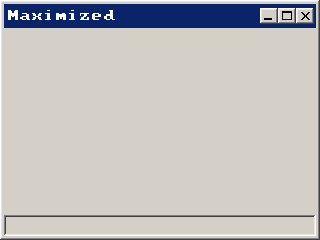
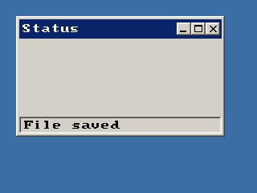
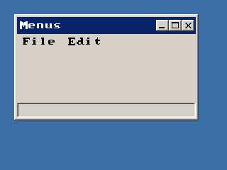

<!-- AUTOGENERATED COPYRIGHT HEADER START -->
<!-- Copyright (C) 2026 Claude <noreply@anthropic.com> -->
<!-- AUTOGENERATED COPYRIGHT HEADER END -->
<!-- Generated by tools/wiki/wiki.py. Edit tools/wiki/text/ instead of this file. -->
# BlitzPlus: Windows

Creating and controlling windows.


Back to [[BlitzPlus]] or the [[Command-Index]].

| Command | Returns | Summary |
|---|---|---|
| [ActivateWindow](BlitzPlus-Windows#activatewindow) | None | Brings a window of your program to the front and makes it the active one, as if the user had clicked on its title. |
| [ActiveWindow](BlitzPlus-Windows#activewindow) | Int |  |
| [ClientHeight](BlitzPlus-Windows#clientheight) | Int | Gives the height of the area of a group that gadgets can use, which is the inside of the window without its frame, title, menu bar and status bar. |
| [ClientWidth](BlitzPlus-Windows#clientwidth) | Int | Gives the width of the area of a group that gadgets can use, without frame or scroll bars. |
| [CreateWindow](BlitzPlus-Windows#createwindow) | Int | Makes a window and shows it. |
| [Desktop](BlitzPlus-Windows#desktop) | Int | Gives the handle of the desktop, the group that top level windows live in. |
| [MaximizeWindow](BlitzPlus-Windows#maximizewindow) | None | Makes a window as big as the desktop. |
| [MinimizeWindow](BlitzPlus-Windows#minimizewindow) | None | Hides a window as if it were put into the task bar. |
| [RestoreWindow](BlitzPlus-Windows#restorewindow) | None | Puts a window back to the position and size it had before it was minimized or maximized. |
| [SetMinWindowSize](BlitzPlus-Windows#setminwindowsize) | None | Sets how small the user may make a window. |
| [SetStatusText](BlitzPlus-Windows#setstatustext) | Int | Writes text into the status bar at the bottom of a window, which was asked for with flag 8 of [CreateWindow](BlitzPlus-Windows#createwindow). |
| [UpdateWindowMenu](BlitzPlus-Windows#updatewindowmenu) | None | Redraws the menu bar of a window after you changed its menus. |
| [WindowMaximized](BlitzPlus-Windows#windowmaximized) | Int |  |
| [WindowMenu](BlitzPlus-Windows#windowmenu) | Int | Gives the root of the menu tree of a window, which exists from the start but is empty. |
| [WindowMinimized](BlitzPlus-Windows#windowminimized) | Int |  |

### ActivateWindow

```blitzbasic
ActivateWindow window%
```

**Works in:** BlitzPlus

Brings a window of your program to the front and makes it the active one, as if the user had clicked on its title. The window gets a [WindowActivate](BlitzPlus-Events#eventid) event ($804). It only works for your own windows, never for other programs.

```blitzbasic
Graphics 320, 240, 32, 2
back  = CreateWindow("Back", 10, 10, 200, 130, Desktop(), 3)
front = CreateWindow("Front", 90, 70, 200, 130, Desktop(), 3)
ActivateWindow back
Repeat
Until WaitEvent() = $803
```


| Parameter | Type | Default | Description |
|---|---|---|---|
| `window` | Int | required | Handle of a window made with [CreateWindow](BlitzPlus-Windows#createwindow). |

**Differences and known gaps:**

* All windows are drawn inside the one window of your program, so activating one moves it in front of the others there instead of in front of other applications.

### ActiveWindow

```blitzbasic
ActiveWindow  ; returns Int
```

**Works in:** BlitzPlus

_Not documented yet._

**Returns:** The handle of the window that is active now, or the one that was active last when your program has lost the focus. 0 if no window was made yet.

**Differences and known gaps:**

* The windows are inside the program's own window, so there is no "none of ours is active" state: the answer is always the window that was activated most recently.

### ClientHeight

```blitzbasic
ClientHeight group%  ; returns Int
```

**Works in:** BlitzPlus

Gives the height of the area of a group that gadgets can use, which is the inside of the window without its frame, title, menu bar and status bar. For [Desktop](BlitzPlus-Windows#desktop) it is the height of the screen, so it tells you the resolution.

```blitzbasic
Graphics 320, 240, 32, 2
win = CreateWindow("Client", 10, 10, 200, 150, Desktop(), 15)
Notify "Window: " + ClientWidth(win) + " x " + ClientHeight(win) + Chr$(13) + "Desktop: " + ClientWidth(Desktop()) + " x " + ClientHeight(Desktop())
```

| Parameter | Type | Default | Description |
|---|---|---|---|
| `group` | Int | required | Handle of a window, panel, tabber, canvas or the desktop. Other gadgets can give meaningless numbers. |

**Returns:** The usable height in pixels.

**Differences and known gaps:**

* The desktop is the window of your program, so it is as big as the mode given to `Graphics`, not the screen of the computer.

### ClientWidth

```blitzbasic
ClientWidth group%  ; returns Int
```

**Works in:** BlitzPlus

Gives the width of the area of a group that gadgets can use, without frame or scroll bars. For [Desktop](BlitzPlus-Windows#desktop) it is the width of the screen.

```blitzbasic
Graphics 320, 240, 32, 2
win = CreateWindow("Client", 10, 10, 200, 150, Desktop(), 15)
; A gadget as wide as the inside of its window fits exactly.
CreateButton "Wide", 0, 0, ClientWidth(win), 24, win
Repeat
Until WaitEvent() = $803
```

| Parameter | Type | Default | Description |
|---|---|---|---|
| `group` | Int | required | Handle of a window, panel, tabber, canvas or the desktop. Other gadgets can give meaningless numbers. |

**Returns:** The usable width in pixels.

**Differences and known gaps:**

* The desktop is the window of your program, so it is as big as the mode given to `Graphics`, not the screen of the computer.

### CreateWindow

```blitzbasic
CreateWindow text$, x%, y%, width%, height%, group%=0, style%=15  ; returns Int
```

**Works in:** BlitzPlus

Makes a window and shows it. Windows are the parents of every other gadget: pass the window as the group of a button, label or list to put it inside. The position is relative to the group, which is [Desktop](BlitzPlus-Windows#desktop) for a normal window or another window to make a child that belongs to it.

The style is a sum of these flags, and 15 is the default:

| Flag | Meaning |
| --- | --- |
| 1 | Title bar |
| 2 | The user can resize the window |
| 4 | Room for a menu bar, see [WindowMenu](BlitzPlus-Windows#windowmenu) |
| 8 | Status bar at the bottom, see [SetStatusText](BlitzPlus-Windows#setstatustext) |
| 16 | Tool window with a smaller title bar |
| 32 | Width and height are the size of the inside, not of the whole window |

Windows send events when they move ($801), change size ($802), are closed ($803) or are activated ($804). Closing does not remove a window by itself, your program decides what to do with the $803 event.

```blitzbasic
Graphics 320, 240, 32, 2
win = CreateWindow("My window", 20, 20, 260, 180, Desktop(), 15)
CreateLabel "Try the X.", 20, 20, 200, 40, win
SetStatusText win, "Waiting"
asked = 0
Repeat
	e = WaitEvent()
	If e = $803 And EventSource() = win Then
		asked = asked + 1
		SetStatusText win, "Close was asked " + asked + "x"
	EndIf
Until asked = 2
```


| Parameter | Type | Default | Description |
|---|---|---|---|
| `text` | String | required |  |
| `x` | Int | required | Horizontal position inside the group. |
| `y` | Int | required | Vertical position inside the group. |
| `width` | Int | required | Width of the window. |
| `height` | Int | required | Height of the window. |
| `group` | Int | `0` | Desktop or another window. Defaults to 0, which means the desktop. |
| `style` | Int | `15` | Sum of the flags above. Defaults to 15. |

**Returns:** A handle for the window.

**Differences and known gaps:**

* All windows are drawn inside one SDL window and cannot leave it, there are no separate windows of the operating system and no taskbar entries. Windows are drawn in the order they were activated.
* Flag 16 is accepted but the title bar looks like a normal one.
* A window with flag 4 only shows the menu bar once menus were added.

### Desktop

```blitzbasic
Desktop  ; returns Int
```

**Works in:** BlitzPlus

Gives the handle of the desktop, the group that top level windows live in. Pass it as the group of [CreateWindow](BlitzPlus-Windows#createwindow). With [ClientWidth](BlitzPlus-Windows#clientwidth) and [ClientHeight](BlitzPlus-Windows#clientheight) it tells the size of the screen. [DesktopBuffer](BlitzPlus-Canvas#desktopbuffer) is what you draw to if you want to paint on it.

```blitzbasic
Graphics 320, 240, 32, 2
win = CreateWindow("Centered", 0, 0, 180, 100, Desktop(), 15)
SetGadgetShape win, (ClientWidth(Desktop()) - 180) / 2, (ClientHeight(Desktop()) - 100) / 2, 180, 100
Repeat
Until WaitEvent() = $803
```

**Returns:** A handle that stands for the desktop.

**Differences and known gaps:**

* The desktop is the program's own window, which has the size you gave `Graphics`. Windows cannot be placed outside of it.

### MaximizeWindow

```blitzbasic
MaximizeWindow window%
```

**Works in:** BlitzPlus

Makes a window as big as the desktop. [RestoreWindow](BlitzPlus-Windows#restorewindow) brings back the size it had before, and [WindowMaximized](BlitzPlus-Windows#windowmaximized) says whether it is in this state.

```blitzbasic
Graphics 320, 240, 32, 2
win = CreateWindow("Maximized", 40, 40, 160, 100, Desktop(), 15)
MaximizeWindow win
Repeat
Until WaitEvent() = $803
```



| Parameter | Type | Default | Description |
|---|---|---|---|
| `window` | Int | required | Handle of a window. |

**Differences and known gaps:**

* The window fills the whole program window, also when it was made without flag 2 and so cannot be resized by the user.

### MinimizeWindow

```blitzbasic
MinimizeWindow window%
```

**Works in:** BlitzPlus

Hides a window as if it were put into the task bar. Its gadgets keep their state. [RestoreWindow](BlitzPlus-Windows#restorewindow) shows it again and [WindowMinimized](BlitzPlus-Windows#windowminimized) tells if it is hidden.

```blitzbasic
Graphics 320, 240, 32, 2
win = CreateWindow("Hide and seek", 40, 40, 200, 100, Desktop(), 15)
MinimizeWindow win
If WindowMinimized(win) Then RestoreWindow win
Repeat
Until WaitEvent() = $803
```

| Parameter | Type | Default | Description |
|---|---|---|---|
| `window` | Int | required | Handle of a window. |

**Differences and known gaps:**

* There is no task bar, so a minimized window simply is not drawn and there is no way for the user to bring it back. Your program has to call `RestoreWindow`.

### RestoreWindow

```blitzbasic
RestoreWindow window%
```

**Works in:** BlitzPlus

Puts a window back to the position and size it had before it was minimized or maximized. Nothing happens to a window that is in neither state. This command is undocumented in the official help, but it exists in all versions of BlitzPlus.

```blitzbasic
Graphics 320, 240, 32, 2
win = CreateWindow("Restore", 40, 40, 160, 100, Desktop(), 15)
MaximizeWindow win
RestoreWindow win
Notify "Back at " + GadgetWidth(win) + " x " + GadgetHeight(win)
```

| Parameter | Type | Default | Description |
|---|---|---|---|
| `window` | Int | required | Handle of a window. |

### SetMinWindowSize

```blitzbasic
SetMinWindowSize window%, width%=-1, height%=-1
```

**Works in:** BlitzPlus

Sets how small the user may make a window. Without the sizes, the current size of the window becomes the smallest one. The biggest size is always the size of the desktop.

```blitzbasic
Graphics 320, 240, 32, 2
win = CreateWindow("Not too small", 20, 20, 240, 160, Desktop(), 15)
SetMinWindowSize win, 160, 100
Repeat
Until WaitEvent() = $803
```

| Parameter | Type | Default | Description |
|---|---|---|---|
| `window` | Int | required | Handle of a window that can be resized. |
| `width` | Int | `-1` | Smallest width. Defaults to -1, which takes the current width. |
| `height` | Int | `-1` | Smallest height. Defaults to -1, which takes the current height. |

**Differences and known gaps:**

* The help lists height before width in its syntax line, the real order is width then height.
* Making a window smaller with `SetGadgetShape` is not limited by it, only the user dragging the frame is.

### SetStatusText

```blitzbasic
SetStatusText window%, text$  ; returns Int
```

**Works in:** BlitzPlus

Writes text into the status bar at the bottom of a window, which was asked for with flag 8 of [CreateWindow](BlitzPlus-Windows#createwindow). The text cannot be read back.

```blitzbasic
Graphics 320, 240, 32, 2
win = CreateWindow("Status", 20, 20, 260, 150, Desktop(), 15)
SetStatusText win, "File saved"
Repeat
Until WaitEvent() = $803
```



| Parameter | Type | Default | Description |
|---|---|---|---|
| `window` | Int | required | Handle of a window made with flag 8. |
| `text` | String | required | Text to show. |

**Returns:** Always 0. The original returns a value that is not documented.

### UpdateWindowMenu

```blitzbasic
UpdateWindowMenu window%
```

**Works in:** BlitzPlus

Redraws the menu bar of a window after you changed its menus. It only has to be called after commands like `CreateMenu`, `CheckMenu` or `SetMenuText`, and one call after a bunch of changes is enough.

```blitzbasic
Graphics 320, 240, 32, 2
win  = CreateWindow("Menu", 20, 20, 240, 140, Desktop(), 15)
file = CreateMenu("File", 0, WindowMenu(win))
CreateMenu "Quit", 1, file
UpdateWindowMenu win
Repeat
	e = WaitEvent()
Until e = $803 Or (e = $1001 And EventData() = 1)
```

| Parameter | Type | Default | Description |
|---|---|---|---|
| `window` | Int | required | Handle of a window. |

**Differences and known gaps:**

* Menus here change the screen right away, so this command only asks for a redraw.

### WindowMaximized

```blitzbasic
WindowMaximized window%  ; returns Int
```

**Works in:** BlitzPlus

_Not documented yet._

| Parameter | Type | Default | Description |
|---|---|---|---|
| `window` | Int | required | Handle of a window. |

**Returns:** 1 if the window is maximized with [MaximizeWindow](BlitzPlus-Windows#maximizewindow), otherwise 0.

### WindowMenu

```blitzbasic
WindowMenu window%  ; returns Int
```

**Works in:** BlitzPlus

Gives the root of the menu tree of a window, which exists from the start but is empty. Menus made with this as their parent are the titles in the menu bar. The window needs flag 4 to show room for it.

```blitzbasic
Graphics 320, 240, 32, 2
win = CreateWindow("Menus", 20, 20, 260, 150, Desktop(), 15)
file = CreateMenu("File", 0, WindowMenu(win))
CreateMenu "Open", 1, file
CreateMenu "Exit", 2, file
edit = CreateMenu("Edit", 0, WindowMenu(win))
CreateMenu "Copy", 3, edit
UpdateWindowMenu win
Repeat
Until WaitEvent() = $803
```



| Parameter | Type | Default | Description |
|---|---|---|---|
| `window` | Int | required | Handle of a window. |

**Returns:** The handle of the root menu. It is the same on every call.

### WindowMinimized

```blitzbasic
WindowMinimized window%  ; returns Int
```

**Works in:** BlitzPlus

_Not documented yet._

| Parameter | Type | Default | Description |
|---|---|---|---|
| `window` | Int | required | Handle of a window. |

**Returns:** 1 if the window is hidden with [MinimizeWindow](BlitzPlus-Windows#minimizewindow), otherwise 0.
