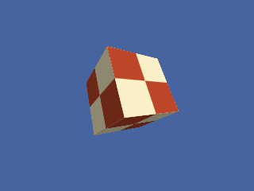

<!-- AUTOGENERATED COPYRIGHT HEADER START -->
<!-- Copyright (C) 2026 Claude <noreply@anthropic.com> -->
<!-- AUTOGENERATED COPYRIGHT HEADER END -->
<!-- Generated by tools/wiki/wiki.py. Edit tools/wiki/text/ instead of this file. -->
# BrushTexture

[Command Index](Command-Index) · [Blitz3D](Blitz3D) · [Brushes](Blitz3D-Brushes)

```blitzbasic
BrushTexture brush:Int32, texture:Int32, frame:Int32=0, index:Int32=0
```

**Works in:** Blitz3D

Puts a texture on one of the layers of the brush. Layer 0 is the base texture, further layers are blended on top of it using [TextureBlend](TextureBlend). For a texture from [LoadAnimTexture](LoadAnimTexture) the frame chooses the cell to show.

```blitzbasic
Graphics3D 320, 240, 0, 2
SetBuffer BackBuffer()
camera = CreateCamera()
CameraClsColor camera, 70, 100, 160
light = CreateLight()
RotateEntity light, 40, 30, 0

tex = CreateTexture(64, 64)
SetBuffer TextureBuffer(tex)
ClsColor 250, 240, 200
Cls
Color 190, 70, 40
Rect 0, 0, 32, 32, 1
Rect 32, 32, 32, 32, 1
SetBuffer BackBuffer()

brush = CreateBrush(255, 255, 255)
BrushTexture brush, tex
cube = CreateCube()
PositionEntity cube, 0, 0, 4.4
TurnEntity cube, 25, 35, 0
PaintEntity cube, brush
RenderWorld
Flip
WaitKey
```



| Parameter | Type | Default | Description |
|---|---|---|---|
| `brush` | Int32 | required | The brush. |
| `texture` | Int32 | required | The texture to put on the brush. |
| `frame` | Int32 | `0` | Frame of an animated texture. Defaults to 0. |
| `index` | Int32 | `0` | Layer number. Defaults to 0. |

**Differences and known gaps:**

* Layers 0 to 7 are accepted. The original help documents only 0 to 3 for this command.

## Related commands

* [BrushAlpha](BrushAlpha)
* [BrushBlend](BrushBlend)
* [BrushColor](BrushColor)
* [BrushFX](BrushFX)
* [BrushShininess](BrushShininess)
* [CreateBrush](CreateBrush)
* [FreeBrush](FreeBrush)
* [GetBrushTexture](GetBrushTexture)

[Command Index](Command-Index) · [Blitz3D](Blitz3D) · [Brushes](Blitz3D-Brushes)
