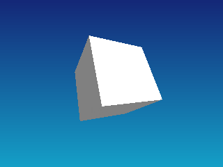

<!-- AUTOGENERATED COPYRIGHT HEADER START -->
<!-- Copyright (C) 2026 Claude <noreply@anthropic.com> -->
<!-- AUTOGENERATED COPYRIGHT HEADER END -->
<!-- Generated by tools/wiki/wiki.py. Edit tools/wiki/text/ instead of this file. -->


# CameraClsMode

<div align="center">

[Command Index](Command-Index) · [Blitz3D](Blitz3D) · [Cameras](Blitz3D-Cameras)

</div>


## Command Syntax

```blitzbasic
CameraClsMode camera:Int32, cls_color:Int32, cls_zbuffer:Int32
```

## Description

Chooses what the camera clears before it draws: the color buffer, the depth buffer, both or neither. Switch color clearing off to draw a 2D background first and let the 3D world appear on top of it. Leave depth clearing on unless you render several cameras on purpose into the same pixels and want their depth to combine, otherwise earlier cameras block later ones.

## Parameters

| Parameter | Type | Default | Description |
|---|---|---|---|
| `camera` | Int32 | required | Camera handle. |
| `cls_color` | Int32 | required | True to clear the color buffer, false to keep what is there. |
| `cls_zbuffer` | Int32 | required | True to clear the depth buffer, false to keep it. |

## Examples

```blitzbasic
Graphics3D 320, 240, 0, 2
SetBuffer BackBuffer()
camera = CreateCamera()
CameraClsMode camera, 0, 1
light = CreateLight()
RotateEntity light, 45, 45, 0
cube = CreateCube()
PositionEntity cube, 0, 0, 4
TurnEntity cube, 25, 30, 0
; A 2D background that the world is drawn over.
Cls
For i = 0 To 239 Step 4
	Color 20, 40 + i / 2, 120 + i / 3
	Rect 0, i, 320, 4, 1
Next
RenderWorld
Flip
WaitKey
```

## Media



## Related Commands

* [CameraClsColor](CameraClsColor)
* [CameraFogColor](CameraFogColor)
* [CameraFogMode](CameraFogMode)
* [CameraFogRange](CameraFogRange)
* [CameraProject](CameraProject)
* [CameraProjMode](CameraProjMode)
* [CameraRange](CameraRange)
* [CameraViewport](CameraViewport)

<div align="center">

[Command Index](Command-Index) · [Blitz3D](Blitz3D) · [Cameras](Blitz3D-Cameras)

</div>
