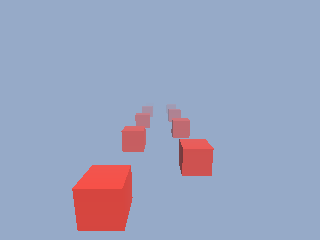

<!-- AUTOGENERATED COPYRIGHT HEADER START -->
<!-- Copyright (C) 2026 Claude <noreply@anthropic.com> -->
<!-- AUTOGENERATED COPYRIGHT HEADER END -->
<!-- Generated by tools/wiki/wiki.py. Edit tools/wiki/text/ instead of this file. -->


# CameraFogRange

<div align="center">

[Command Index](Command-Index) · [Blitz3D](Blitz3D) · [Cameras](Blitz3D-Cameras)

</div>


## Command Syntax

```blitzbasic
CameraFogRange camera:Int32, near:Float32, far:Float32
```

## Description

Sets where the fog starts and where it becomes solid. Nothing closer than `near` is touched and everything beyond `far` is completely the fog color. The default range is 1 to 1000, which is why fog is hardly visible until you shorten it.

## Parameters

| Parameter | Type | Default | Description |
|---|---|---|---|
| `camera` | Int32 | required | Camera handle. |
| `near` | Float32 | required | Distance where the fog starts. |
| `far` | Float32 | required | Distance where everything is fully fogged. |

## Examples

```blitzbasic
Graphics3D 320, 240, 0, 2
SetBuffer BackBuffer()
camera = CreateCamera()
PositionEntity camera, 0, 3, -4
RotateEntity camera, 12, 0, 0
CameraClsColor camera, 150, 170, 200
CameraFogMode camera, 1
CameraFogColor camera, 150, 170, 200
CameraFogRange camera, 2, 24
light = CreateLight()
RotateEntity light, 45, 45, 0
For i = 0 To 11
	cube = CreateCube()
	ScaleEntity cube, 0.6, 0.6, 0.6
	PositionEntity cube, (i Mod 2) * 3 - 1.5, 0, i * 2.5
	EntityColor cube, 220, 60, 50
Next
RenderWorld
Flip
WaitKey
```

## Media



## Related Commands

* [CameraClsColor](CameraClsColor)
* [CameraClsMode](CameraClsMode)
* [CameraFogColor](CameraFogColor)
* [CameraFogMode](CameraFogMode)
* [CameraProject](CameraProject)
* [CameraProjMode](CameraProjMode)
* [CameraRange](CameraRange)
* [CameraViewport](CameraViewport)

<div align="center">

[Command Index](Command-Index) · [Blitz3D](Blitz3D) · [Cameras](Blitz3D-Cameras)

</div>
