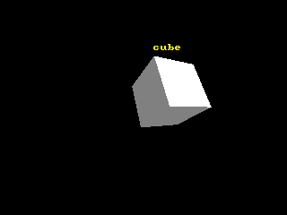

<!-- AUTOGENERATED COPYRIGHT HEADER START -->
<!-- Copyright (C) 2026 Claude <noreply@anthropic.com> -->
<!-- AUTOGENERATED COPYRIGHT HEADER END -->
<!-- Generated by tools/wiki/wiki.py. Edit tools/wiki/text/ instead of this file. -->
# CameraProject

[Command Index](Command-Index) · [Blitz3D](Blitz3D) · [Cameras](Blitz3D-Cameras)

```blitzbasic
CameraProject camera%, x#, y#, z#
```

**Works in:** Blitz3D

Works out where a point of the world lands on the screen. The result is not returned: read it afterwards with [ProjectedX](ProjectedX), [ProjectedY](ProjectedY) and [ProjectedZ](ProjectedZ). X and Y are pixels of the graphics buffer and Z is the distance of the point in front of the camera. A point behind the camera or a camera that is off gets Y and X far outside the screen, so check `ProjectedZ` before drawing. Use it to put 2D labels, health bars or a lens flare on a 3D position.

```blitzbasic
Graphics3D 320, 240, 0, 2
SetBuffer BackBuffer()
camera = CreateCamera()
light = CreateLight()
RotateEntity light, 45, 45, 0
cube = CreateCube()
PositionEntity cube, 1, 0.5, 6
TurnEntity cube, 25, 30, 0
RenderWorld
CameraProject camera, EntityX(cube), EntityY(cube) + 2, EntityZ(cube)
If ProjectedZ() > 0 Then
	Color 255, 255, 0
	Text ProjectedX(), ProjectedY(), "cube", 1, 1
EndIf
Flip
WaitKey
```



| Parameter | Type | Default | Description |
|---|---|---|---|
| `camera` | Int | required | Camera handle. |
| `x` | Float | required | X coordinate in the world. |
| `y` | Float | required | Y coordinate in the world. |
| `z` | Float | required | Z coordinate in the world. |

## Related commands

* [CameraClsColor](CameraClsColor)
* [CameraClsMode](CameraClsMode)
* [CameraFogColor](CameraFogColor)
* [CameraFogMode](CameraFogMode)
* [CameraFogRange](CameraFogRange)
* [CameraProjMode](CameraProjMode)
* [CameraRange](CameraRange)
* [CameraViewport](CameraViewport)

[Command Index](Command-Index) · [Blitz3D](Blitz3D) · [Cameras](Blitz3D-Cameras)
