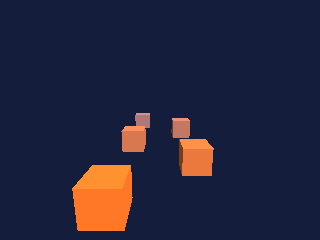

<!-- AUTOGENERATED COPYRIGHT HEADER START -->
<!-- Copyright (C) 2026 Claude <noreply@anthropic.com> -->
<!-- AUTOGENERATED COPYRIGHT HEADER END -->
<!-- Generated by tools/wiki/wiki.py. Edit tools/wiki/text/ instead of this file. -->


# CameraRange

<div align="center">

[Command Index](Command-Index) · [Blitz3D](Blitz3D) · [Cameras](Blitz3D-Cameras)

</div>


## Command Syntax

```blitzbasic
CameraRange camera:Int32, near:Float32, far:Float32
```

## Parameters

| Parameter | Type | Default | Description |
|---|---|---|---|
| `camera` | Int32 | required | Camera handle. |
| `near` | Float32 | required | Closest distance that is drawn. Must be greater than 0. |
| `far` | Float32 | required | Farthest distance that is drawn. Must be greater than `near`. |

## Description

Sets the nearest and farthest distance in front of the camera that is drawn. Anything closer than `near` or farther than `far` is clipped away. The defaults are 1 and 1000. Raising `near` and lowering `far` gives the depth buffer more precision where it matters, which stops distant surfaces from flickering through each other. BlitzLLVM draws with a reversed float depth buffer, so the precision is nearly even over the whole range and this is rarely needed. The distance is measured along the view direction, not as a radius around the camera.
The runtime stops with an error unless `0 < near < far`.

## Examples

```blitzbasic
Graphics3D 320, 240, 0, 2
SetBuffer BackBuffer()
camera = CreateCamera()
CameraRange camera, 1, 16
CameraClsColor camera, 20, 30, 60
PositionEntity camera, 0, 3, -4
RotateEntity camera, 12, 0, 0
light = CreateLight()
RotateEntity light, 45, 45, 0
For i = 0 To 9
	cube = CreateCube()
	ScaleEntity cube, 0.6, 0.6, 0.6
	PositionEntity cube, (i Mod 2) * 3 - 1.5, 0, i * 2.5
	EntityColor cube, 255 - i * 20, 120, 40 + i * 20
Next
RenderWorld
Flip
WaitKey
```

## Media



## Related Commands

* [CameraClsColor](CameraClsColor)
* [CameraClsMode](CameraClsMode)
* [CameraFogColor](CameraFogColor)
* [CameraFogMode](CameraFogMode)
* [CameraFogRange](CameraFogRange)
* [CameraProject](CameraProject)
* [CameraProjMode](CameraProjMode)
* [CameraViewport](CameraViewport)

<div align="center">

[Command Index](Command-Index) · [Blitz3D](Blitz3D) · [Cameras](Blitz3D-Cameras)

</div>
