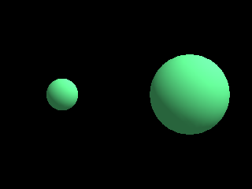

<!-- AUTOGENERATED COPYRIGHT HEADER START -->
<!-- Copyright (C) 2026 Claude <noreply@anthropic.com> -->
<!-- AUTOGENERATED COPYRIGHT HEADER END -->
<!-- Generated by tools/wiki/wiki.py. Edit tools/wiki/text/ instead of this file. -->
# CameraZoom

[Command Index](Command-Index) · [Blitz3D](Blitz3D) · [Cameras](Blitz3D-Cameras)

```blitzbasic
CameraZoom camera%, zoom#
```

**Works in:** Blitz3D

Changes how much the camera magnifies the view. 1 is the default, larger values zoom in and smaller values zoom out. Zoom narrows or widens the field of view, so it can imitate a telescope or a wide angle lens. The runtime does not accept values below 0.001.

```blitzbasic
Graphics3D 320, 240, 0, 2
SetBuffer BackBuffer()
normal = CreateCamera()
CameraViewport normal, 0, 0, 158, 240
zoomed = CreateCamera()
CameraViewport zoomed, 162, 0, 158, 240
CameraZoom zoomed, 2.5
light = CreateLight()
RotateEntity light, 45, 45, 0
ball = CreateSphere(16)
PositionEntity ball, 0, 0, 4
EntityColor ball, 80, 200, 120
RenderWorld
Flip
WaitKey
```



| Parameter | Type | Default | Description |
|---|---|---|---|
| `camera` | Int | required | Camera handle. |
| `zoom` | Float | required | Magnification, 1 by default. |

## Related commands

* [CameraClsColor](CameraClsColor)
* [CameraClsMode](CameraClsMode)
* [CameraFogColor](CameraFogColor)
* [CameraFogMode](CameraFogMode)
* [CameraFogRange](CameraFogRange)
* [CameraProject](CameraProject)
* [CameraProjMode](CameraProjMode)
* [CameraRange](CameraRange)

[Command Index](Command-Index) · [Blitz3D](Blitz3D) · [Cameras](Blitz3D-Cameras)
