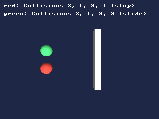

<!-- AUTOGENERATED COPYRIGHT HEADER START -->
<!-- Copyright (C) 2026 Claude <noreply@anthropic.com> -->
<!-- AUTOGENERATED COPYRIGHT HEADER END -->
<!-- Generated by tools/wiki/wiki.py. Edit tools/wiki/text/ instead of this file. -->
# Collisions

[Command Index](Command-Index) · [Blitz3D](Blitz3D) · [Collisions](Blitz3D-Collisions)

## Command Syntax

```blitzbasic
Collisions source_type:Int32, destination_type:Int32, method:Int32, response:Int32
```

## Description

**Works in:** Blitz3D

Switches on collision checking between two entity types, and says how it should work. All checking, and the movement that follows from it, happens inside [UpdateWorld](UpdateWorld). Between calls, the entity can be moved freely with [MoveEntity](MoveEntity), [TranslateEntity](TranslateEntity) and so on; UpdateWorld then walks the entity from where it was at the last update to where you put it, and stops or slides it if something is in the way.

The source type is the one that moves and gets pushed back. The destination type is what it bumps into. A pair of types can only have one rule: if you call Collisions again for the same pair, the new call is ignored until [ClearCollisions](ClearCollisions) removes the rules. Collisions work in one direction only, so `Collisions 2, 1, ...` does not make type 1 react to type 2.

| Method | The source ellipsoid hits | Destination needs |
|---|---|---|
| 1 | The destination's ellipsoid | [EntityRadius](EntityRadius) |
| 2 | The triangles of the destination mesh | Nothing, but it has to be a mesh |
| 3 | The destination's box | [EntityBox](EntityBox) |

| Response | What the source does |
|---|---|
| 1 | Stops where it hit. |
| 2 | Slides along the surface. |
| 3 | Slides, but only sideways and upwards: it does not slip down slopes. |

Hidden entities, and entities with a hidden parent, are not collided with.

**Differences and known gaps:**

* Types outside 0 to 999, or a method or response outside 1 to 3, stop the program with a runtime error.

## Parameters

| Parameter | Type | Default | Description |
|---|---|---|---|
| `source_type` | Int32 | required | Collision type of the entities that move. |
| `destination_type` | Int32 | required | Collision type of the entities they can hit. |
| `method` | Int32 | required | 1 ellipsoid, 2 polygon, 3 box, see the table. |
| `response` | Int32 | required | 1 stop, 2 slide, 3 slide without slipping down slopes. |

## Examples

```blitzbasic
Graphics3D 320, 240, 0, 2
SetBuffer BackBuffer()
camera = CreateCamera()
CameraClsColor camera, 30, 40, 70
PositionEntity camera, 0, 14, 0
RotateEntity camera, 90, 0, 0
light = CreateLight()
RotateEntity light, 60, 30, 0

; A wall of type 1 and two balls of type 2 and 3.
wall = CreateCube()
ScaleEntity wall, 0.5, 1, 5
PositionEntity wall, 3, 0, 0
EntityColor wall, 200, 200, 200
EntityType wall, 1

stopper = CreateSphere(16)
EntityColor stopper, 220, 70, 60
EntityRadius stopper, 1
EntityType stopper, 2
PositionEntity stopper, -6, 0, -1.5

slider = CreateSphere(16)
EntityColor slider, 70, 200, 110
EntityRadius slider, 1
EntityType slider, 3
PositionEntity slider, -6, 0, 1.5

; Polygon collisions with the wall; type 2 stops, type 3 slides.
Collisions 2, 1, 2, 1
Collisions 3, 1, 2, 2

For frame = 0 To 49
	TranslateEntity stopper, 0.2, 0, -0.08
	TranslateEntity slider, 0.2, 0, 0.08
	UpdateWorld
	RenderWorld
	Color 255, 255, 255
	Text 8, 8, "red: Collisions 2, 1, 2, 1 (stop)"
	Text 8, 24, "green: Collisions 3, 1, 2, 2 (slide)"
	Flip
Next
```

## Media



## Related Commands

* [ClearCollisions](ClearCollisions)
* [CollisionNY](CollisionNY)
* [CollisionNZ](CollisionNZ)
* [CountCollisions](CountCollisions)

[Command Index](Command-Index) · [Blitz3D](Blitz3D) · [Collisions](Blitz3D-Collisions)
