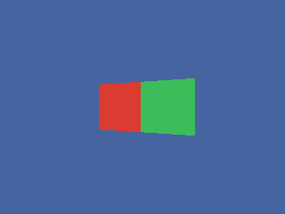

<!-- AUTOGENERATED COPYRIGHT HEADER START -->
<!-- Copyright (C) 2026 Claude <noreply@anthropic.com> -->
<!-- AUTOGENERATED COPYRIGHT HEADER END -->
<!-- Generated by tools/wiki/wiki.py. Edit tools/wiki/text/ instead of this file. -->
# CreateBrush

[Command Index](Command-Index) · [Blitz3D](Blitz3D) · [Brushes](Blitz3D-Brushes)

```blitzbasic
CreateBrush red#=255, green#=255, blue#=255  ; returns Int
```

**Works in:** Blitz3D

Makes a brush: a bundle of look settings (color, alpha, shininess, blend mode, effects and up to eight textures) that you can apply in one go with [PaintEntity](PaintEntity), [PaintMesh](PaintMesh) or [PaintSurface](PaintSurface). The new brush is opaque white with no texture unless you pass a color.

Brushes are the way to give different surfaces of one mesh a different look, because [EntityColor](EntityColor) and [EntityAlpha](EntityAlpha) affect the whole entity at once.

```blitzbasic
Graphics3D 320, 240, 0, 2
SetBuffer BackBuffer()
camera = CreateCamera()
CameraClsColor camera, 70, 100, 160
light = CreateLight()
RotateEntity light, 40, 30, 0

mesh = CreateMesh()
a = CreateSurface(mesh)
AddVertex a, -1, 1, 0 : AddVertex a, 1, 1, 0 : AddVertex a, 1, -1, 0 : AddVertex a, -1, -1, 0
AddTriangle a, 0, 1, 2 : AddTriangle a, 0, 2, 3
b = CreateSurface(mesh)
AddVertex b, 1, 1, 0 : AddVertex b, 3, 1, 0 : AddVertex b, 3, -1, 0 : AddVertex b, 1, -1, 0
AddTriangle b, 0, 1, 2 : AddTriangle b, 0, 2, 3
UpdateNormals mesh

red = CreateBrush(220, 60, 50)
BrushShininess red, 0.8
green = CreateBrush(60, 190, 90)
PaintSurface a, red
PaintSurface b, green
FreeBrush red
FreeBrush green

PositionEntity mesh, -1, 0, 6
TurnEntity mesh, 0, -20, 0
RenderWorld
Flip
WaitKey
```



| Parameter | Type | Default | Description |
|---|---|---|---|
| `red` | Float | `255` | Red part, 0 to 255. Defaults to 255. |
| `green` | Float | `255` | Green part, 0 to 255. Defaults to 255. |
| `blue` | Float | `255` | Blue part, 0 to 255. Defaults to 255. |

**Returns:** A brush handle.

## Related commands

* [BrushAlpha](BrushAlpha)
* [BrushBlend](BrushBlend)
* [BrushColor](BrushColor)
* [BrushFX](BrushFX)
* [FreeBrush](FreeBrush)
* [GetEntityBrush](GetEntityBrush)
* [GetSurfaceBrush](GetSurfaceBrush)
* [LoadBrush](LoadBrush)

[Command Index](Command-Index) · [Blitz3D](Blitz3D) · [Brushes](Blitz3D-Brushes)
