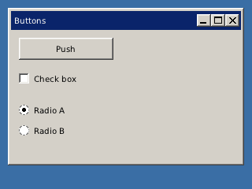

<!-- AUTOGENERATED COPYRIGHT HEADER START -->
<!-- Copyright (C) 2026 Claude <noreply@anthropic.com> -->
<!-- AUTOGENERATED COPYRIGHT HEADER END -->
<!-- Generated by tools/wiki/wiki.py. Edit tools/wiki/text/ instead of this file. -->


# CreateButton

<div align="center">

[Command Index](Command-Index) · [BlitzPlus](BlitzPlus) · [Gadgets](BlitzPlus-Gadgets)

</div>


## Command Syntax

```blitzbasic
CreateButton:Int32 text:String, x:Int32, y:Int32, width:Int32, height:Int32, group:Int32, style:Int32=1
```

## Description

Makes a button with a caption. The style picks what it is:

| Style | Kind |
| --- | --- |
| 1 | Push button, sends $401 when clicked. This is the default |
| 2 | Check box, toggles between ticked and not and sends the new state |
| 3 | Radio button, ticking one unticks the others in the same group |
| 4 | Default button, also fires when Enter is pressed inside its group |
| 5 | Cancel button, also fires when Escape is pressed inside its group |

Add 65536 to keep the button from following when its group is resized. Radio buttons that share a group belong together, so put sets of them on different panels to keep them apart. Use [ButtonState](ButtonState) and [SetButtonState](SetButtonState) for check boxes and radio buttons.

**Differences and known gaps:**

* Buttons are drawn in the look of the program, not with the controls of the operating system.

## Parameters

| Parameter | Type | Default | Description |
|---|---|---|---|
| `text` | String | required | Caption of the button. |
| `x` | Int32 | required | Horizontal position inside the group. |
| `y` | Int32 | required | Vertical position inside the group. |
| `width` | Int32 | required | Width of the button. |
| `height` | Int32 | required | Height of the button. |
| `group` | Int32 | required | Window, panel, tabber or canvas that holds it. |
| `style` | Int32 | `1` | Kind of button, see the table. Defaults to 1. |

**Returns:** A handle for the button.

## Examples

```blitzbasic
Graphics 320, 240, 32, 2
win = CreateWindow("Buttons", 10, 10, 300, 200, Desktop(), 3)
push = CreateButton("Push", 10, 10, 120, 28, win)
tick = CreateButton("Check box", 10, 50, 140, 24, win, 2)
a    = CreateButton("Radio A", 10, 90, 140, 24, win, 3)
b    = CreateButton("Radio B", 10, 116, 140, 24, win, 3)
SetButtonState a, True
count = 0
Repeat
	e = WaitEvent()
	If e = $401 And EventSource() = push Then count = count + 1 : SetGadgetText push, "Pushed " + count
Until e = $803
```

## Media



## Related Commands

* [ButtonState](ButtonState)
* [CreateComboBox](CreateComboBox)
* [CreateLabel](CreateLabel)
* [CreateListBox](CreateListBox)
* [CreatePanel](CreatePanel)
* [CreateProgBar](CreateProgBar)
* [CreateSlider](CreateSlider)
* [CreateTabber](CreateTabber)

<div align="center">

[Command Index](Command-Index) · [BlitzPlus](BlitzPlus) · [Gadgets](BlitzPlus-Gadgets)

</div>
