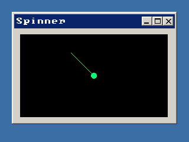

<!-- AUTOGENERATED COPYRIGHT HEADER START -->
<!-- Copyright (C) 2026 Claude <noreply@anthropic.com> -->
<!-- AUTOGENERATED COPYRIGHT HEADER END -->
<!-- Generated by tools/wiki/wiki.py. Edit tools/wiki/text/ instead of this file. -->
# CreateCanvas

[Command Index](Command-Index) · [BlitzPlus](BlitzPlus) · [Canvas](BlitzPlus-Canvas)

```blitzbasic
CreateCanvas x%, y%, width%, height%, group%, style%=0  ; returns Int
```

**Works in:** BlitzPlus

Makes a rectangular area in a window or panel that your program paints on itself, for animations, graphs or anything else the other gadgets cannot show. Canvases also tell you about the mouse: they send $203 when it moves over them and $205 and $206 when it enters or leaves, with the position in [EventX](EventX) and [EventY](EventY), and they get keyboard events when they have the focus.

Draw with [CanvasBuffer](CanvasBuffer) and [FlipCanvas](FlipCanvas). A canvas can also be the group of other gadgets.

```blitzbasic
Graphics 320, 240, 32, 2
win = CreateWindow("Spinner", 20, 20, 280, 190, Desktop(), 3)
cv  = CreateCanvas(10, 10, 250, 140, win)
frame = 0
Repeat
	SetBuffer CanvasBuffer(cv)
	ClsColor 0, 0, 0
	Cls
	Color 0, 255, 120
	a# = frame * 15
	Line 125, 70, 125 + Cos(a) * 55, 70 + Sin(a) * 55
	Oval 120, 65, 10, 10, 1
	FlipCanvas cv
	frame = frame + 1
	e = WaitEvent(100)
Until e = $803
```



| Parameter | Type | Default | Description |
|---|---|---|---|
| `x` | Int | required | Horizontal position inside the group. |
| `y` | Int | required | Vertical position inside the group. |
| `width` | Int | required | Width of the canvas. |
| `height` | Int | required | Height of the canvas. |
| `group` | Int | required | Window, panel or tabber that holds it. |
| `style` | Int | `0` | 0 lets the canvas follow the size of its group when [SetGadgetLayout](SetGadgetLayout) says so, 65536 keeps it as it is. Defaults to 0. |

**Returns:** A handle for the canvas.

**Differences and known gaps:**

* Canvases are drawn by the same renderer as the rest of the interface, so nothing needs DirectX.

## Related commands

* [CanvasBuffer](CanvasBuffer)
* [DesktopBuffer](DesktopBuffer)
* [FlipCanvas](FlipCanvas)

[Command Index](Command-Index) · [BlitzPlus](BlitzPlus) · [Canvas](BlitzPlus-Canvas)
