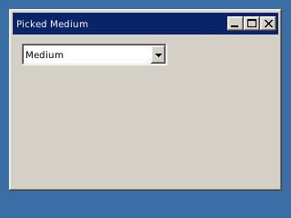

<!-- AUTOGENERATED COPYRIGHT HEADER START -->
<!-- Copyright (C) 2026 Claude <noreply@anthropic.com> -->
<!-- AUTOGENERATED COPYRIGHT HEADER END -->
<!-- Generated by tools/wiki/wiki.py. Edit tools/wiki/text/ instead of this file. -->


# CreateComboBox

[Command Index](Command-Index) · [BlitzPlus](BlitzPlus) · [Gadgets](BlitzPlus-Gadgets)

## Command Syntax

```blitzbasic
CreateComboBox:Int32 x:Int32, y:Int32, width:Int32, height:Int32, group:Int32, style:Int32=0
```

## Description

Makes a drop-down list. It shows the selected entry and opens the list when clicked. Fill it with [AddGadgetItem](AddGadgetItem), and read what was picked with [SelectedGadgetItem](SelectedGadgetItem) when a $401 event arrives.

**Differences and known gaps:**

* The user cannot type into it, only pick from the list.

## Parameters

| Parameter | Type | Default | Description |
|---|---|---|---|
| `x` | Int32 | required | Horizontal position inside the group. |
| `y` | Int32 | required | Vertical position inside the group. |
| `width` | Int32 | required | Width of the box. |
| `height` | Int32 | required | Height of the closed box. |
| `group` | Int32 | required | Window, panel, tabber or canvas that holds it. |
| `style` | Int32 | `0` | 0, or 65536 to not follow the group when it is resized. Defaults to 0. |

**Returns:** A handle for the combo box.

## Examples

```blitzbasic
Graphics 320, 240, 32, 2
win = CreateWindow("Combo", 10, 10, 300, 200, Desktop(), 3)
box = CreateComboBox(10, 10, 160, 24, win)
AddGadgetItem box, "Small"
AddGadgetItem box, "Medium"
AddGadgetItem box, "Large"
SelectGadgetItem box, 0
Repeat
	e = WaitEvent()
	If e = $401 Then SetGadgetText win, "Picked " + GadgetItemText(box, SelectedGadgetItem(box))
Until e = $803
```

## Media



## Related Commands

* [CreateButton](CreateButton)
* [CreateLabel](CreateLabel)
* [CreateListBox](CreateListBox)
* [CreatePanel](CreatePanel)
* [CreateProgBar](CreateProgBar)
* [CreateSlider](CreateSlider)
* [CreateTabber](CreateTabber)

[Command Index](Command-Index) · [BlitzPlus](BlitzPlus) · [Gadgets](BlitzPlus-Gadgets)
