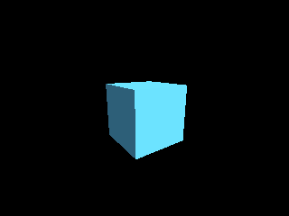

<!-- AUTOGENERATED COPYRIGHT HEADER START -->
<!-- Copyright (C) 2026 Claude <noreply@anthropic.com> -->
<!-- AUTOGENERATED COPYRIGHT HEADER END -->
<!-- Generated by tools/wiki/wiki.py. Edit tools/wiki/text/ instead of this file. -->


# CreateCube

<div align="center">

[Command Index](Command-Index) · [Blitz3D](Blitz3D) · [Meshes](Blitz3D-Meshes)

</div>


## Command Syntax

```blitzbasic
CreateCube:Int32 parent:Int32=0
```

## Parameters

| Parameter | Type | Default | Description |
|---|---|---|---|
| `parent` | Int32 | `0` | Entity the cube follows, or 0 for none. Defaults to 0. |

**Returns:** The handle of the new cube.

## Description

Creates a cube that reaches from -1, -1, -1 to 1, 1, 1, so its edges are 2 units long, and returns it as a mesh entity. Cubes are the standard placeholder for anything that is not modeled yet. Scale it with [ScaleEntity](ScaleEntity) for boxes of any proportion.

## Examples

```blitzbasic
Graphics3D 320, 240, 0, 2
SetBuffer BackBuffer()
camera = CreateCamera()
PositionEntity camera, 0, 1.5, -5
RotateEntity camera, 15, 0, 0
light = CreateLight()
RotateEntity light, 45, 45, 0
cube = CreateCube()
TurnEntity cube, 0, 35, 0
EntityColor cube, 90, 190, 240
RenderWorld
Flip
WaitKey
```

## Media



## Related Commands

* [CreateCone](CreateCone)
* [CreateCylinder](CreateCylinder)
* [CreateMesh](CreateMesh)
* [CreateMirror](CreateMirror)
* [CreatePlane](CreatePlane)
* [CreateSphere](CreateSphere)

<div align="center">

[Command Index](Command-Index) · [Blitz3D](Blitz3D) · [Meshes](Blitz3D-Meshes)

</div>
