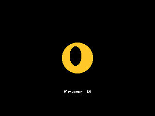

<!-- AUTOGENERATED COPYRIGHT HEADER START -->
<!-- Copyright (C) 2026 Claude <noreply@anthropic.com> -->
<!-- AUTOGENERATED COPYRIGHT HEADER END -->
<!-- Generated by tools/wiki/wiki.py. Edit tools/wiki/text/ instead of this file. -->


# CreateImage

<div align="center">

[Command Index](Command-Index) · [BlitzBasic](BlitzBasic) · [Images](BlitzBasic-Images)

</div>


## Command Syntax

```blitzbasic
CreateImage:Int32 width:Int32, height:Int32, frames:Int32=1
```

## Description

Creates an empty image that is filled with black, which is the default mask color and so draws as transparent. Draw into it by making it the current buffer with [ImageBuffer](ImageBuffer). An image can hold several frames of the same size next to each other, such as the steps of an animation, which are chosen with the frame number of [DrawImage](DrawImage).

**Differences and known gaps:**

* A graphics window must be open, because images live in video memory. A size that is zero or negative stops the program with an error.

## Parameters

| Parameter | Type | Default | Description |
|---|---|---|---|
| `width` | Int32 | required | Width of one frame in pixels. |
| `height` | Int32 | required | Height of one frame in pixels. |
| `frames` | Int32 | `1` | Number of frames. Defaults to 1. |

**Returns:** A handle for the image.

## Examples

```blitzbasic
Graphics 320, 240, 0, 2
SetBuffer BackBuffer()
Local img = CreateImage(64, 64, 8)
For f = 0 To 7
	SetBuffer ImageBuffer(img, f)
	Color 255, 200, 40
	Oval 0, 0, 64, 64, 1
	Color 0, 0, 0
	Oval 16 + f * 4, 8 + f, 24, 40, 1
Next
SetBuffer BackBuffer()
Local n = 0
While n < 40
	Cls
	Color 255, 255, 255
	DrawImage img, 128, 88, (n / 2) Mod 8
	Text 160, 190, "frame " + ((n / 2) Mod 8), 1, 1
	Flip
	n = n + 1
Wend
```

## Media



## Related Commands

* [CopyImage](CopyImage)
* [DrawImage](DrawImage)
* [FreeImage](FreeImage)
* [GrabImage](GrabImage)
* [HandleImage](HandleImage)
* [LoadAnimImage](LoadAnimImage)
* [LoadImage](LoadImage)
* [MaskImage](MaskImage)

<div align="center">

[Command Index](Command-Index) · [BlitzBasic](BlitzBasic) · [Images](BlitzBasic-Images)

</div>
