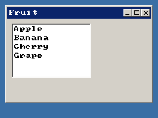

<!-- AUTOGENERATED COPYRIGHT HEADER START -->
<!-- Copyright (C) 2026 Claude <noreply@anthropic.com> -->
<!-- AUTOGENERATED COPYRIGHT HEADER END -->
<!-- Generated by tools/wiki/wiki.py. Edit tools/wiki/text/ instead of this file. -->
# CreateListBox

[Command Index](Command-Index) · [BlitzPlus](BlitzPlus) · [Gadgets](BlitzPlus-Gadgets)

```blitzbasic
CreateListBox x%, y%, width%, height%, group%, style%=0  ; returns Int
```

**Works in:** BlitzPlus

Makes a list of entries from which the user can pick one. A scroll bar appears when there are more entries than fit. Clicking an entry sends $401 with the gadget as the source, and the entry is given by [SelectedGadgetItem](SelectedGadgetItem).

```blitzbasic
Graphics 320, 240, 32, 2
win  = CreateWindow("Fruit", 10, 10, 300, 200, Desktop(), 3)
list = CreateListBox(10, 10, 160, 110, win)
AddGadgetItem list, "Apple"
AddGadgetItem list, "Banana"
AddGadgetItem list, "Cherry"
AddGadgetItem list, "Grape"
Repeat
	e = WaitEvent()
	If e = $401 Then SetGadgetText win, "Chose " + GadgetItemText(list, SelectedGadgetItem(list))
Until e = $803
```



| Parameter | Type | Default | Description |
|---|---|---|---|
| `x` | Int | required | Horizontal position inside the group. |
| `y` | Int | required | Vertical position inside the group. |
| `width` | Int | required | Width of the list. |
| `height` | Int | required | Height of the list. |
| `group` | Int | required | Window, panel, tabber or canvas that holds it. |
| `style` | Int | `0` | 0, or 65536 to not follow the group when it is resized. Defaults to 0. |

**Returns:** A handle for the list box.

**Differences and known gaps:**

* Only one entry can be selected at a time.

## Related commands

* [CreateButton](CreateButton)
* [CreateComboBox](CreateComboBox)
* [CreateLabel](CreateLabel)
* [CreatePanel](CreatePanel)
* [CreateProgBar](CreateProgBar)
* [CreateSlider](CreateSlider)
* [CreateTabber](CreateTabber)

[Command Index](Command-Index) · [BlitzPlus](BlitzPlus) · [Gadgets](BlitzPlus-Gadgets)
