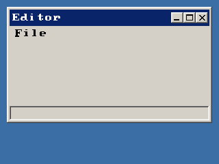

<!-- AUTOGENERATED COPYRIGHT HEADER START -->
<!-- Copyright (C) 2026 Claude <noreply@anthropic.com> -->
<!-- AUTOGENERATED COPYRIGHT HEADER END -->
<!-- Generated by tools/wiki/wiki.py. Edit tools/wiki/text/ instead of this file. -->


# CreateMenu

<div align="center">

[Command Index](Command-Index) · [BlitzPlus](BlitzPlus) · [Menus](BlitzPlus-Menus)

</div>


## Command Syntax

```blitzbasic
CreateMenu:Int32 text:String, menu_id:Int32, parent_menu:Int32
```

## Description

Makes a menu title or a menu item. Give [WindowMenu](WindowMenu) as the parent to get a title in the menu bar, and a menu as the parent to put an item or a submenu into it. An item that has items of its own opens a submenu. Choosing an item sends a $1001 event whose [EventData](EventData) is the number you gave. An empty text makes a separator line.

Call [UpdateWindowMenu](UpdateWindowMenu) once you are done changing menus. The window needs flag 4 in its style to have room for the menu bar.

**Differences and known gaps:**

* The shortcut underline for `&` is accepted but menus are only used with the mouse and the arrow keys.

## Parameters

| Parameter | Type | Default | Description |
|---|---|---|---|
| `text` | String | required | Text of the title or item. Put `&` before a letter to underline it for the keyboard. An empty text is a separator. |
| `menu_id` | Int32 | required |  |
| `parent_menu` | Int32 | required |  |

**Returns:** A handle for the menu.

## Examples

```blitzbasic
Graphics 320, 240, 32, 2
win  = CreateWindow("Editor", 10, 10, 300, 170, Desktop(), 15)
file = CreateMenu("File", 0, WindowMenu(win))
CreateMenu "New", 1, file
CreateMenu "", 0, file
CreateMenu "Quit", 2, file
UpdateWindowMenu win
Repeat
	e = WaitEvent()
	If e = $1001 Then SetStatusText win, "Menu " + EventData()
Until e = $803 Or (e = $1001 And EventData() = 2)
```

## Media



## Related Commands

* [CheckMenu](CheckMenu)
* [DisableMenu](DisableMenu)
* [EnableMenu](EnableMenu)
* [MenuChecked](MenuChecked)
* [MenuEnabled](MenuEnabled)
* [MenuText](MenuText)
* [SetMenuText](SetMenuText)
* [UncheckMenu](UncheckMenu)

<div align="center">

[Command Index](Command-Index) · [BlitzPlus](BlitzPlus) · [Menus](BlitzPlus-Menus)

</div>
