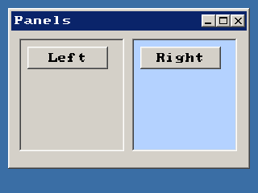

<!-- AUTOGENERATED COPYRIGHT HEADER START -->
<!-- Copyright (C) 2026 Claude <noreply@anthropic.com> -->
<!-- AUTOGENERATED COPYRIGHT HEADER END -->
<!-- Generated by tools/wiki/wiki.py. Edit tools/wiki/text/ instead of this file. -->


# CreatePanel

[Command Index](Command-Index) · [BlitzPlus](BlitzPlus) · [Gadgets](BlitzPlus-Gadgets)

## Command Syntax

```blitzbasic
CreatePanel:Int32 x:Int32, y:Int32, width:Int32, height:Int32, group:Int32, style:Int32=0
```

## Description

Makes a rectangle that other gadgets can be placed on, so you can group them, hide them together or move them together. Give it a color with [SetPanelColor](SetPanelColor) or a picture with [SetPanelImage](SetPanelImage). Style 1 draws a frame around it.

## Parameters

| Parameter | Type | Default | Description |
|---|---|---|---|
| `x` | Int32 | required | Horizontal position inside the group. |
| `y` | Int32 | required | Vertical position inside the group. |
| `width` | Int32 | required | Width of the panel. |
| `height` | Int32 | required | Height of the panel. |
| `group` | Int32 | required | Window, tabber, canvas or another panel that holds it. |
| `style` | Int32 | `0` | 1 draws a frame. Add 65536 to not follow the group when it is resized. Defaults to 0. |

**Returns:** A handle for the panel.

## Examples

```blitzbasic
Graphics 320, 240, 32, 2
win   = CreateWindow("Panels", 10, 10, 300, 200, Desktop(), 3)
left  = CreatePanel(10, 10, 130, 140, win, 1)
right = CreatePanel(150, 10, 130, 140, win, 1)
SetPanelColor right, 180, 210, 255
CreateButton "Left", 10, 10, 100, 28, left
CreateButton "Right", 10, 10, 100, 28, right
Repeat
Until WaitEvent() = $803
```

## Media



## Related Commands

* [CreateButton](CreateButton)
* [CreateComboBox](CreateComboBox)
* [CreateLabel](CreateLabel)
* [CreateListBox](CreateListBox)
* [CreateProgBar](CreateProgBar)
* [CreateSlider](CreateSlider)
* [CreateTabber](CreateTabber)
* [SetPanelColor](SetPanelColor)

[Command Index](Command-Index) · [BlitzPlus](BlitzPlus) · [Gadgets](BlitzPlus-Gadgets)
