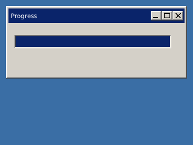

<!-- AUTOGENERATED COPYRIGHT HEADER START -->
<!-- Copyright (C) 2026 Claude <noreply@anthropic.com> -->
<!-- AUTOGENERATED COPYRIGHT HEADER END -->
<!-- Generated by tools/wiki/wiki.py. Edit tools/wiki/text/ instead of this file. -->


# CreateProgBar

[Command Index](Command-Index) · [BlitzPlus](BlitzPlus) · [Gadgets](BlitzPlus-Gadgets)

## Command Syntax

```blitzbasic
CreateProgBar:Int32 x:Int32, y:Int32, width:Int32, height:Int32, group:Int32, style:Int32=0
```

## Description

Makes a bar that shows how far something got. Set how full it is with [UpdateProgBar](UpdateProgBar).

## Parameters

| Parameter | Type | Default | Description |
|---|---|---|---|
| `x` | Int32 | required | Horizontal position inside the group. |
| `y` | Int32 | required | Vertical position inside the group. |
| `width` | Int32 | required | Width of the bar. |
| `height` | Int32 | required | Height of the bar. |
| `group` | Int32 | required | Window, panel, tabber or canvas that holds it. |
| `style` | Int32 | `0` | 0, or 65536 to not follow the group when it is resized. Defaults to 0. |

**Returns:** A handle for the progress bar.

## Examples

```blitzbasic
Graphics 320, 240, 32, 2
win = CreateWindow("Progress", 10, 10, 300, 120, Desktop(), 3)
bar = CreateProgBar(10, 20, 260, 22, win)
done# = 0
Repeat
	e = WaitEvent(300)
	done# = done# + 0.2
	If done# > 1 Then done# = 1
	UpdateProgBar bar, done#
Until e = $803
```

## Media



## Related Commands

* [CreateButton](CreateButton)
* [CreateComboBox](CreateComboBox)
* [CreateLabel](CreateLabel)
* [CreateListBox](CreateListBox)
* [CreatePanel](CreatePanel)
* [CreateSlider](CreateSlider)
* [CreateTabber](CreateTabber)
* [UpdateProgBar](UpdateProgBar)

[Command Index](Command-Index) · [BlitzPlus](BlitzPlus) · [Gadgets](BlitzPlus-Gadgets)
