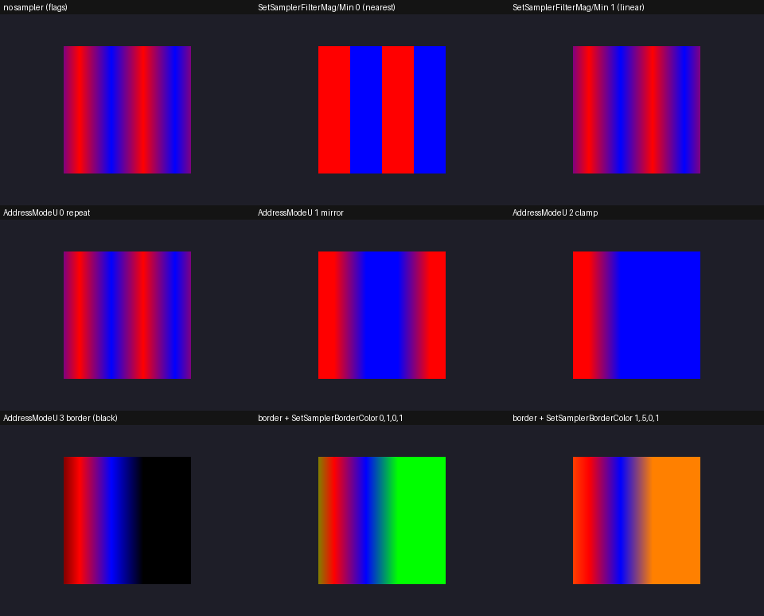
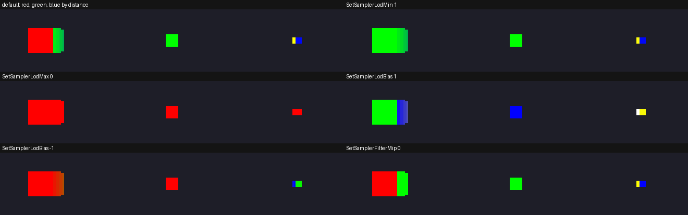
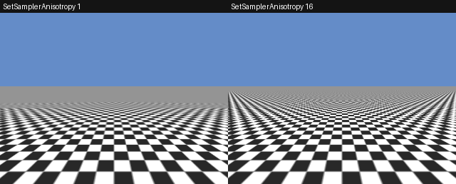

<!-- AUTOGENERATED COPYRIGHT HEADER START -->
<!-- Copyright (C) 2026 Claude <noreply@anthropic.com> -->
<!-- AUTOGENERATED COPYRIGHT HEADER END -->
<!-- Generated by tools/wiki/wiki.py. Edit tools/wiki/text/ instead of this file. -->
# CreateSampler 〔BlitzLLVM〕

[Command Index](Command-Index) · [Blitz3D](Blitz3D) · [Textures](Blitz3D-Textures)

## Command Syntax

```blitzbasic
CreateSampler:Int32
```

## Description

**〔BlitzLLVM〕** This command does not exist in the original Blitz products. BlitzLLVM adds it.

Makes a sampler, which says how a texture is read: how it is filtered when it is bigger or smaller on the screen, what happens to texture coordinates outside of 0 to 1, and which mip levels may be used. A new sampler reads linearly with linear blending between mip levels, repeats on all three axes, has no anisotropic filtering, a lod bias of 0 and may use every level. This is a BlitzLLVM extension: the originals read every texture with the settings of its flags and do not have samplers. It is a Vulkan sampler (`VkSampler`) underneath.

A sampler does nothing until it is given to a texture with [SetTextureSampler](SetTextureSampler). The same sampler can be set on any number of textures, and changing it changes all of them. A texture without a sampler is read with what its flags say: clamped (16 and 32) or repeating, and with mip maps (8) or without.

## Parameters

**Returns:** The handle of the new sampler.

## Examples

```blitzbasic
Graphics3D 320, 240, 0, 2
SetBuffer BackBuffer()
tex = LoadTexture("wall.png", 1 + 8)
sampler = CreateSampler()
SetSamplerFilterMag sampler, 0       ; show the texels as blocks up close
SetSamplerAnisotropy sampler, 8      ; and keep floors sharp from afar
SetTextureSampler tex, sampler
```

Filters, address modes and the border color, on a texture of two texels (red and blue) that is repeated twice over a cube face:


Mip levels (`SetSamplerLodMin`, `SetSamplerLodMax`, `SetSamplerLodBias`, `SetSamplerFilterMip`) on cubes at three distances, whose texture has a red, a green and a blue level:


Anisotropic filtering on a floor that goes far into the distance:

## Media







## Related Commands

* [CreateTexture](CreateTexture)
* [FreeSampler](FreeSampler) 〔BlitzLLVM〕
* [GetSamplerAddressModeU](GetSamplerAddressModeU) 〔BlitzLLVM〕
* [GetSamplerAddressModeV](GetSamplerAddressModeV) 〔BlitzLLVM〕
* [GetSamplerAddressModeW](GetSamplerAddressModeW) 〔BlitzLLVM〕
* [GetSamplerAnisotropy](GetSamplerAnisotropy) 〔BlitzLLVM〕
* [GetSamplerBorderColorA](GetSamplerBorderColorA) 〔BlitzLLVM〕
* [SetTextureSampler](SetTextureSampler) 〔BlitzLLVM〕

[Command Index](Command-Index) · [Blitz3D](Blitz3D) · [Textures](Blitz3D-Textures)
