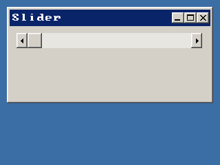

<!-- AUTOGENERATED COPYRIGHT HEADER START -->
<!-- Copyright (C) 2026 Claude <noreply@anthropic.com> -->
<!-- AUTOGENERATED COPYRIGHT HEADER END -->
<!-- Generated by tools/wiki/wiki.py. Edit tools/wiki/text/ instead of this file. -->


# CreateSlider

<div align="center">

[Command Index](Command-Index) · [BlitzPlus](BlitzPlus) · [Gadgets](BlitzPlus-Gadgets)

</div>


## Command Syntax

```blitzbasic
CreateSlider:Int32 x:Int32, y:Int32, width:Int32, height:Int32, group:Int32, style:Int32=1
```

## Parameters

| Parameter | Type | Default | Description |
|---|---|---|---|
| `x` | Int32 | required | Horizontal position inside the group. |
| `y` | Int32 | required | Vertical position inside the group. |
| `width` | Int32 | required | Width of the slider. |
| `height` | Int32 | required | Height of the slider. |
| `group` | Int32 | required | Window, panel, tabber or canvas that holds it. |
| `style` | Int32 | `1` | 1 for horizontal or 2 for vertical, plus 65536 for not following the group. Defaults to 1. |

**Returns:** A handle for the slider.

## Description

Makes a scroll bar the user can drag. Style 1 is horizontal and 2 is vertical, and 65536 can be added to not follow the group when it is resized. The range is set with [SetSliderRange](SetSliderRange) and a $401 event with the new value arrives when it moves. [SliderValue](SliderValue) reads it at any time.

## Examples

```blitzbasic
Graphics 320, 240, 32, 2
win = CreateWindow("Slider", 10, 10, 300, 140, Desktop(), 3)
sl  = CreateSlider(10, 10, 270, 22, win, 1)
SetSliderRange sl, 10, 110
Repeat
	e = WaitEvent()
	If e = $401 Then SetGadgetText win, "Value " + SliderValue(sl)
Until e = $803
```

## Media



## Related Commands

* [CreateButton](CreateButton)
* [CreateComboBox](CreateComboBox)
* [CreateLabel](CreateLabel)
* [CreateListBox](CreateListBox)
* [CreatePanel](CreatePanel)
* [CreateProgBar](CreateProgBar)
* [CreateTabber](CreateTabber)
* [SetSliderRange](SetSliderRange)

<div align="center">

[Command Index](Command-Index) · [BlitzPlus](BlitzPlus) · [Gadgets](BlitzPlus-Gadgets)

</div>
