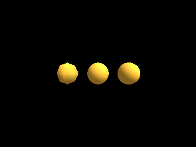

<!-- AUTOGENERATED COPYRIGHT HEADER START -->
<!-- Copyright (C) 2026 Claude <noreply@anthropic.com> -->
<!-- AUTOGENERATED COPYRIGHT HEADER END -->
<!-- Generated by tools/wiki/wiki.py. Edit tools/wiki/text/ instead of this file. -->
# CreateSphere

[Command Index](Command-Index) · [Blitz3D](Blitz3D) · [Meshes](Blitz3D-Meshes)

```blitzbasic
CreateSphere:Int32 segments:Int32=8, parent:Int32=0
```

**Works in:** Blitz3D

Creates a sphere with a radius of 1 around the origin. `segments` sets how round it looks. A sphere has `2 * segments * (segments - 1) * 2` triangles, so 8 gives 224 and 16 gives 960: use the smallest number that still looks smooth at the distance the sphere is seen from. Valid values are 2 to 100.

```blitzbasic
Graphics3D 320, 240, 0, 2
SetBuffer BackBuffer()
camera = CreateCamera()
PositionEntity camera, 0, 0, -9
light = CreateLight()
RotateEntity light, 45, 45, 0
For i = 0 To 2
	ball = CreateSphere(4 + i * 6)
	PositionEntity ball, i * 2.8 - 2.8, 0, 0
	EntityColor ball, 255, 190, 60
Next
RenderWorld
Flip
WaitKey
```



| Parameter | Type | Default | Description |
|---|---|---|---|
| `segments` | Int32 | `8` | Detail of the sphere, 2 to 100. Defaults to 8. |
| `parent` | Int32 | `0` | Entity the sphere follows, or 0 for none. Defaults to 0. |

**Returns:** The handle of the new sphere.

## Related commands

* [CreateCone](CreateCone)
* [CreateCube](CreateCube)
* [CreateCylinder](CreateCylinder)
* [CreateMesh](CreateMesh)
* [CreateMirror](CreateMirror)
* [CreatePlane](CreatePlane)

[Command Index](Command-Index) · [Blitz3D](Blitz3D) · [Meshes](Blitz3D-Meshes)
