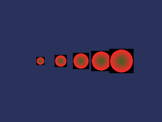

<!-- AUTOGENERATED COPYRIGHT HEADER START -->
<!-- Copyright (C) 2026 Claude <noreply@anthropic.com> -->
<!-- AUTOGENERATED COPYRIGHT HEADER END -->
<!-- Generated by tools/wiki/wiki.py. Edit tools/wiki/text/ instead of this file. -->
# CreateSprite

[Command Index](Command-Index) · [Blitz3D](Blitz3D) · [Sprites](Blitz3D-Sprites)

```blitzbasic
CreateSprite parent%=0  ; returns Int
```

**Works in:** Blitz3D

Creates a sprite: a flat square of two triangles that extends from -1, -1 to 1, 1 around its position. A sprite has no mesh to edit, so it is very cheap and suited to particles, lens flares, trees in the distance and 2D games drawn in 3D. By default a sprite turns to face the camera, see [SpriteViewMode](SpriteViewMode), so a round texture makes it look like a sphere from every side.

Sprites have their own commands for scale, rotation and handle: [ScaleSprite](ScaleSprite), [RotateSprite](RotateSprite) and [HandleSprite](HandleSprite). Everything else, such as position, texture and color, works as for any entity.

A parent makes the sprite follow another entity. The sprite is still created at 0, 0, 0, not at the parent's position.

```blitzbasic
Graphics3D 320, 240, 0, 2
SetBuffer BackBuffer()
camera = CreateCamera()
CameraClsColor camera, 40, 50, 90

; A texture of a soft red disc on black.
tex = CreateTexture(64, 64)
SetBuffer TextureBuffer(tex)
ClsColor 0, 0, 0
Cls
For i = 0 To 12
	Color 255 - i * 14, 40 + i * 4, 40
	Oval 2 + i * 2, 2 + i * 2, 60 - i * 4, 60 - i * 4, 1
Next
SetBuffer BackBuffer()

For i = 0 To 4
	sprite = CreateSprite()
	EntityTexture sprite, tex
	PositionEntity sprite, -4 + i * 2, 0, 8
	ScaleSprite sprite, 0.4 + i * 0.2, 0.4 + i * 0.2
Next
RenderWorld
Flip
WaitKey
```



| Parameter | Type | Default | Description |
|---|---|---|---|
| `parent` | Int | `0` | Optional parent entity. |

**Returns:** An entity handle for the sprite.

**Differences and known gaps:**

* Sprites are always drawn full-bright and visible from both sides, whatever [EntityFX](EntityFX) says. The original only does this for sprites made with LoadSprite.

## Related commands

* [HandleSprite](HandleSprite)
* [LoadSprite](LoadSprite)
* [RotateSprite](RotateSprite)
* [ScaleSprite](ScaleSprite)
* [SpriteViewMode](SpriteViewMode)

[Command Index](Command-Index) · [Blitz3D](Blitz3D) · [Sprites](Blitz3D-Sprites)
