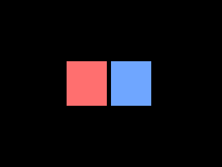

<!-- AUTOGENERATED COPYRIGHT HEADER START -->
<!-- Copyright (C) 2026 Claude <noreply@anthropic.com> -->
<!-- AUTOGENERATED COPYRIGHT HEADER END -->
<!-- Generated by tools/wiki/wiki.py. Edit tools/wiki/text/ instead of this file. -->
# CreateSurface

[Command Index](Command-Index) · [Blitz3D](Blitz3D) · [Surfaces](Blitz3D-Surfaces)

## Command Syntax

```blitzbasic
CreateSurface:Int32 mesh:Int32, brush:Int32=0
```

## Description

**Works in:** Blitz3D

Adds an empty surface to a mesh and returns its handle. A mesh is a list of surfaces, and every surface is one batch of triangles that shares a material: color, texture and so on. Use one surface per material and put all triangles with that material into it, since each surface costs a draw call. Fill the surface with [AddVertex](AddVertex) and [AddTriangle](AddTriangle).
A `brush` paints the surface right away, see [PaintSurface](PaintSurface).

## Parameters

| Parameter | Type | Default | Description |
|---|---|---|---|
| `mesh` | Int32 | required | Mesh handle. |
| `brush` | Int32 | `0` | Brush that paints the new surface, or 0 for none. Defaults to 0. |

**Returns:** The handle of the new surface.

## Examples

```blitzbasic
Graphics3D 320, 240, 0, 2
SetBuffer BackBuffer()
camera = CreateCamera()
PositionEntity camera, 0, 0, -5
light = CreateLight()
RotateEntity light, 20, 20, 0
mesh = CreateMesh()
; Two surfaces in one mesh, each painted with its own brush.
red = CreateBrush(255, 80, 80)
blue = CreateBrush(80, 120, 255)
left = CreateSurface(mesh, red)
right = CreateSurface(mesh, blue)
For i = 0 To 1
	If i = 0 Then s = left Else s = right
	x = i * 2.2 - 2.0
	a = AddVertex(s, x, -1, 0)
	b = AddVertex(s, x, 1, 0)
	c = AddVertex(s, x + 1.8, 1, 0)
	d = AddVertex(s, x + 1.8, -1, 0)
	AddTriangle s, a, b, c
	AddTriangle s, a, c, d
Next
UpdateNormals mesh
RenderWorld
Flip
WaitKey
```

## Media



## Related Commands

* [ClearSurface](ClearSurface)
* [FindSurface](FindSurface)
* [GetSurface](GetSurface)
* [PaintSurface](PaintSurface)

[Command Index](Command-Index) · [Blitz3D](Blitz3D) · [Surfaces](Blitz3D-Surfaces)
