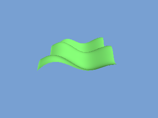

<!-- AUTOGENERATED COPYRIGHT HEADER START -->
<!-- Copyright (C) 2026 Claude <noreply@anthropic.com> -->
<!-- AUTOGENERATED COPYRIGHT HEADER END -->
<!-- Generated by tools/wiki/wiki.py. Edit tools/wiki/text/ instead of this file. -->


# CreateTerrain

<div align="center">

[Command Index](Command-Index) · [Blitz3D](Blitz3D) · [Terrain](Blitz3D-Terrain)

</div>


## Command Syntax

```blitzbasic
CreateTerrain:Int32 grid_size:Int32, parent:Int32=0
```

## Parameters

| Parameter | Type | Default | Description |
|---|---|---|---|
| `grid_size` | Int32 | required | Number of grid squares along each side. |
| `parent` | Int32 | `0` | Optional parent entity. |

**Returns:** An entity handle for the terrain.

## Description

Creates a flat terrain with `grid_size` squares along each side. Terrain heights are numbers from 0 to 1 at each corner of the grid; set them with [ModifyTerrain](ModifyTerrain) or load them from a picture with [LoadTerrain](LoadTerrain). The terrain spans from 0, 0, 0 to `grid_size`, 1, `grid_size`, so scale it with [ScaleEntity](ScaleEntity) to make it taller or wider: a scale of 1, 40, 1 makes the highest point 40 units up.

A texture with a scale of 1 covers one grid square, so scale the texture by the grid size to stretch it over the whole terrain. See [ScaleTexture](ScaleTexture).

A parent makes the terrain follow another entity. The terrain is still created at 0, 0, 0, not at the parent's position.

## Differences

* The original only accepts powers of two (32, 64, 128 and so on) and stops with a runtime error otherwise. Here any size from 2 to 4096 is accepted.

## Examples

```blitzbasic
Graphics3D 320, 240, 0, 2
SetBuffer BackBuffer()
camera = CreateCamera()
CameraClsColor camera, 120, 160, 210
PositionEntity camera, 20, 24, -24
RotateEntity camera, 30, 0, 0
light = CreateLight()
RotateEntity light, 50, 20, 0

size = 32
land = CreateTerrain(size)
ScaleEntity land, 1, 10, 1
PositionEntity land, 4, 0, 0
EntityColor land, 90, 170, 80

; Hills made from two waves.
For z = 0 To size
	For x = 0 To size
		h# = 0.5 + 0.25 * Sin(x * 14) + 0.25 * Sin(z * 22 + x * 5)
		ModifyTerrain land, x, z, h
	Next
Next

RenderWorld
Flip
WaitKey
```

## Media



## Related Commands

* [LoadTerrain](LoadTerrain)
* [ModifyTerrain](ModifyTerrain)
* [TerrainDetail](TerrainDetail)
* [TerrainHeight](TerrainHeight)
* [TerrainShading](TerrainShading)
* [TerrainSize](TerrainSize)
* [TerrainX](TerrainX)
* [TerrainY](TerrainY)

<div align="center">

[Command Index](Command-Index) · [Blitz3D](Blitz3D) · [Terrain](Blitz3D-Terrain)

</div>
