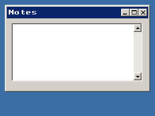
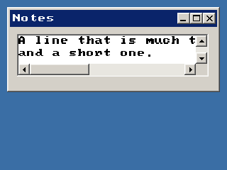

<!-- AUTOGENERATED COPYRIGHT HEADER START -->
<!-- Copyright (C) 2026 Claude <noreply@anthropic.com> -->
<!-- AUTOGENERATED COPYRIGHT HEADER END -->
<!-- Generated by tools/wiki/wiki.py. Edit tools/wiki/text/ instead of this file. -->
# CreateTextArea

[Command Index](Command-Index) · [BlitzPlus](BlitzPlus) · [Text Areas](BlitzPlus-Text-Areas)

```blitzbasic
CreateTextArea:Int32 x:Int32, y:Int32, width:Int32, height:Int32, group:Int32, style:Int32=0
```

**Works in:** BlitzPlus

Makes a box for editing several lines of text, with scroll bars. The user can type, select with the mouse or with Shift and the arrow keys, and use Ctrl+A, C, X and V. Every change sends a $401 event; [TextAreaText](TextAreaText) reads the result. Style 1 turns line wrapping on so text is only scrolled vertically, and 65536 can be added to not follow the group when it is resized.

```blitzbasic
Graphics 320, 240, 32, 2
win  = CreateWindow("Notes", 10, 10, 300, 180, Desktop(), 3)
area = CreateTextArea(10, 10, 270, 120, win, 1)
ActivateGadget area
Repeat
	e = WaitEvent()
	If e = $401 Then SetGadgetText win, "Notes - " + TextAreaLen(area) + " chars"
Until e = $803
```



The bar along the bottom of a text area that does not wrap:

```blitzbasic
Graphics 320, 240, 32, 2
win  = CreateWindow("Notes", 10, 10, 300, 120, Desktop(), 3)
area = CreateTextArea(10, 10, 270, 60, win)
SetTextAreaText area, "A line that is much too long to fit in this text area," + Chr$(10) + "and a short one."
Repeat
Until WaitEvent() = $803
```



| Parameter | Type | Default | Description |
|---|---|---|---|
| `x` | Int32 | required | Horizontal position inside the group. |
| `y` | Int32 | required | Vertical position inside the group. |
| `width` | Int32 | required | Width of the text area. |
| `height` | Int32 | required | Height of the text area. |
| `group` | Int32 | required | Window, panel, tabber or canvas that holds it. |
| `style` | Int32 | `0` | 1 for wrapping, plus 65536 for not following the group. Defaults to 0. |

**Returns:** A handle for the text area.

**Differences and known gaps:**

* Without wrapping, a bar along the bottom appears once a line does not fit. Besides the bar, the cursor keys scroll sideways, and so does the mouse wheel while Shift is held.
* It is not a rich text control: it holds colors and bold or italic for ranges of text, but no pictures, links or paragraph styles.

## Related commands

* [AddTextAreaText](AddTextAreaText)
* [CreateTextField](CreateTextField)
* [FormatTextAreaText](FormatTextAreaText)
* [LockTextArea](LockTextArea)
* [SetTextAreaColor](SetTextAreaColor)
* [SetTextAreaFont](SetTextAreaFont)
* [SetTextAreaTabs](SetTextAreaTabs)
* [UnlockTextArea](UnlockTextArea)

[Command Index](Command-Index) · [BlitzPlus](BlitzPlus) · [Text Areas](BlitzPlus-Text-Areas)
