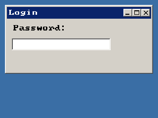

<!-- AUTOGENERATED COPYRIGHT HEADER START -->
<!-- Copyright (C) 2026 Claude <noreply@anthropic.com> -->
<!-- AUTOGENERATED COPYRIGHT HEADER END -->
<!-- Generated by tools/wiki/wiki.py. Edit tools/wiki/text/ instead of this file. -->


# CreateTextField

<div align="center">

[Command Index](Command-Index) · [BlitzPlus](BlitzPlus) · [Text Areas](BlitzPlus-Text-Areas)

</div>


## Command Syntax

```blitzbasic
CreateTextField:Int32 x:Int32, y:Int32, width:Int32, height:Int32, group:Int32, style:Int32=0
```

## Parameters

| Parameter | Type | Default | Description |
|---|---|---|---|
| `x` | Int32 | required | Horizontal position inside the group. |
| `y` | Int32 | required | Vertical position inside the group. |
| `width` | Int32 | required | Width of the field. |
| `height` | Int32 | required | Height of the field. |
| `group` | Int32 | required | Window, panel, tabber or canvas that holds it. |
| `style` | Int32 | `0` | 1 for a password field, plus 65536 for not following the group. Defaults to 0. |

**Returns:** A handle for the text field.

## Description

Makes a box for a single line of text. A $401 event is sent for each change and its [EventData](EventData) is the character typed, and Enter sends one with 13. Style 1 shows stars instead of what is typed, for passwords. Read the text with [TextFieldText](TextFieldText) and set it with [SetGadgetText](SetGadgetText).

Text fields use Enter and Escape themselves, so use a button of style 4 or 5 to react to these keys, see [CreateButton](CreateButton).

## Examples

```blitzbasic
Graphics 320, 240, 32, 2
win  = CreateWindow("Login", 10, 10, 300, 140, Desktop(), 3)
CreateLabel "Password:", 10, 10, 150, 24, win
pass = CreateTextField(10, 40, 200, 24, win, 1)
Repeat
	e = WaitEvent()
	If e = $401 Then SetGadgetText win, "Length " + Len(TextFieldText(pass))
Until e = $803
```

## Media



## Related Commands

* [AddTextAreaText](AddTextAreaText)
* [CreateTextArea](CreateTextArea)
* [FormatTextAreaText](FormatTextAreaText)
* [LockTextArea](LockTextArea)
* [SetTextAreaColor](SetTextAreaColor)
* [SetTextAreaFont](SetTextAreaFont)
* [SetTextAreaTabs](SetTextAreaTabs)
* [TextFieldText](TextFieldText)

<div align="center">

[Command Index](Command-Index) · [BlitzPlus](BlitzPlus) · [Text Areas](BlitzPlus-Text-Areas)

</div>
