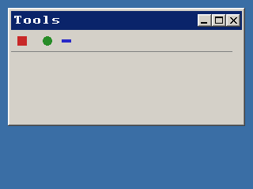

<!-- AUTOGENERATED COPYRIGHT HEADER START -->
<!-- Copyright (C) 2026 Claude <noreply@anthropic.com> -->
<!-- AUTOGENERATED COPYRIGHT HEADER END -->
<!-- Generated by tools/wiki/wiki.py. Edit tools/wiki/text/ instead of this file. -->
# CreateToolBar

[Command Index](Command-Index) · [BlitzPlus](BlitzPlus) · [Toolbars](BlitzPlus-Toolbars)

```blitzbasic
CreateToolBar:Int32 icons:String, x:Int32, y:Int32, width:Int32, height:Int32, group:Int32, style:Int32=0
```

**Works in:** BlitzPlus

Makes a row of icon buttons from a picture file. The picture holds square icons side by side, and the number of icons is its width divided by its height. The pixel in the top left corner is the transparent color, and an icon that is only that color becomes a gap between buttons. Clicking a button sends $401 and [EventData](EventData) is the number of the icon, counted from 0.

```blitzbasic
Graphics 320, 240, 32, 2
; Make a strip of four 16x16 icons: a square, a gap, a circle and a bar.
strip = CreateImage(64, 16)
SetBuffer ImageBuffer(strip)
Color 255, 0, 255 : Rect 0, 0, 64, 16, 1
Color 200, 40, 40 : Rect 2, 2, 12, 12, 1
Color 40, 140, 40 : Oval 34, 2, 12, 12, 1
Color 40, 40, 200 : Rect 50, 6, 12, 4, 1
SaveImage strip, "icons.bmp"
SetBuffer BackBuffer()

win = CreateWindow("Tools", 10, 10, 300, 150, Desktop(), 3)
bar = CreateToolBar("icons.bmp", 0, 0, 280, 28, win)
Repeat
	e = WaitEvent()
	If e = $401 And EventSource() = bar Then SetGadgetText win, "Icon " + EventData()
Until e = $803
```



| Parameter | Type | Default | Description |
|---|---|---|---|
| `icons` | String | required |  |
| `x` | Int32 | required | Horizontal position inside the group. |
| `y` | Int32 | required | Vertical position inside the group. |
| `width` | Int32 | required | Width of the toolbar. |
| `height` | Int32 | required | Height of the toolbar. |
| `group` | Int32 | required | Window, panel, tabber or canvas that holds it. |
| `style` | Int32 | `0` | Reserved. Defaults to 0. |

**Returns:** A handle for the toolbar.

**Differences and known gaps:**

* The tool tips given with [SetToolBarTips](SetToolBarTips) show below a button after the mouse rested on it for half a second.

## Related commands

* [DisableToolBarItem](DisableToolBarItem)
* [EnableToolBarItem](EnableToolBarItem)
* [SetToolBarTips](SetToolBarTips)

[Command Index](Command-Index) · [BlitzPlus](BlitzPlus) · [Toolbars](BlitzPlus-Toolbars)
