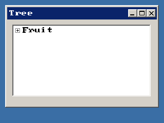

<!-- AUTOGENERATED COPYRIGHT HEADER START -->
<!-- Copyright (C) 2026 Claude <noreply@anthropic.com> -->
<!-- AUTOGENERATED COPYRIGHT HEADER END -->
<!-- Generated by tools/wiki/wiki.py. Edit tools/wiki/text/ instead of this file. -->
# CreateTreeView

[Command Index](Command-Index) · [BlitzPlus](BlitzPlus) · [Tree Views](BlitzPlus-Tree-Views)

```blitzbasic
CreateTreeView x%, y%, width%, height%, group%, style%=0  ; returns Int
```

**Works in:** BlitzPlus

Makes a list of nodes that can be opened and closed, like a folder view. Clicking a node sends $401 with the tree as the source, and [SelectedTreeViewNode](SelectedTreeViewNode) tells which. The tree starts out empty: add nodes below the node that [TreeViewRoot](TreeViewRoot) gives.

```blitzbasic
Graphics 320, 240, 32, 2
win  = CreateWindow("Tree", 10, 10, 300, 200, Desktop(), 3)
tree = CreateTreeView(10, 10, 270, 140, win)
fruit = AddTreeViewNode("Fruit", TreeViewRoot(tree))
AddTreeViewNode "Apple", fruit
AddTreeViewNode "Pear", fruit
Repeat
	e = WaitEvent()
	If e = $401 Then SetGadgetText win, "Node " + TreeViewNodeText(SelectedTreeViewNode(tree))
Until e = $803
```



| Parameter | Type | Default | Description |
|---|---|---|---|
| `x` | Int | required | Horizontal position inside the group. |
| `y` | Int | required | Vertical position inside the group. |
| `width` | Int | required | Width of the tree. |
| `height` | Int | required | Height of the tree. |
| `group` | Int | required | Window, panel, tabber or canvas that holds it. |
| `style` | Int | `0` | 0, or 65536 to not follow the group when it is resized. Defaults to 0. |

**Returns:** A handle for the tree view.

## Related commands

* [AddTreeViewNode](AddTreeViewNode)
* [CollapseTreeViewNode](CollapseTreeViewNode)
* [CountTreeViewNodes](CountTreeViewNodes)
* [ExpandTreeViewNode](ExpandTreeViewNode)
* [FreeTreeViewNode](FreeTreeViewNode)
* [InsertTreeViewNode](InsertTreeViewNode)
* [ModifyTreeViewNode](ModifyTreeViewNode)
* [SelectedTreeViewNode](SelectedTreeViewNode)

[Command Index](Command-Index) · [BlitzPlus](BlitzPlus) · [Tree Views](BlitzPlus-Tree-Views)
