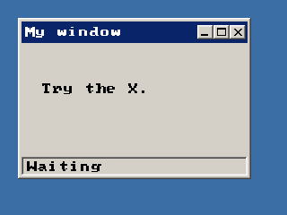

<!-- AUTOGENERATED COPYRIGHT HEADER START -->
<!-- Copyright (C) 2026 Claude <noreply@anthropic.com> -->
<!-- AUTOGENERATED COPYRIGHT HEADER END -->
<!-- Generated by tools/wiki/wiki.py. Edit tools/wiki/text/ instead of this file. -->
# CreateWindow

[Command Index](Command-Index) · [BlitzPlus](BlitzPlus) · [Windows](BlitzPlus-Windows)

```blitzbasic
CreateWindow:Int32 text:String, x:Int32, y:Int32, width:Int32, height:Int32, group:Int32=0, style:Int32=15
```

**Works in:** BlitzPlus

Makes a window and shows it. Windows are the parents of every other gadget: pass the window as the group of a button, label or list to put it inside. The position is relative to the group, which is [Desktop](Desktop) for a normal window or another window to make a child that belongs to it.

The style is a sum of these flags, and 15 is the default:

| Flag | Meaning |
| --- | --- |
| 1 | Title bar |
| 2 | The user can resize the window |
| 4 | Menu bar, shown with a line under it even before menus are added, see [WindowMenu](WindowMenu) |
| 8 | Status bar at the bottom, see [SetStatusText](SetStatusText) |
| 16 | Tool window with a smaller title bar and only a close box |
| 32 | Width and height are the size of the inside, not of the whole window |

Windows send events when they move ($801), change size ($802), are closed ($803) or are activated ($804). Closing does not remove a window by itself, your program decides what to do with the $803 event.

```blitzbasic
Graphics 320, 240, 32, 2
win = CreateWindow("My window", 20, 20, 260, 180, Desktop(), 15)
CreateLabel "Try the X.", 20, 20, 200, 40, win
SetStatusText win, "Waiting"
asked = 0
Repeat
	e = WaitEvent()
	If e = $803 And EventSource() = win Then
		asked = asked + 1
		SetStatusText win, "Close was asked " + asked + "x"
	EndIf
Until asked = 2
```



| Parameter | Type | Default | Description |
|---|---|---|---|
| `text` | String | required |  |
| `x` | Int32 | required | Horizontal position inside the group. |
| `y` | Int32 | required | Vertical position inside the group. |
| `width` | Int32 | required | Width of the window. |
| `height` | Int32 | required | Height of the window. |
| `group` | Int32 | `0` | Desktop or another window. Defaults to 0, which means the desktop. |
| `style` | Int32 | `15` | Sum of the flags above. Defaults to 15. |

**Returns:** A handle for the window.

**Differences and known gaps:**

* All windows are drawn inside one SDL window and cannot leave it, there are no separate windows of the operating system and no taskbar entries. Windows are drawn in the order they were activated.

## Related commands

* [ActivateWindow](ActivateWindow)
* [ActiveWindow](ActiveWindow)
* [MaximizeWindow](MaximizeWindow)
* [MinimizeWindow](MinimizeWindow)
* [RestoreWindow](RestoreWindow)
* [SetMinWindowSize](SetMinWindowSize)
* [UpdateWindowMenu](UpdateWindowMenu)
* [WindowMaximized](WindowMaximized)

[Command Index](Command-Index) · [BlitzPlus](BlitzPlus) · [Windows](BlitzPlus-Windows)
